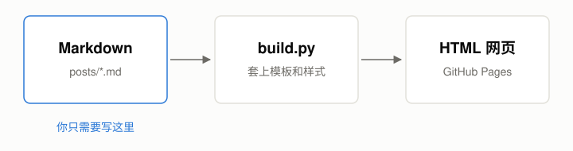

这篇文章本身就是一份示范。打开 `posts/2026-11-16-writing-guide/index.md`，对照源文件和网页效果看，很快就能上手。

## 文章开头的设置

每篇文章开头 `---` 之间的部分是文章信息，只有 `title` 和 `date` 是必填的：

```yaml
title: 文章标题
date: 2026-11-16
summary: 列表页显示的摘要（不写就自动取第一段）
tags: [标签一, 标签二]
thumb: pipeline.svg      # 列表页右侧的缩略图（放在文章文件夹里）
authors: [我, 合作者]    # 不写就默认只有你自己
series: blog-notes       # 属于哪个系列（在 site.yml 里定义）
part: 1
tldr: 显示在标题下方的一段摘要框
draft: true              # 草稿：正式构建时不会发布
```

## 图片

如果文章有图片，把文章写成一个文件夹（`posts/日期-名字/index.md`），图片放在同一个文件夹里。单独占一段、并且带引号说明的图片会自动变成带编号的图：



## 表格

| 写法 | 效果 |
|:--|:--|
| `**粗体**` | **粗体** |
| `$E=mc^2$` | $E=mc^2$ |
| `[@gruber2004]` | [@gruber2004] |

## 公式

行内公式用单个美元符号，比如 $\mathcal{L}(\theta) = -\sum_i \log p_\theta(x_i)$。独立公式用两个：

$$
\nabla_\theta \mathcal{L} = -\sum_{i=1}^{N} \frac{\nabla_\theta\, p_\theta(x_i)}{p_\theta(x_i)}
$$

只有用到公式的文章才会加载 KaTeX，其他页面依然是零 JavaScript。

## 学术引用

在文章开头的 `references` 里登记文献，正文里用 `[@key]` 写括号引用，比如 Markdown 最早是一个很简单的格式 [@gruber2004]；也可以多个一起引用 [@gruber2004; @naik2026]。直接写 `@key` 是叙述式引用：@naik2026 就是一个研究博客的好例子。文末会自动生成参考文献列表，点击引用会跳过去并高亮。

## 代码

```python
def hello(name: str) -> str:
    return f"你好，{name}"
```

## 脚注和折叠块

脚注这样写[^1]，会自动放到文章最后。

<details markdown="1">
<summary>点击展开：折叠块</summary>

折叠块里也可以写 **Markdown**，适合放实验细节、完整的 prompt 之类的长内容。

</details>

[^1]: 这里是脚注的内容。
