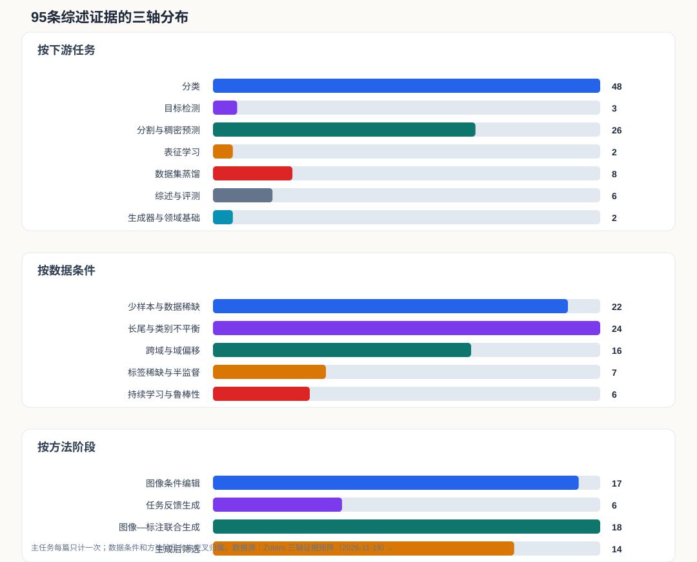

## 摘要

扩散模型让“用生成图像扩充训练集”从个别数据集上的技巧，变成了覆盖分类、分割、检测和表征学习的通用手段。近年的数据选择、数据剪枝和扩散式数据集蒸馏工作，又把研究推进到候选样本效用、集合覆盖和压缩替代的问题。本文按三条可交叉的轴线组织材料，主任务决定评价指标，数据条件决定生成要补的缺口，方法阶段决定生成器如何接入训练流程。

研究重心经历了三次转移。2023 年的工作证明，合成图像本身可以作为训练数据。2024 年转向在少样本条件下兼顾保真度与多样性。2025—2026 年进入任务感知阶段：让下游模型的反馈引导生成，或在生成后筛选真正有用的样本，并扩展到长尾识别和医学稠密预测。与此同时，数据选择和数据集蒸馏形成了独立的参照系，前者强调真实数据与合成候选之间的条件互补，后者强调用极少的合成样本替代大数据集。

比较结果显示，在真实数据预算、生成器和下游模型固定时，样本选择和标签有效性通常比单纯增加合成数量更关键。部分实验只增强训练早期未学会的 30%–40% 样本，或在特定 LVIS 设置中只用约 6% 的生成预算就取得收益。但各论文在真实数据量、生成器状态、筛选预算和混合方式上差异很大，指标不宜直接横向比较。文章最后归纳了六类风险，并提出下一步的关键：可复现的任务效用评测、可靠的样本筛选、结构一致的标注生成，以及跨域外部验证。

**关键词**：扩散模型；合成数据；数据增强；长尾识别；少样本学习；医学图像分割；任务反馈生成；样本筛选

## 1. 引言

深度模型依赖大规模、标注充分的数据，但在医学影像、细粒度识别、长尾类别和新场景检测中，真实样本和像素级标注都很昂贵。翻转、裁剪、颜色扰动等传统增强只能带来局部变化，无法改变物种、病灶形态、天气、背景这类语义属性。扩散模型（<a href="#ref-bg-ddpm2020">DDPM</a>、<a href="#ref-bg-ldm2022">LDM</a>）及其可控变体（<a href="#ref-bg-controlnet2023">ControlNet</a>）的成熟，让“按需生成训练数据”成为可行路线。与 <a href="#ref-bg-gan2014">GAN</a> 相比，扩散模型训练更稳定、样本多样性更高。在文本条件和图像条件的生成式数据增强中，扩散模型已经成为当前占主导地位的生成框架。

然而，把生成图像直接加进训练集并不必然带来提升。合成图像可能标签不符、分布偏移、过于“典型”，在某些设置下甚至会降低性能（<a href="#ref-2097">When More Data Hurts</a>、<a href="#ref-2194">Limitations in Data-Scarce Domains</a>）。因此本文关心的核心问题是：**在什么数据条件下、生成什么样的样本、以什么方式使用，合成数据才能真正改善下游模型？**

全文结构如下：第 2 节给出问题定义和分类框架；第 3 节梳理 2023—2026 年的发展脉络；第 4 节按技术路线逐类比较代表方法；第 5 节把方法放回下游任务与数据条件中对照；第 6 节整理常用数据集与实验协议；第 7 节讨论质量指标、比较协议和代表性结果；第 8 节分析共同局限与开放问题；第 9 节总结。常用代码仓库放在文末的折叠附录中。

## 2. 问题定义与分类框架

### 2.1 问题定义

设真实训练集为 Dreal，它可能样本很少、类别长尾、来自单一域或缺少像素级标注。生成式数据增广用生成器 G 构造合成集 Dsyn = {(x̃, ỹ)}，其中 ỹ 可以是类别标签、分割掩码、检测框或深度图；再以某种方式把 Dsyn 与 Dreal 结合，训练下游模型 f，目标是提升 f 在真实测试分布（包括域外分布）上的表现。

这个定义把一篇论文要回答的问题拆成三个：

1. **生成什么**：用什么生成器、什么条件，生成哪一部分数据分布。
2. **标注从哪里来**：ỹ 如何保证正确，尤其是分割掩码和检测框。
3. **怎么使用**：合成样本是否需要筛选、加权，以什么比例、在训练的哪个阶段加入。

### 2.2 三轴分类

本文用三条可交叉的轴线组织文献。一篇论文在“下游任务”上只归一个主类，在另两条轴上可以同时属于多个分支。

| 轴 | 回答的问题 | 取值 | 决定了什么 |
|:--|:--|:--|:--|
| 下游任务 | 合成数据服务于哪个任务 | 分类、目标检测、分割与稠密预测、表征学习、数据集蒸馏 | 评价指标，以及需要同步生成的标注类型 |
| 数据条件 | 真实数据缺什么 | 少样本与数据稀缺、长尾与类别不平衡、跨域与域偏移、标签稀缺与半监督、持续学习与鲁棒性 | 生成要补的缺口 |
| 方法阶段 | 生成器如何接入训练流程 | 图像条件编辑、任务反馈生成、图像—标注联合生成、生成后筛选 | 技术路线与主要风险 |

<small>任务按单一主类统计；数据条件和方法阶段允许交叉归属，计数不能相加。</small>

### 2.3 通用流水线

几乎所有方法都可以放进同一条流水线：生成器适配、条件控制、样本生成、生成后筛选、利用方式五个环节顺序连接，再加一条从下游模型回到生成环节的反馈回路。第 4 节按这条流水线逐环节展开。

## 3. 发展脉络

按核心问题的变化，这批文献大致经历了三个阶段。阶段之间有重叠，年份表示大致的主导时期。

| 阶段 | 核心问题 | 代表方法 | 关键进展 |
|:--|:--|:--|:--|
| 2023 | 合成图像能否直接当训练数据 | <a href="#ref-2240">Azizi 等</a>、<a href="#ref-2162">GIF</a>、<a href="#ref-2262">Fake It</a>、<a href="#ref-364">DiffuMask</a>、<a href="#ref-2166">DatasetDM</a>、<a href="#ref-2258">StableRep</a> | 类条件或文生图合成用于分类和表征学习；从交叉注意力中免费获得掩码 |
| 2024 | 如何兼顾保真度与多样性、适配少样本 | <a href="#ref-2158">DA-Fusion</a>、<a href="#ref-123">DiffuseMix</a>、<a href="#ref-2154">Diff-Mix</a>、<a href="#ref-2150">DataDream</a>、<a href="#ref-2238">DiffAug</a>、<a href="#ref-2260">SynCLR</a> | 从真实图编辑、类间混合、LoRA 少样本适配 |
| 2025—2026 | 生成什么样的样本对模型有用，以及哪些样本值得保留 | <a href="#ref-2118">Diff-II</a>、<a href="#ref-2120">MRCA</a>、<a href="#ref-2098">DBG</a>、<a href="#ref-2130">DAR-GDA</a>、<a href="#ref-2190">C2I</a>、<a href="#ref-116">TADA</a>、<a href="#ref-2500">DisCL</a>、<a href="#ref-2504">High-dimensional Selection</a>、<a href="#ref-2505">Pool-Select-Refine</a>、<a href="#ref-2291">FROST</a>、<a href="#ref-2506">TATC</a>、<a href="#ref-2509">SynQuE</a>、<a href="#ref-2106">IMS3</a> | 任务反馈生成、生成后筛选、条件边际效用、数据剪枝、扩散式数据集蒸馏和成本审计 |

### 3.1 2023：从生成图像走向生成训练数据

<a href="#ref-2240">Azizi 等人的工作</a>把 Imagen 微调为类条件模型，在 ImageNet 上证明合成图像能够支持分类器训练，并发现微调和 guidance 权重的选择直接影响图像与标签的对齐。<a href="#ref-2162">GIF</a> 把问题表述为 dataset expansion，用少量真实图像引导 DALL-E 2 或 Stable Diffusion 生成新的带标签样本，同时指出纯合成数据仍不如同规模的真实数据。<a href="#ref-2262">Fake It Till You Make It</a> 只用类名就生成了 ImageNet 克隆，并观察到默认 guidance 下的图像细节丰富但缺乏多样性。

<a href="#ref-364">DiffuMask</a> 和 <a href="#ref-2166">DatasetDM</a> 把增广对象从图像扩展到“图像 + 感知标注”。DiffuMask 利用文本条件扩散中的交叉注意力自动得到像素级掩码；DatasetDM 在扩散模型的潜特征上训练感知解码器，只需约 100 张标注图像就能生成语义分割、实例分割和深度等配对数据。VOC 使用 100 张真实图像时，联合训练从 65.2 提升到 78.5 mIoU，纯合成训练为 73.7；COCO 使用 800 张真实图像加 80,000 张合成图像时提升 12.1 AP。<a href="#ref-2258">StableRep</a> 则把合成数据用于表征学习，将同一提示生成的多张图像互为正样本做多正例对比学习。

### 3.2 2024：控制保真度、多样性和少样本适配

这一阶段的共同发现是：现成生成器的图“不像”目标数据，而用少量真实图微调又容易“太像”、缺乏变化。<a href="#ref-2158">DA-Fusion</a> 从真实图像出发，在去噪中途插入原图并用文本反演学到的概念 token 做编辑，可以处理预训练模型没见过的概念。<a href="#ref-123">DiffuseMix</a> 先用条件提示重绘输入图，再与原图拼接并混入分形纹理；<a href="#ref-2154">Diff-Mix</a> 在类别之间做图像翻译，按翻译强度给出软标签。<a href="#ref-2150">DataDream</a> 用少量真实样本对 U-Net 和文本编码器做 LoRA 微调，明显缩小了生成分布和目标分布的差距。<a href="#ref-2299">DreamDA</a> 则在反演轨迹中扰动 U-Net 瓶颈，并用多头一致性和伪标签训练缓解标签漂移，在预训练和从头训练两种设置下都报告了较大增益。<a href="#ref-2300">DistDiff</a> 用类级和组级原型估计真实分布，再用分布感知能量引导扩散采样；<a href="#ref-2301">CBDM</a> 说明长尾分布会直接破坏尾类生成质量，需要在扩散训练中调整类别先验。

同期还出现两条并行路线。<a href="#ref-2238">DiffAug</a> 只做一次加噪与一次去噪，就提升了分类器的协变量偏移鲁棒性；<a href="#ref-2260">SynCLR</a> 和 StableRep 把合成数据当作视觉预训练的数据源。扩散模型由此从“下游训练集的附加样本生成器”扩展为预训练数据源。

### 3.3 2025—2026：任务感知、长尾与医学场景

焦点转向合成样本的下游效用。<a href="#ref-2118">Diff-II</a> 在同类两张图的反演潜变量之间做圆形插值，再两阶段去噪，同时提高忠实度和多样性。<a href="#ref-2120">MRCA</a> 让实例分割器反过来指导扩散模型，多轮生成模型最不确定的对象。<a href="#ref-2098">DBG</a> 围绕决策边界生成样本。<a href="#ref-2122">CORAL</a> 发现长尾类别在 U-Net 潜空间中会与头部类别重叠，于是用对比正则解耦类别表征。<a href="#ref-2130">DAR-GDA</a> 用一步蒸馏、对抗对齐和重要性重加权同时处理采样效率和分布偏移。

医学与稠密预测工作更关注结构一致性：<a href="#ref-2054">MatchMask</a>、<a href="#ref-2059">MRGen</a>、<a href="#ref-2039">Dual-Stream Diffusion</a>、<a href="#ref-2274">Polyp-LDM</a>、<a href="#ref-2035">DiDGen</a>、<a href="#ref-2276">DiffAtlas</a> 都同时以图像质量和下游分割效果为目标。评测也开始系统化：<a href="#ref-2090">UniDiffDA</a> 把方法拆成模型微调、样本生成、样本利用三部分，在通用、细粒度、长尾、跨域和医学分类上统一复现，发现结果强烈依赖任务和设置。<a href="#ref-2097">When More Data Hurts</a> 和 <a href="#ref-2194">Limitations in Data-Scarce Domains</a> 则开始系统追问“合成数据什么时候反而有害”。

近年的工作把这条线进一步分成四个互补问题。<a href="#ref-2290">When Pretty Isn't Useful</a> 在 13 个 2022—2025 年文生图模型上发现，视觉质量和提示词遵循能力提升并没有带来更好的真实测试集分类效果，反而伴随纹理、高频细节和分布覆盖的下降。<a href="#ref-2291">FROST</a> 和 <a href="#ref-2292">LSADA</a> 把下游训练状态接入筛选或生成过程，前者用真实梯度锚定合成样本效用，后者用样本损失和损失下降速度决定增强强度。<a href="#ref-2293">CCDM</a> 和 <a href="#ref-2294">SENSE</a> 分别把“合成数据是否有用”的问题推进到检测集合排序和分割标注分配。<a href="#ref-2295">Preserve the Hard</a> 则通过保留不确定区域、只重绘上下文来从构造上避免标签错位。另三篇工作补足了条件设计与强基线：<a href="#ref-2296">Augmented Conditioning</a> 用增强后的真实图像作为条件，<a href="#ref-2297">Closed-Set Equivalence</a> 量化闭集合成数据相对真实增广的规模折损，<a href="#ref-2298">The Unmet Promise</a> 证明针对任务检索真实图像是必须面对的强基线。

## 4. 方法详解与对比

### 4.1 生成器适配：让生成器认识目标数据

预训练文生图模型对常见概念生成良好，但对细粒度类别、专用领域和医学图像常常“画不出”或“画不像”，因此需要用目标域的真实样本做适配（<a href="#ref-2090">UniDiffDA</a>）。适配强度从轻到重依次是：提示工程、文本反演、LoRA、领域微调、从头训练。

| 方法 | 适配方式 | 所需真实样本 | 关键设计 | 主要解决的问题 |
|:--|:--|:--|:--|:--|
| <a href="#ref-2262">Fake It</a> | 不微调，只改提示并降低 guidance | 0 | 类无关的提示改写，减少语义错误、增加多样性 | 零真实图像构建分类训练集 |
| <a href="#ref-2240">Azizi 等</a> | 把 Imagen 微调成类条件模型 | 全量 ImageNet | 仔细选择 guidance 权重与采样参数 | 图像与标签对齐 |
| <a href="#ref-2158">DA-Fusion</a> | 文本反演学习新概念 token | 每类少量 | 从真实图出发的 SDEdit 式编辑 | 预训练模型没见过的概念 |
| <a href="#ref-2150">DataDream</a> | LoRA 微调 U-Net 与文本编码器 | 少样本 | 再用合成数据 LoRA 微调 CLIP | 合成分布贴合目标分布 |
| <a href="#ref-2281">LoFT</a> | 每张真实图单独训练 LoRA，推理时融合 | 每类 8–64 张 | 融合多张真实图的特征 | 保真度与多样性兼顾 |
| <a href="#ref-2100">ChimeraLoRA</a> | 类共享 LoRA + 逐图 LoRA | 少样本 | 按 Dirichlet 系数组合两类适配器 | 类别先验与个体细节解耦 |
| <a href="#ref-2102">BOB</a> | 微调时条件化背景和姿态 | 每类 5–10 张 | 生成时边缘化类无关属性 | 过拟合与类间伪关联 |
| <a href="#ref-2056">MedDiff-FT</a> | 数据高效微调扩散基础模型 | 小规模医学数据 | 动态引导掩码、随机掩码生成器、自动质检 | 医学图像的结构依赖与域特异性 |
| <a href="#ref-2138">AugGen</a> | 在目标人脸数据集上从头训练类条件模型 | 目标数据集 | 不使用外部数据或预训练模型 | 外部依赖与隐私 |
| <a href="#ref-2110">WILD-Diffusion</a> | 有限数据下从头训练 | 小数据集 | 在 Wasserstein 不确定集中迭代生成训练样本 | 小数据训练扩散模型的过拟合 |

这条线的演进很清楚：从“一个类一个适配器”（DataDream）走向“把类别共性和个体细节解耦”（LoFT、ChimeraLoRA、BOB）。医学方向更依赖领域预训练和数据高效微调。需要注意的是，<a href="#ref-2112">The Learnability Gap</a> 发现：大规模预训练自编码器的潜表征虽然保留了医学判别信息，却很难被分类器学到，而且领域微调也弥合不了这个差距。这意味着“在哪个空间里生成”本身就是一个待解决的问题。

### 4.2 图像条件编辑：从真实图像出发

这类方法以真实图像或其反演潜变量为起点，只改动部分属性，因此更容易保持标签和布局。核心控制量是“离原图有多远”：越近越忠实，越远越多样。

| 方法 | 起点 | 变化来源 | 标签处理 | 作者自述或可见的局限 |
|:--|:--|:--|:--|:--|
| <a href="#ref-2158">DA-Fusion</a> | 真实图插入去噪中途 | 概念 token + 随机编辑强度 | 沿用原标签 | 变化范围受原图约束 |
| <a href="#ref-123">DiffuseMix</a> | 真实图 | 条件提示重绘，与原图半边拼接并混入分形纹理 | 沿用原标签 | 提示错误会生成不真实图像 |
| <a href="#ref-2154">Diff-Mix</a> | 其他类别的真实图 | 类间翻译，强度从 0.5/0.7/0.9 中随机选 | 软标签按强度非线性插值；偏好目标类高置信样本 | 易产生前景残缺的样本 |
| <a href="#ref-2118">Diff-II</a> | 同类两张图的反演 | 圆形插值 + 两阶段去噪 | 沿用类别 | 每类至少两张图；不平衡因子达到 100 时增益下降 |
| <a href="#ref-2116">DisCL</a> | 真实图 | 不同图像引导强度形成“合成到真实”的谱 | 沿用类别 | 需要设计课程 |
| <a href="#ref-2178">MGRAttn-RNO</a> | 参考图 | 只更新前景的参考注意力 + 互相排斥的初始噪声 | 沿用类别 | 依赖前景分割质量 |
| <a href="#ref-2244">Free-Lunch</a> | 真实图 | 弱化噪声 + 背景修复 | 保留前景框 | 面向跨域少样本检测 |
| <a href="#ref-2210">1S-DAug</a> | 单张测试图 | 几何扰动 + 受控加噪 + 图像条件去噪 | 测试时增强 | 只在推理阶段使用 |

几种方法对“编辑强度”的处理代表了三种思路：DA-Fusion 和 Diff-Mix 随机采样强度；DisCL 把强度做成从易到难的课程，训练早期用偏离较大但容易学的样本，后期用接近真实但难学的样本；Diff-II 则绕开强度，改在反演空间里插值。

### 4.3 图像—标注联合生成

分割和检测需要像素级或框级标注，“标注从哪里来”决定了方法的形态。按标注来源可以分成四种范式。

| 范式 | 做法 | 代表方法 | 优点 | 主要问题 |
|:--|:--|:--|:--|:--|
| 先图后标 | 先生成图像，再从扩散注意力或特征中解码标注 | <a href="#ref-364">DiffuMask</a>、<a href="#ref-2166">DatasetDM</a>、<a href="#ref-2104">S3OD</a> | 不需要真实掩码，可无限扩展 | 伪标签边界不准 |
| 先标后图 | 以掩码、布局为条件生成图像 | <a href="#ref-2054">MatchMask</a>、<a href="#ref-2059">MRGen</a>、<a href="#ref-2270">SFD-Polyp</a>、<a href="#ref-2186">Tail-SD</a> | 图像与标注对齐有保障 | 新掩码从哪里来；掩码多样性受限 |
| 联合生成 | 图像与掩码在同一扩散过程或共享潜空间中一起生成 | <a href="#ref-2039">Dual-Stream Diffusion</a>、<a href="#ref-2274">Polyp-LDM</a>、<a href="#ref-2276">DiffAtlas</a>、<a href="#ref-2142">Diff-2-in-1</a>、<a href="#ref-2114">Sketch2CT</a> | 一致性好，可按需生成 | 训练更重，对小数据敏感 |
| 修复与编辑 | 保留背景或前景，只生成局部 | <a href="#ref-240">医学 DiffAug</a>、<a href="#ref-2279">DiGDA</a>、<a href="#ref-2198">ISIC2019 长尾分类</a> | 真实感强，对齐精确 | 多样性受原图限制 |

医学方法的细节差异主要体现在掩码来源和质量控制上：

| 方法 | 数据 | 掩码来源 | 关键设计 | 质量控制 |
|:--|:--|:--|:--|:--|
| <a href="#ref-2054">MatchMask</a> | VOC、COCO、ADE20K（少标注） | 少量真实掩码 | 梯度探针定位关键层，轻量适配器 + 层自适应交叉注意力融合 | 相对过滤错误区域 |
| <a href="#ref-2059">MRGen</a> | 多种 MRI 模态 | 文本 + 掩码 | 构建大规模 MRI 图文数据集，为缺少掩码的模态生成数据 | — |
| <a href="#ref-2039">Dual-Stream Diffusion</a> | 内镜息肉、皮肤镜、肝脏 CT | 结构流预测 | 结构流与外观流解耦，时间门控融合，结构感知头 | — |
| <a href="#ref-2274">Polyp-LDM</a> | 结肠镜 | 统一 VAE 的共享潜空间 | 微调 VAE 解码器，风格克隆模块 | — |
| <a href="#ref-2270">SFD-Polyp</a> | 结肠镜 | 真实掩码 + 保守扰动 | 风格集成模块 | 只做受控的轮廓与子区域小扰动，避免不合理形状 |
| <a href="#ref-2035">DiDGen</a> | 皮肤镜 | 测试时布局引导 + 注意力标注 | LLM 生成结构化临床提示；区域感知注意力损失 | — |
| <a href="#ref-2276">DiffAtlas</a> | 心脏 CT、MRI | 图像—掩码联合扩散 | 测试时生成与目标图像匹配的图像—掩码对，兼具图谱法鲁棒性 | — |
| <a href="#ref-2056">MedDiff-FT</a> | 五个医学分割数据集 | 随机掩码生成器 | 动态自适应引导掩码 | 特征空间自动质检 + 掩码腐蚀 |
| <a href="#ref-240">医学 DiffAug</a> | 息肉、视盘视杯 | 现有标注中的合理位置 | 文本与掩码共同引导的病灶修复 | 潜空间分割网络校验定位 |
| <a href="#ref-2114">Sketch2CT</a> | 3D CT | 先从噪声生成 3D 器官掩码 | 2D 草图与文本共同引导 | — |

在“先标后图”的范式里，掩码很少时新掩码从哪里来，是绕不开的问题。现有做法包括：对真实掩码做常规增强、做保守的局部扰动（SFD-Polyp）、用生成模型直接生成掩码（Sketch2CT、Dual-Stream Diffusion），或者干脆不生成新掩码，只改背景和病灶内容（医学 DiffAug、DiGDA）。目前还没有通用的方法来正式验证合成掩码是否符合解剖规律。

### 4.4 任务反馈生成：让下游模型参与生成

这是当前最活跃的方向。按反馈接入生成的位置，可以分为采样时引导、在线定向生成和强化学习微调三类。

| 方法 | 任务 | 反馈信号 | 接入方式 | 是否修改生成器 |
|:--|:--|:--|:--|:--|
| <a href="#ref-2190">C2I</a> | 少样本医学分类 | 类对比影响力：样本梯度与同类验证梯度对齐、与异类相反 | 以此为奖励，用强化学习微调扩散模型 | 是 |
| <a href="#ref-2283">S2-RL</a> | 分割数据集蒸馏 | 样本级与集合级双重奖励 | GRPO 微调扩散策略 | 是 |
| <a href="#ref-2098">DBG</a> | 长尾分类 | 决策边界 | 生成近边界样本，使决策空间更可分 | — |
| <a href="#ref-2120">MRCA</a> | 长尾实例分割 | 分割模型的不确定性 | 多轮在线生成，按模型状态调整各类数量与尺寸 | 否 |
| <a href="#ref-2104">S3OD</a> | 显著性目标检测 | 模型在各类别上的表现 | 迭代优先生成难类别 | 否 |
| <a href="#ref-2182">BRIDGE</a> | 长尾自监督预训练 | 编码器的 kNN 距离 | 选出覆盖稀疏的锚点，再做图到图生成 | 否 |
| <a href="#ref-2272">EBIS</a> | 烧伤分割（半监督） | 教师模型的不确定性 | 合成图只进入教师路径，避免偏差传给学生 | 否 |
| <a href="#ref-2279">DiGDA</a> | 冠脉狭窄检测 | 用户指定的严重程度 | 修复式生成病灶，平衡中重度样本 | 否 |
| <a href="#ref-2242">Generative Active Learning</a> | 分类 | 贝叶斯采集函数 | 选择对训练最有效的合成样本 | — |
| <a href="#ref-2291">FROST</a> | 分类 | 真实训练梯度与合成样本梯度的对齐度 | 在线批次门控 + 样本 IQR 过滤 | 否 |
| <a href="#ref-2292">LSADA</a> | 分类 | 当前损失与损失下降速度 | 样本级增强强度 + 类相关/无关区域解耦扩散融合 | 否（使用冻结 SD 2.1） |
| <a href="#ref-2295">Preserve the Hard</a> | 语义分割 | 像素预测熵 | 保留高不确定区域，扩散重绘其余上下文，合成像素设为 ignore | 否 |

这些工作指向同一个结论：**最有用的样本是靠近决策边界、但仍在真实数据流形上的困难样本**。C2I 的梯度分析、DBG 的近边界生成、MRCA 的不确定性驱动都体现了这一点。代价是反馈模型的错误可能被闭环放大，<a href="#ref-2283">S2-RL</a> 的作者也承认其奖励只是下游效用的近似。

### 4.5 生成后筛选：生成器无关的“挑数据”

筛选不改动生成器，可以直接用在任何生成结果上。筛选标准经历了从“质量”到“难度”再到“分布覆盖”的升级。

| 方法 | 打分依据 | 是否需重训生成器 | 主要发现 |
|:--|:--|:--|:--|
| <a href="#ref-116">TADA</a> | 训练早期按损失聚类，只对未学会的样本做生成 | 否（先选后生成） | CIFAR 与 TinyImageNet 目标样本约30%–40%；ImageNet约65%；COCO约75%；只增强目标样本即优于全量增强，最高提升 2.8 个百分点 |
| <a href="#ref-2250">Post-Generation Curation</a> | 奖励语义对齐，惩罚生成器偏好的“典型模式”冗余 | 否 | 最多少用 40% 的合成样本就达到真实数据性能 |
| <a href="#ref-2234">Chamfer Guidance</a> | 少量真实样例与合成集之间的 Chamfer 距离 | 否（采样时引导） | 只需 2 个真实样例 |
| <a href="#ref-2254">SynBalance</a> | 数量、多样性、可识别度、域差 | 否 | 选择与长尾真实分布互补的子集 |
| <a href="#ref-351">DiffuLT</a> | 特征提取器剔除有害样本 | 训练中引导 | “近分布”样本对长尾识别最有价值 |
| <a href="#ref-2236">SaSPA</a> | 预测置信度过滤 | 否 | 作者比较后认为 CLIP 过滤对细粒度概念不够敏感 |
| <a href="#ref-2198">ISIC2019 长尾分类</a> | OOD 后筛选 | 否 | 保留真实且有临床意义的样本 |
| <a href="#ref-2293">CCDM</a> | 按目标数量、框尺度和主类别分层的域匹配 | 否 | 不训练检测器也能按下游 mAP 排序候选合成集 |

<a href="#ref-2291">FROST</a>、<a href="#ref-2293">CCDM</a>、<a href="#ref-2292">LSADA</a> 和 <a href="#ref-2294">SENSE</a> 还应单独看作“评测与筛选”路线。FROST 和 CCDM 直接估计候选样本或候选集合的下游效用，LSADA 用学习状态决定生成强度，SENSE 用场景密度、实例细节和最优传输判断分割数据是否值得使用。它们的核心贡献是回答“哪些合成数据有用”，不等同于只比较生成器图像质量。筛选与传统的数据选择研究是同一类思路，已有工作直接借鉴：<a href="#ref-116">TADA</a> 引用了 coreset 选择库 DeepCore，<a href="#ref-2190">C2I</a> 沿用了基于梯度的影响力估计。把 coreset、影响力函数、主动学习采集函数等方法系统地迁移到合成数据上，目前还缺少统一评测。

### 4.5.1 数据选择与蒸馏：从“挑图”到条件边际效用

数据选择与扩散蒸馏论文把“生成后筛选”拆成了几个层次。相关方法不再把图像逼真度当成唯一目标，而是区分候选池是否覆盖真实分布、单个样本对当前训练的效用，以及一个集合是否同时满足覆盖和低冗余。

| 层次 | 要回答的问题 | 代表工作 | 可迁移到合成数据的信号 |
|:--|:--|:--|:--|
| 数据集级评估 | 这一批合成数据整体是否值得进入下游训练 | <a href="#ref-2504">High-dimensional Analysis</a>、<a href="#ref-2509">SynQuE</a>、<a href="#ref-2510">Yamaguchi</a> | 协方差匹配、无标注质量估计、真实与合成的互补性 |
| 样本级任务效用 | 当前模型真正需要哪一张合成图 | <a href="#ref-2291">FROST</a>、<a href="#ref-2506">TATC</a>、<a href="#ref-2508">IDS</a>、<a href="#ref-2501">SDS</a> | 真实梯度锚点、目标覆盖增益、信息瓶颈权重、图像—标注一致性 |
| 集合级覆盖与冗余 | 选出的样本是否覆盖缺口，是否只是重复 canonical mode | <a href="#ref-2250">Post-Generation Curation</a>、<a href="#ref-2522">CCS</a>、<a href="#ref-2524">D² Pruning</a>、<a href="#ref-2529">InfoMax</a>、<a href="#ref-2507">Mind the Tail</a> | 类内覆盖、视觉概念支持、难度与邻域支持、集合内部冗余 |
| 动态选择 | 样本价值是否随训练阶段变化 | <a href="#ref-116">TADA</a>、<a href="#ref-2500">DisCL</a>、<a href="#ref-2525">InfoBatch</a> | 学习状态、guidance level、动态重加权和无偏梯度估计 |
| 成本审计 | 筛选器本身是否抵消了减少训练数据的收益 | <a href="#ref-2511">Are Coreset Selection Methods Worth Their Cost?</a> | 生成、特征提取、梯度计算、筛选和下游训练的总 wall-clock |

这几层不能压成一个“质量分数”。FROST 和 TATC 关注的是已有训练集条件下的边际收益，CCS、D² Pruning 和 InfoMax 关注的是集合覆盖与冗余，SynQuE 关注的是在不启动完整下游训练时如何比较候选数据集。把它们组合进扩散增广时，较稳妥的顺序是先做可靠性门控，再计算相对真实集的互补度，最后进行带类别和覆盖约束的集合选择。

数据选择和数据集蒸馏也需要分开。数据剪枝保留真实样本，数据蒸馏优化或生成新的样本；前者更容易保留标签真实性，后者更容易改变分布和表达能力。<a href="#ref-2512">Unifying Dataset Pruning and Distillation</a>、<a href="#ref-2544">Rethinking Dataset Distillation for Classification</a> 和 <a href="#ref-2545">Hard Truths about Soft Labels</a> 都说明，蒸馏结果必须固定标签协议、验证骨干和预算，不能直接拿来替代真实数据选择的结论。

### 4.6 长尾：修正生成器，还是修正分类器

长尾场景有一个容易被忽略的嵌套问题：生成器本身也是在长尾数据上训练的。<a href="#ref-2122">CORAL</a> 发现尾部类的潜表征与头部类重叠，导致生成的尾部类图像“借用”了头部类特征，而且这不只是尾部样本少的问题，类别间的相对不平衡本身就有显著影响。文献因此分成两条线。

| 方法 | 修正对象 | 核心思路 | 是否依赖外部模型或数据 |
|:--|:--|:--|:--|
| <a href="#ref-2122">CORAL</a> | 生成器 | 对比正则对齐 U-Net 瓶颈层的潜表征 | 否 |
| <a href="#ref-2126">Principled LT Diffusion</a> | 生成器 | 互学习正则 + 博弈论收敛分析 | 否 |
| <a href="#ref-351">DiffuLT</a> | 生成器与数据 | 只用长尾数据从头训练扩散模型，生成平衡的代理数据集 | 否 |
| <a href="#ref-276">LDMLR</a> | 特征 | 在编码后的特征空间用 DDIM 生成尾部伪特征 | 否 |
| <a href="#ref-2170">Fill-Up</a> | 数据 | 用文本反演 token 生成与真实域对齐的尾部图像 | 是（预训练文生图） |
| <a href="#ref-2254">SynBalance</a> | 数据 | 控制合成属性，选互补子集，两阶段训练 | 是 |
| <a href="#ref-2146">长尾食物分类</a> | 数据 | 正负提示生成尾部图像，强调类间可分性 | 是 |
| <a href="#ref-2098">DBG</a> | 分类器边界 | 生成近边界样本，避免头到尾迁移造成的类间纠缠 | — |
| <a href="#ref-2130">DAR-GDA</a> | 分布对齐 | 一步蒸馏 + 对抗对齐 + 重要性重加权 | 是（教师模型） |
| <a href="#ref-2186">Tail-SD</a> | 检测数据 | 文本、框、掩码混合条件生成稀有目标 | 是 |
| <a href="#ref-2214">长尾遥感分割</a> | 分割数据 | 按类别比例生成布局，再用 ControlNet 渲染 | 是 |
| <a href="#ref-2268">TRCGL-Net</a> | 医学多标签分类 | 文本引导扩散生成尾部胸片 + 标签共现建模 | — |

<a href="#ref-2098">DBG</a> 把两条线连了起来：它指出“头到尾迁移”虽然平衡了决策空间，却会把头部特征混进尾部类，这与 CORAL 发现的“特征借用”是同一现象的两面。目前的医学长尾工作（TRCGL-Net、ISIC2019 长尾分类等）多数仍停留在“给少数类多生成”，还没有吸收这些关于生成器偏差的发现。

### 4.7 表征学习、合成预训练与数据集蒸馏

这三类工作的目标需要分开。下游数据增强把合成样本加入某个任务的训练集，目标是提高真实测试集性能；合成数据预训练把合成图像当作通用表征学习的数据源；数据集蒸馏则用极少合成样本替代大数据集。三者的准确率、线性探测结果和压缩率不能直接放在同一张排行榜里。

| 类型 | 主要目标 | 典型评价 |
|:--|:--|:--|
| 下游数据增强 | 提高真实测试集性能 | Top-1、mAP、mIoU、Dice |
| 合成数据预训练 | 用合成数据学习通用表征 | 线性探测、迁移性能 |
| 数据集蒸馏 | 用极少合成样本替代大数据集 | IPC、压缩率、验证集性能 |

| 方法 | 类型 | 做法 | 代表结果 |
|:--|:--|:--|:--|
| <a href="#ref-2258">StableRep</a> | 合成预训练 | 同一提示生成的多张图互为正样本 | 20M 合成图训练超过 50M 真实图训练的 CLIP |
| <a href="#ref-2260">SynCLR</a> | 合成预训练 | LLM 生成描述，文生图为每条描述生成多图，做对比学习 | ADE20K 上比 MAE、iBOT 高 5.0、3.1 mIoU |
| <a href="#ref-2262">Fake It</a> | 合成预训练 | 扫描合成数据规模，分析预训练与下游迁移 | 在不同规模设置下比较合成预训练的迁移收益 |
| <a href="#ref-2072">Scaling Laws</a> | 合成预训练 | 研究提示、CFG、生成模型类型对缩放的影响 | 训练 CLIP 接近真实图，训练监督分类器明显落后 |
| <a href="#ref-2106">IMS3</a> | 数据集蒸馏 | 缓解扩散模型集中在高密度区域的问题，覆盖边界样本 | 以 IPC 和验证集性能评估 |
| <a href="#ref-2108">EVLF</a> | 数据集蒸馏 | 在编码器与解码器之间早期融合视觉与文本，避免提示主导 | 以压缩率和验证集性能评估 |
| <a href="#ref-2246">D3S2</a> | 数据集蒸馏 | 类别平衡的掩码选择 + 布局到图像生成 | 1% 压缩率下 ADE20K 24.99%、COCO-Stuff 35.49% mIoU |
| <a href="#ref-2283">S2-RL</a> | 数据集蒸馏 | GRPO 微调扩散策略，样本级与集合级双奖励 | 以压缩率和验证集性能评估 |
| <a href="#ref-2285">DIVER</a> | 数据集蒸馏 | 语义继承、引导、融合，去除架构特定噪声 | 以 IPC 和验证集性能评估 |
| <a href="#ref-2287">SFM</a> | 数据集蒸馏 | 统计流匹配替代线性梯度匹配 | 面向预训练自监督模型的压缩评估 |

扩散式蒸馏工作可以按生成先验、任务引导和评测协议三类理解。<a href="#ref-2532">Minimax Diffusion</a>、<a href="#ref-2533">D4M</a>、<a href="#ref-2534">RDED</a> 和 <a href="#ref-2536">MGD³</a> 主要处理代表性与多样性；<a href="#ref-2535">Influence-Guided Diffusion</a>、<a href="#ref-2539">DAP</a>、<a href="#ref-2540">Learnability-Guided Diffusion</a>、<a href="#ref-2541">Influence Matching</a> 和 <a href="#ref-2542">DMGD</a> 把任务效用或统计匹配写进生成过程；<a href="#ref-2538">Pushforward Optimal Quantization</a>、<a href="#ref-2544">Rethinking Dataset Distillation for Classification</a> 和 <a href="#ref-2545">Hard Truths about Soft Labels</a> 则提醒我们，压缩率、软标签和验证模型会显著改变结论。它们适合做生成式蒸馏基线，不应与 Real + Synthetic augmentation 的普通增广结果混排。

数据集蒸馏与生成式增广都按训练效用合成数据，只是预算方向相反。蒸馏结果需要同时报告压缩比例、初始化方式和验证骨干，不能与普通增广的准确率直接比较。

## 5. 应用对照：下游任务 × 数据条件

下表把主要方法放进“任务 × 数据条件”的矩阵，方便按自己的场景查找相关工作。

| 任务 ＼ 数据条件 | 少样本与数据稀缺 | 长尾与类别不平衡 | 跨域与域偏移 | 标签稀缺与半监督 | 鲁棒性与持续学习 |
|:--|:--|:--|:--|:--|:--|
| 分类 | <a href="#ref-2150">DataDream</a>、<a href="#ref-2281">LoFT</a>、<a href="#ref-2100">ChimeraLoRA</a>、<a href="#ref-2102">BOB</a>、<a href="#ref-2118">Diff-II</a>、<a href="#ref-2158">DA-Fusion</a>、<a href="#ref-2190">C2I</a>、<a href="#ref-2202">Few-Shot Synthetic Data</a> | <a href="#ref-2098">DBG</a>、<a href="#ref-2122">CORAL</a>、<a href="#ref-351">DiffuLT</a>、<a href="#ref-2170">Fill-Up</a>、<a href="#ref-2254">SynBalance</a>、<a href="#ref-276">LDMLR</a>、<a href="#ref-2268">TRCGL-Net</a> | <a href="#ref-2116">DisCL</a>、<a href="#ref-2252">Not Just Pretty Pictures</a>、<a href="#ref-2224">病理 SSDA</a> | <a href="#ref-2256">开放集半监督扩散</a>、<a href="#ref-2264">Beyond Words</a> | <a href="#ref-2238">DiffAug</a>、<a href="#ref-2243">Class-Mixed Diffusion</a>、<a href="#ref-2210">1S-DAug</a>、<a href="#ref-2134">Diffusing DeBias</a> |
| 目标检测 | <a href="#ref-2244">Free-Lunch</a>、<a href="#ref-2104">S3OD</a> | <a href="#ref-2186">Tail-SD</a> | <a href="#ref-2244">Free-Lunch</a>、<a href="#ref-2248">FrozenDrive</a> | — | — |
| 分割与稠密预测 | <a href="#ref-2054">MatchMask</a> | <a href="#ref-2120">MRCA</a>、<a href="#ref-2214">长尾遥感分割</a> | <a href="#ref-2039">Dual-Stream Diffusion</a>、<a href="#ref-2276">DiffAtlas</a> | <a href="#ref-2054">MatchMask</a>、<a href="#ref-2059">MRGen</a>、<a href="#ref-2272">EBIS</a> | — |
| 表征学习 | — | <a href="#ref-2182">BRIDGE</a> | — | — | — |

几点观察：

- **分类**是方法最密集的任务。少样本场景的主线是生成器适配，长尾场景的主线是修正生成器偏差与生成近边界样本。类别提示能快速扩大覆盖，但细粒度类别容易受背景捷径和提示偏差影响。
- **目标检测**证据最少，但最能说明“不能只看视觉质量”：生成图像还必须保证目标位置、尺度、遮挡与框标注一致。
- **分割**，尤其是医学分割，主要瓶颈不是图像是否逼真，而是病灶形状、边界和标注是否可信。
- 持续学习、检测与分割在鲁棒性方向的空格，既可能是本文收录范围的偏差，也可能是真正的研究空白。

## 6. 常用数据集与实验协议

数据集和实验协议决定了论文结论能推广到哪里。自然图像方向高度集中在少数几个基准上；医学方向的数据集分散、规模小、私有数据多，只有息肉分割形成了较统一的划分。另一个普遍问题是划分信息不完整：在有全文、属于图像增广范围的 74 篇工作中，约 45 篇没有完整报告训练、验证、测试的具体数量，多数只写“沿用官方划分”或“标准协议”。

### 6.1 自然图像数据集

| 用途 | 数据集 | 规模与特点 | 代表方法 |
|:--|:--|:--|:--|
| 通用分类 | ImageNet-1K | 1.28M 训练图、50K 验证图、1000 类；合成规模实验的主战场 | <a href="#ref-2240">Azizi 等</a>（合成 1.2M–12M）、<a href="#ref-2072">Scaling Laws</a>（合成至约 4M）、<a href="#ref-2262">Fake It</a>、<a href="#ref-2234">Chamfer Guidance</a>、<a href="#ref-2130">DAR-GDA</a>、<a href="#ref-2238">DiffAug</a>、<a href="#ref-2290">When Pretty</a>、<a href="#ref-2298">The Unmet Promise</a> |
| 通用分类（小规模） | CIFAR-10/100、Tiny-ImageNet、ImageNet-100 | 便于快速实验和理论验证 | <a href="#ref-116">TADA</a>、<a href="#ref-2130">DAR-GDA</a>、<a href="#ref-123">DiffuseMix</a>、<a href="#ref-2250">Post-Generation Curation</a>、<a href="#ref-2256">开放集半监督扩散</a>、<a href="#ref-2291">FROST</a>、<a href="#ref-2292">LSADA</a>、<a href="#ref-2297">Closed-Set Equivalence</a> |
| 分布偏移测试 | ImageNet-V2/Sketch/R/A、ImageNet-C、Waterbirds、ImageNet-9、PACS、DomainNet | 只用于测试，不参与训练 | <a href="#ref-2072">Scaling Laws</a>、<a href="#ref-2238">DiffAug</a>、<a href="#ref-2234">Chamfer Guidance</a>、<a href="#ref-2134">Diffusing DeBias</a>、<a href="#ref-2154">Diff-Mix</a>、<a href="#ref-2252">Not Just Pretty Pictures</a>、<a href="#ref-2290">When Pretty</a>、<a href="#ref-2298">The Unmet Promise</a> |
| 细粒度与少样本 | CUB、FGVC-Aircraft、Stanford Cars、Oxford-IIIT Pets、Flowers102、DTD、EuroSAT、Caltech101、Food101、SUN397 | 少样本设置通常从官方训练集中每类抽 k 张 | <a href="#ref-2150">DataDream</a>、<a href="#ref-2299">DreamDA</a>、<a href="#ref-2300">DistDiff</a>、<a href="#ref-2281">LoFT</a>、<a href="#ref-2100">ChimeraLoRA</a>、<a href="#ref-2102">BOB</a>、<a href="#ref-2118">Diff-II</a>、<a href="#ref-2236">SaSPA</a>、<a href="#ref-2158">DA-Fusion</a>、<a href="#ref-2162">GIF</a>、<a href="#ref-2298">The Unmet Promise</a> |
| 长尾分类 | CIFAR-10/100-LT、ImageNet-LT、Places-LT、iNaturalist 2018、CUB-LT、Flower-LT、Food101-LT | 人为构造或天然长尾；按 many/medium/few 分组报告 | <a href="#ref-2170">Fill-Up</a>、<a href="#ref-351">DiffuLT</a>、<a href="#ref-276">LDMLR</a>、<a href="#ref-2122">CORAL</a>、<a href="#ref-2098">DBG</a>、<a href="#ref-2254">SynBalance</a>、<a href="#ref-2116">DisCL</a>、<a href="#ref-2178">MGRAttn-RNO</a>、<a href="#ref-2146">长尾食物分类</a>、<a href="#ref-2301">CBDM</a>、<a href="#ref-2296">Augmented Conditioning</a> |
| 检测与实例分割 | COCO、LVIS（rare/common/frequent）、跨域少样本检测基准（ArTaxOr、DIOR、UODD、Clipart1k、DeepFish、NEU-DET）、nuScenes、DIS-5K 等显著性基准 | 检测证据最少，基准分散 | <a href="#ref-2186">Tail-SD</a>、<a href="#ref-2120">MRCA</a>、<a href="#ref-2244">Free-Lunch</a>、<a href="#ref-2248">FrozenDrive</a>、<a href="#ref-2104">S3OD</a>、<a href="#ref-2293">CCDM</a> |
| 语义分割 | PASCAL VOC 2012、ADE20K、COCO / COCO-Stuff、Cityscapes、LoveDA（遥感） | 少标注设置常按比例取 VOC 训练集 | <a href="#ref-364">DiffuMask</a>、<a href="#ref-2166">DatasetDM</a>、<a href="#ref-2054">MatchMask</a>、<a href="#ref-2246">D3S2</a>、<a href="#ref-2283">S2-RL</a>、<a href="#ref-2214">长尾遥感分割</a>、<a href="#ref-2294">SENSE</a>、<a href="#ref-2295">Preserve the Hard</a> |
| 表征学习 | CC12M、RedCaps 等图文描述；下游用 ImageNet 线性探测、9 个细粒度数据集、ADE20K | 合成规模可达上亿张 | <a href="#ref-2258">StableRep</a>、<a href="#ref-2260">SynCLR</a> |
| 数据集蒸馏 | ImageNet-1K 及其子集（ImageNette、ImageWoof、ImageIDC 等） | 按每类保留张数（IPC）或全局压缩率报告 | <a href="#ref-2106">IMS3</a>、<a href="#ref-2108">EVLF</a>、<a href="#ref-2285">DIVER</a>、<a href="#ref-2287">SFM</a> |

### 6.2 医学图像数据集

| 模态 | 数据集 | 任务 | 规模与划分 | 代表方法 |
|:--|:--|:--|:--|:--|
| 结肠镜 | Kvasir-SEG、CVC-ClinicDB、CVC-ColonDB、CVC-300、ETIS、PolypGen、HyperKvasir | 息肉分割 | 常用 PraNet 划分：Kvasir 900 张 + ClinicDB 550 张训练，其余五个数据集测试 | <a href="#ref-2270">SFD-Polyp</a>、<a href="#ref-2274">Polyp-LDM</a>（PolypGen 按中心划分）、<a href="#ref-240">医学 DiffAug</a>、<a href="#ref-2039">Dual-Stream Diffusion</a> |
| 皮肤镜 | ISIC 2016/2017/2018/2019、PH2 | 病变分割与分类 | ISIC 2018 Task 1 有 2,594 对图像—掩码；ISIC 2019 有 25,331 张、8 类 | <a href="#ref-2035">DiDGen</a>、<a href="#ref-2039">Dual-Stream Diffusion</a>、<a href="#ref-2056">MedDiff-FT</a>、<a href="#ref-2198">ISIC2019 长尾分类</a>、<a href="#ref-2112">The Learnability Gap</a> |
| 眼底 | REFUGE2 | 视盘视杯分割 | 1,200 张（800 训练 / 400 测试） | <a href="#ref-240">医学 DiffAug</a> |
| 超声 | BUSI、DDTI | 乳腺、甲状腺结节分割 | 留出 20% 作验证或测试 | <a href="#ref-2056">MedDiff-FT</a> |
| 心脏 CT/MRI | MM-WHS、TotalSegmentator 心脏子集 | 心脏结构分割 | MM-WHS 仅 20 例 CT + 20 例 MRI；80% / 20% 划分，另设 2-shot、4-shot | <a href="#ref-2276">DiffAtlas</a> |
| 腹部 CT/MRI | 3D-IRCADb-01、CHAOS、MSD、MRGen-DB | 器官与病灶分割、跨模态生成 | 3D-IRCADb 按患者划分；MRGen-DB 含 6,384 个体数据、245,082 张切片 | <a href="#ref-2039">Dual-Stream Diffusion</a>、<a href="#ref-2059">MRGen</a>、<a href="#ref-2114">Sketch2CT</a>（8:2 划分） |
| 胸部 X 光 | PadChest、NIH ChestX-ray14、MIMIC-LT | 长尾多标签分类、稀有病变分类 | PadChest 超过 16 万张，按患者 80% / 20%；ChestX-ray14 实验只用约 50 张阳性样本做 LoRA | <a href="#ref-2268">TRCGL-Net</a>、<a href="#ref-2202">Few-Shot Synthetic Data</a>、<a href="#ref-2112">The Learnability Gap</a> |
| 病理 | NLST、TCGA 肺腺癌 WSI | 生长模式分类、跨队列适应 | NLST 190 例患者 / 536 张 WSI；TCGA 399 例 / 1,023 张；患者级 5 折，TCGA 留出 871 个 tile 作目标域测试 | <a href="#ref-2224">病理 SSDA</a> |
| 多器官小图 | MedMNIST（BreastMNIST、PneumoniaMNIST、DermaMNIST 等） | 少样本分类 | 每类 16 张标注样本 | <a href="#ref-2190">C2I</a>、<a href="#ref-2162">GIF</a>、<a href="#ref-2292">LSADA</a>、<a href="#ref-2297">Closed-Set Equivalence</a> |
| 冠脉造影 | 内部数据集、ARCADE | 狭窄检测与分级 | 内部 7,894 张按患者划分（5,156 / 1,854 / 884）；ARCADE 200 例作外部验证 | <a href="#ref-2279">DiGDA</a> |
| 烧伤照片 | EBIS | 半监督分割 | 392 训练 / 208 测试；标注比例 5% / 10% / 20% | <a href="#ref-2272">EBIS</a> |
| 创伤影像 | PRONTO | 出血部位分类 | 362 张图像 / 211 例患者，按患者 70% / 30% | <a href="#ref-2194">Limitations in Data-Scarce Domains</a> |

### 6.3 低数据设置的构造方式

论文模拟“数据不足”的方式主要有六种。不同构造方式之间的结果不能直接比较。

| 构造方式 | 做法 | 例子 |
|:--|:--|:--|
| 每类 k-shot | 从官方训练集中每类抽 k 张，测试集不变 | <a href="#ref-2150">DataDream</a> 16-shot，每类生成 500 张；<a href="#ref-2118">Diff-II</a>、<a href="#ref-2102">BOB</a> 5/10-shot；<a href="#ref-2158">DA-Fusion</a> 每次随机 20 类、1/2/4/8-shot、重复 15 次；<a href="#ref-2190">C2I</a> 每类 16 张 |
| 按比例取标注子集 | 只保留一定比例的标注，其余作为无标注数据 | <a href="#ref-2272">EBIS</a> 5% / 10% / 20%；<a href="#ref-2256">开放集半监督扩散</a> 每类 100 张或 10% 标注 |
| 人为构造长尾 | 从均衡数据集按指数或 Pareto 分布抽样 | CIFAR-LT 的不平衡因子 10 / 50 / 100；ImageNet-LT 每类 5–1,280 张；<a href="#ref-2182">BRIDGE</a> 的 ImageNet-100-LT 用 Pareto α=2.5 |
| 交叉验证 | 小数据集轮换训练与测试 | <a href="#ref-2198">ISIC2019 长尾分类</a> 5 折，每轮只用 4 折微调生成器；<a href="#ref-2202">Few-Shot Synthetic Data</a> 5 折；<a href="#ref-2224">病理 SSDA</a> 患者级 5 折 |
| 外部或跨域测试 | 在训练未见的数据集或域上测试 | 息肉 PraNet 划分的 5 个测试集；<a href="#ref-2279">DiGDA</a> 用 ARCADE；<a href="#ref-2244">Free-Lunch</a> 从 COCO 迁移到 6 个专业域；ImageNet 的各种变体 |
| 改变合成规模与比例 | 固定真实数据，扫描合成数据量 | <a href="#ref-2240">Azizi 等</a> 1.2M–12M；<a href="#ref-2262">Fake It</a> 1/10× 到 50×；<a href="#ref-2202">Few-Shot Synthetic Data</a> 0.5×–20×；<a href="#ref-2186">Tail-SD</a> 真实:合成 = 4:1；<a href="#ref-2270">SFD-Polyp</a> 1:1；<a href="#ref-2178">MGRAttn-RNO</a> 1:5 |

### 6.4 生成器训练数据与测试集的隔离

只有少数论文明确说明生成器没有接触测试数据：

- <a href="#ref-2059">MRGen</a>：明确写道分割测试数据严格不参与生成器训练，以防信息泄露。
- <a href="#ref-2272">EBIS</a>：扩散模型只在训练划分上训练，并保持严格的训练/测试分离。
- <a href="#ref-2198">ISIC2019 长尾分类</a>：每一折都只用训练折微调生成器，测试折完全留出。
- <a href="#ref-2276">DiffAtlas</a>：全量设置与少样本设置共用同一个测试集，便于比较。

其余大多数论文没有说明。一项胸片合成研究（eBioMedicine 2024）发现，如果测试集与生成器的训练或调参数据来自同一来源，合成数据的收益会被明显高估。因此，在少样本或交叉验证设置中，生成器应当和下游模型一样，只能看到当前划分的训练数据。

### 6.5 观察

1. **自然图像基准高度集中**：ImageNet-1K、CUB、Stanford Cars、FGVC-Aircraft、CIFAR-LT 和 ImageNet-LT 覆盖了大多数分类工作，方法之间容易对比。
2. **医学数据集分散且规模小**：同一模态往往只有一两篇论文使用，MM-WHS 只有 40 例，内部数据集无法复现。息肉分割的 PraNet 划分是少有的统一基准，适合作为医学方法比较的起点。
3. **检测和三维数据证据最少**：检测基准各不相同，三维医学数据只有 Sketch2CT、MRGen 等少数工作涉及。
4. **划分信息普遍不完整**：约六成论文没有完整报告划分数量，少样本抽样的随机种子和重复次数也常被省略，这直接影响复现。

## 7. 评测：指标、协议与结果

### 7.1 合成质量指标

合成质量的评价可以分为四类：分布距离（FID、KID、CMMD）、样本级相似度（SSIM、PSNR、LPIPS）、语义对齐（CLIP 分数、预训练分类器判定的可识别度）和人工评估（专家打分、图灵测试）。在本文收录的工作中，FID 最常见，但几乎总是与下游任务性能一起报告，单靠 FID 下结论的论文很少。

医学与自然图像的做法有明显差别：

- **医学**更常用专家评估和像素级指标。像素级指标多见于从掩码或配对图生成的任务，因为那里有可以逐像素比较的参考图。
- **医学 FID 的特征空间存在争议**。多数论文直接用 ImageNet 预训练的 Inception-v3 计算 FID，但医学图像与自然图像差异很大。<a href="#ref-2274">Polyp-LDM</a> 因此加报了基于 CLIP 特征的 CLIP-FID 和 CMMD。
- **自然图像**更多用语义指标：<a href="#ref-2072">Scaling Laws</a> 用预训练分类器的可识别度和多样性两个指标刻画合成数据；<a href="#ref-2234">Chamfer Guidance</a> 在 DINOv2 特征上计算 Precision、Recall、Density、Coverage 和 Fréchet 距离。
- **参考集不统一**：有的论文与训练集比，有的与测试集比（如 <a href="#ref-2035">DiDGen</a> 用测试集中的 1000 张真实图），不同论文的 FID 数值不能直接比较。

关于 real vs real 的参照，多数论文只报告“合成 vs 真实”，在方法之间横比“越低越好”，隐含地把真实数据自身的参考水平当作 0。<a href="#ref-2100">ChimeraLoRA</a> 明确把参考集本身的 FID 记为 0.00。更严谨的做法见于眼科 OCT 生成工作 OCTFlow：用 bootstrap 估计真实数据自身的 FID 波动范围，再判断合成数据是否落在这个范围之内。

### 7.2 比较协议

论文报告的指标需要在统一设置下比较，跨数据集的结果不宜拼成总榜。分类工作通常报告 Top-1、balanced accuracy、尾类准确率或 OOD 准确率；检测报告 AP、召回率和跨域表现；分割报告 mIoU、Dice 或边界指标。比较时至少需要固定以下因素：

1. 真实数据量和合成数据比例。
2. 生成器是从头训练、领域微调还是完全冻结。
3. 文本、类别、图像、掩码、布局等控制信号。
4. 采样步数、guidance scale、生成分辨率和筛选预算。
5. 下游模型结构、训练轮数、增强策略和随机种子。
6. 合成数据是单独训练，还是与真实数据混合。
7. 是否报告逐类别、跨域和外部测试集的表现。
8. 测试集是否与生成器的训练、调参数据完全隔离（见 6.4 节）。

<a href="#ref-2090">UniDiffDA</a> 的价值正在于把这些变量拆开评估。实验协议还应把真实数据增强、同源真实图检索、图像条件扩散、文本条件扩散和任务效用筛选五类基线并列报告。<a href="#ref-2096">医学影像系统综述</a>则从更高层面提醒：合成数据的增益主要来自与真实数据互补，真实数据仍然承担核心监督作用。

### 7.3 UniDiffDA 的统一参照

<a href="#ref-2090">UniDiffDA</a> 把生成器适配、样本生成和样本利用放进同一套协议。下面的结果用于区分“统一设置下的方法差异”和“某篇论文自己的实验设置下有效”，不替代各论文的原始结果。

| 数据集 | 原始训练 | 最好方法 | 结果 |
|:--|--:|:--|--:|
| Caltech-101 | 49.95 | GIF | 76.11 |
| CIFAR-100 | 55.22 | Diff-Mix | 71.37 |
| ImageNet-100 | 65.28 | GIF | 78.63 |
| ImageNet-1K | 22.37 | Diff-Mix | 39.93 |
| CUB 5-shot | 52.24 | Diff-Mix | 63.41 |
| Aircraft 5-shot | 32.26 | Diff-Mix | 40.59 |

### 7.4 代表性结果

下表的数字来自论文各自的实验设置，用于理解方法的作用，不构成跨论文的排行榜。“真实数据量与扩展比例”只在论文明确报告时填写。

| 方法 | 任务与数据条件 | 主要数据集 | 真实数据量与扩展比例 | 论文报告的结果 | 比较时需固定的因素 |
|:--|:--|:--|:--|:--|:--|
| <a href="#ref-2299">DreamDA</a> | 分类，少样本与数据稀缺 | Caltech101、Stanford Cars、Oxford-IIIT Pets、Shenzhen TB、STL-10 | Cars/Caltech 20×，Pets 30×，其余 10×；STL-10 另有 40-label 设置 | 预训练 Cars 89.2→94.5、Pets 86.9→93.2；从头训练 Cars 46.1→87.1、Pets 43.8→86.5 | 预训练或从头训练、生成倍数、伪标签阈值 |
| <a href="#ref-2300">DistDiff</a> | 分类，分布感知生成 | Caltech-101、CIFAR100-Subset、ImageNette、Stanford Cars、DTD、PathMNIST | Caltech-101 5×；Cars 2× | Caltech-101 5×：DA-Fusion 79.14、DiffuseMix 82.33、DistDiff 83.09；Cars 2×：Stable Diffusion 88.45、DistDiff 90.69 | 原型构造、扩展倍数、下游骨干 |
| <a href="#ref-2301">CBDM</a> | 分类，长尾与类别不平衡 | CIFAR-10/100 及 CIFAR10LT/CIFAR100LT | 每种设置生成 10,000 张图像 | CIFAR100-LT：DDPM FID/Recall/IS 7.38/0.52/13.11，CBDM 6.26/0.57/13.24，CBDM+ADA 5.81/0.57/13.34 | 长尾先验、生成样本数、FID 特征空间 |
| <a href="#ref-116">TADA</a> | 分类，任务反馈与生成后筛选 | CIFAR-10/100、TinyImageNet、ImageNet、COCO | CIFAR/Tiny 目标样本约30%–40%；ImageNet约65%；COCO约75% | 只增强目标样本即优于全量增强，最高提升 2.8 个百分点 | 目标样本比例、最终合成比例、真实数据量 |
| <a href="#ref-2102">BOB</a> | 分类，少样本 | Aircraft、CUB、Cars、Pets 等 | 论文按 shot 设置 | 24 个设置中 18 个超过先前方法，14 个提升超过 2 个百分点 | shot 数、属性建模、生成模型 |
| <a href="#ref-2150">DataDream</a> | 分类，少样本 | 10 个少样本分类数据集 | 16-shot 等设置，按类生成 | 10 个数据集中 7 个超过先前方法 | LoRA 预算与 shot 数 |
| <a href="#ref-2154">Diff-Mix</a> | 分类，细粒度 | CUB、FGVC-Aircraft、Flowers | 论文按常规、少样本和长尾设置 | 在常规、少样本和长尾设置中稳定提升 | 类别粒度、生成倍数 |
| <a href="#ref-2178">MGRAttn-RNO</a> | 分类，长尾单样本 | CUB-LT、Flowers-LT（IF100） | IF100，真实与合成比例按论文设置 | CUB-LT IF100 上最高提升 2.50 和 2.94 个百分点 | 不平衡比例、前景掩码质量 |
| <a href="#ref-2116">DisCL</a> | 分类，长尾与跨域 | ImageNet-LT、iWildCam | many/medium/few 与域外测试 | ImageNet-LT 尾类准确率 4.40%→23.64%，整体 35.80%→39.82%；iWildCam OOD F1 35.5→38.2 | many/medium/few 划分、域外测试集 |
| <a href="#ref-2268">TRCGL-Net</a> | 医学多标签，长尾 | PadChest | 按患者划分，尾类设定见论文 | tail mAP 0.4904，overall mAP 0.4408，mAUC 0.8989 | 多标签指标不能与单标签比较 |
| <a href="#ref-2186">Tail-SD</a> | 检测，长尾 | COCO、LVIS | 真实:合成约4:1 | LVIS rare Box AP +4.89，rare Mask AP +5.68 | rare 类定义、实例预算 |
| <a href="#ref-2120">MRCA</a> | 实例分割，长尾 | LVIS | 特定 LVIS 设置中约6%生成预算 | 只需约6%的生成量即可获得持续收益 | 这是特定 LVIS 实例分割设置，不能推广成领域通用比例 |
| <a href="#ref-2104">S3OD</a> | 显著性检测，跨域 | DIS、HR-SOD | 合成单独训练与真实微调分别报告 | 合成数据单独训练时跨数据集错误减少20%–50%；加入真实数据微调后的结果应单独解读 | 错误率不能与 mIoU、AP 混比，两种训练协议不能混写 |
| <a href="#ref-2054">MatchMask</a> | 分割，少标注 | PASCAL VOC、COCO、ADE20K | VOC 1/4 标注，另有无标签半监督设置 | VOC 联合训练 67.5→72.1 mIoU；74.3 属于 MatchMask++ 半监督设置，Unimatch→MatchMask++ 为 78.3→79.6 | 掩码对齐、标注比例、分割骨干 |
| <a href="#ref-2166">DatasetDM</a> | 分割与检测 | PASCAL VOC 2012、COCO 2017 | VOC 100 张真实图；COCO 800 张真实图+80,000 张合成图 | VOC 联合训练 65.2→78.5 mIoU，纯合成训练 73.7；COCO +12.1 AP | 生成标注类型、真实数据量、下游模型 |
| <a href="#ref-2291">FROST</a> | 分类，评测与生成后筛选 | CIFAR-100 | 过滤约20%–30%合成数据 | 相比全量合成训练，FLUX/SANA/SD1.4 分别提升 0.58/0.65/1.14 个百分点 | 真实锚点、梯度计算预算 |
| <a href="#ref-2292">LSADA</a> | 分类，任务反馈与评测 | 6 个自然图像集、3 个医学图像集 | DTD 与 Caltech-101 用 1×生成量，对照 ActGen 10× | 相比 ActGen，自然图像平均提升 4.5 个百分点，医学图像平均提升 2.5 个百分点 | 学习状态定义、生成器和数据集规模 |
| <a href="#ref-2293">CCDM</a> | 检测，评测与生成后筛选 | COCO、VisDrone | 每组候选集合按统一条件构造 | 与 YOLOv8 mAP 的 Spearman ρ 为 0.98/0.96，并约6×加速候选筛选 | 参考集、特征距离、分层统计 |
| <a href="#ref-2294">SENSE</a> | 分割，评测与标签分配 | Cityscapes、COCO、ADE20K | 多种合成规模，按论文协议比较 | Cityscapes DPT 最高 +2.54 mIoU，Mask2Former 多尺度 +1.59；COCO 和 ADE20K 也持续提升 | 场景密度、实例细节、OT 标签分配 |
| <a href="#ref-240">医学 DiffAug</a> | 医学分割 | CVC-ClinicDB、Kvasir-SEG、REFUGE2 | 按各数据集标注比例设置 | Dice 提升 8%–10%；小息肉和扁平病灶的假阴性率最高降低 28% | 病灶类型、文本提示来源 |
| <a href="#ref-2056">MedDiff-FT</a> | 医学分割 | ISIC、BUSI、PH2、DDTI 等 | 按模态和标注比例设置 | 五个数据集平均提升约 1% Dice | 模态、器官、标注比例 |
| <a href="#ref-2246">D3S2</a> | 分割数据集蒸馏 | ADE20K、COCO-Stuff | 1%压缩率 | ADE20K/COCO-Stuff mIoU 24.99%/35.49% | 压缩比例、验证集 |
| <a href="#ref-2258">StableRep</a>、<a href="#ref-2260">SynCLR</a> | 合成预训练 | 合成预训练，ImageNet、ADE20K | 预训练规模与真实图规模分别报告 | 20M 合成图超过 50M 真实图的 CLIP；ADE20K 比 MAE、iBOT 高 5.0、3.1 mIoU | 预训练规模、语言监督 |
| <a href="#ref-2234">Chamfer Guidance</a> | 生成后筛选，少样本 | ImageNet-1K、地理多样性基准 | 按样例数和筛选预算扫描 | 2 个样例时 precision 96.4%、coverage 86.4%；下游 ID/OOD 准确率最高提升 15%/16% | 质量指标与下游效用需同时报告 |

整体来看，收益来自数据条件与任务模型的匹配：少样本分类看类内变化和分布贴合，长尾看尾类覆盖与决策边界，分割还必须验证图像与掩码的一致性。

### 7.5 生成质量、筛选与条件设计

下面的表格汇总 9 篇具有代表性的工作，结果均来自论文正文或附录。数字保留论文原实验设置，不能拼成跨数据集总榜。

| 论文 | 方法核心 | 数据集与任务 | 主要结果 | 局限性 | 开源情况 |
|:--|:--|:--|:--|:--|:--|
| <a href="#ref-2290">When Pretty Isn't Useful</a> | 比较 13 个开源文生图模型作为训练数据生成器，并用结构、纹理、频率和密度—覆盖分析解释 Synth→Real 落差；分类器训练采用 CFG=2.0。 | ImageNet-1K 200 类、每类 500 张合成训练图；ResNet-50，并用 ViT-Ti、ConvNeXt-Ti、Swin-Ti 检查架构趋势。 | 真实数据基线 ResNet-50 准确率 0.73；模型发布时间越新，真实测试集迁移准确率整体越低。结构和低频信息保留较好，纹理和高频细节退化；详细 caption 只能部分改善结构与覆盖。 | 只覆盖 ImageNet-1K 的 200 类和公开模型，结论对检测、分割、较大训练集及闭源模型仍需验证。 | [作者代码](https://github.com/Bill2462/When-Pretty-Isn-t-Useful-codebase)，已归档到 `outputs/synthetic_augmentation_archive_2026-11-19_complete/code/new_candidates_2026-11-19/When-Pretty-Isn-t-Useful-codebase`。 |
| <a href="#ref-2291">FROST</a> | 用真实训练梯度的 EMA 作为锚点，对合成样本计算梯度对齐效用；先做批次门控，再对异常批次做样本级 IQR 过滤。 | CIFAR-100 分类；Spider 1.0 text-to-SQL；工业广告重排序。 | CIFAR-100 相比全量合成训练，FLUX、SANA、SD1.4 分别提升 0.58、0.65、1.14 个百分点；过滤约 20%–30% 合成数据。广告任务过滤 36% 后相对 NE 为 −0.096%，全量合成为 +0.211%。 | 梯度对齐是局部效用代理，不能保证长期收益；需要一批真实训练数据和在线梯度计算，吞吐下降约 6.8%（分类）和 5.7%（广告）。 | 论文未给出已确认的作者代码仓库。 |
| <a href="#ref-2292">LSADA</a> | 用当前损失和损失下降速度构造 learning state，按样本决定增强强度；类相关区域做轻量变换，类无关区域用多样背景提示并在扩散过程中融合。 | 9 个小规模分类集：Caltech-101、CIFAR100-Subset、Stanford Cars、Flowers102、Oxford-IIIT Pets、DTD，以及 BreastMNIST、PathMNIST、OrganSMNIST。 | 相比 ActGen，6 个自然图像集平均提升 4.5 个百分点，3 个医学集平均提升 2.5 个百分点；DTD 和 Caltech-101 用 1× 生成量达到 ActGen 10× 的效果。 | 论文实验仍限于分类；作者将检测、语义分割、其他生成模型和模态列为后续方向。 | 论文未给出已确认的作者代码仓库。 |
| <a href="#ref-2293">CCDM</a> | 将任意特征距离按目标数量、框尺度和主类别分层，并加入分层比例的 JSD 惩罚，训练检测器前直接评估候选集合。 | COCO train2017 的 10,000 张参考图和 val2017；VisDrone-DET；YOLOv8m 检测器。 | 在 20 个 COCO 候选集和 19 个 VisDrone 候选集上，最佳 CCDM 与 YOLOv8 mAP 的 Spearman ρ 为 0.98 和 0.96；伪标签参考仍为 0.936/0.965；筛选 20 个候选集约 6× 加速。 | 需要一个代表部署目标的参考集；依赖基础特征距离和元数据分层，参考集很小时分层统计会不稳定；未知部署域时不适合替代覆盖率导向的方法。 | 论文未给出已确认的作者代码仓库。 |
| <a href="#ref-2294">SENSE</a> | 先分析场景密度和实例保真度，再用熵正则最优传输在像素空间全局分配合成标签，兼容 DPT 与 Mask2Former。 | Cityscapes、COCO、ADE20K 语义分割；DINOv2/DINOv3 主干。 | Cityscapes 上 DPT 单尺度最高 +2.54 mIoU、Mask2Former 多尺度 +1.59；COCO 与 ADE20K 也持续提升。合成数据量增加时 mIoU 继续上升，OT 标签分配在三个数据集上均优于不使用 OT。 | 对生成场景质量和教师标签仍有依赖，合成图像的密集场景与实例细节不足时收益下降；作者将生成—感知端到端反馈列为后续工作。 | [作者代码](https://github.com/zhang0jhon/SENSE)，已归档到 `outputs/synthetic_augmentation_archive_2026-11-19_complete/code/new_candidates_2026-11-19/SENSE`。 |
| <a href="#ref-2295">Preserve the Hard</a> | 用分割器像素熵选择最不确定的语义区域，保留这些真实像素和标签，只对其余上下文做 SDXL inpainting；训练时对重绘像素使用 ignore mask。 | Cityscapes、UAVID、BDD100K 语义分割。 | 相对真实数据基线，UAVID、Cityscapes、BDD100K 分别提升 +3.68、+2.64、+1.57 mIoU，增益集中在少像素和稀有类别。 | 需要每轮运行分割器并使用 SDXL 级别 inpainter，计算成本由重绘主导；作者预计在医学域等 SDXL 先验较弱的领域收益会变小。 | [作者代码](https://github.com/XITASO/Preserve-the-Hard-Regenerate-the-Rest)，已归档到 `outputs/synthetic_augmentation_archive_2026-11-19_complete/code/new_candidates_2026-11-19/Preserve-the-Hard-Regenerate-the-Rest`。 |
| <a href="#ref-2296">Augmented Conditioning</a> | 不微调扩散模型，把 CutMix、Mixup、Dropout 等增强后的真实图像与文本共同作为 LDM-v2.1-unCLIP 条件；最佳为 CLIP embedding 空间 CutMix+Dropout。 | ImageNet-LT 长尾分类；Caltech101、Flowers102、COCO、Pascal VOC 四个少样本分类集。 | ImageNet-LT 上 Embed-CutMix-Dropout 达到 59.6 overall、51.1 few，使用约 1.16M 合成图；90 类分析中 CFG=2.0 为 73.3%，CFG=10 为 66.9%。 | 预训练模型可能见过 ImageNet/COCO，存在训练数据记忆和泄漏风险；论文未给出已确认的作者代码仓库。 | 未找到作者代码仓库。 |
| <a href="#ref-2297">Closed-Set Equivalence</a> | 在每个 base training set 上从头训练闭集 EDM/DiT，并与真实增广和开放集 SD3/CIFAKE 对照，拟合合成数据量相当于多少真实数据。 | BloodMNIST；CIFAR-10 的 1%、10%、50%、100% 子集；ImageNet-100 的多种 base size。 | 闭集合成增广在三个数据集都能提升分类，但达到同等收益需要更多合成图；固定 base size 后收益快速边际递减。CIFAR-10 上闭集 FID 8.33，明显低于开放集 27.15；ImageNet-100 则开放集更强。 | 等效关系是经验拟合、没有理论保证；实验受算力限制，数据集规模相对小，闭集模型在复杂 ImageNet-100 上仍有明显失真。 | 论文未给出已确认的作者代码仓库。 |
| <a href="#ref-2298">The Unmet Promise</a> | 用同一 LAION-2B 上游来源比较 Stable Diffusion 1.5 生成的目标合成图与直接检索的目标真实图，控制适配数据规模并做 CLIP 微调。 | ImageNet-1K、DTD、FGVC-Aircraft、Stanford Cars、Oxford Flowers102 分类。 | FGVC-Aircraft 上 139K 合成图把线性探测从 64.9% 提到 68.7%，同规模检索真实图提高到 82.7%；DTD 合成图使 zero-shot 56.3%→59.6%。在 ImageNet、Cars、Flowers 等设置中合成图有时反而伤害 zero-shot；达到 15K 检索真实图效果需要约 500K 合成图。 | 检索基线依赖生成器上游数据可访问；若上游数据不可用，检索不可执行。合成图仍可能含生成伪影和类别细节错误。 | [作者代码](https://github.com/scottgeng00/unmet-promise)，已归档到 `outputs/synthetic_augmentation_archive_2026-11-19_complete/code/new_candidates_2026-11-19/unmet-promise`。 |

这 9 篇共同补上了综述中原先缺少的三条证据链：视觉逼真度与训练效用并不等价，生成过程需要由任务反馈或条件设计约束，生成后必须用任务相关指标而不是只看 FID 来筛选。对分割而言，保留真实标签对应的困难区域，或通过最优传输重分配标签，是目前更直接的标签有效性控制方案。DreamDA、DistDiff 和 CBDM 三篇分类基准补充了第 7.4 节的跨数据集比较。

### 7.6 数据选择与扩散式数据集蒸馏

相关论文可分为 17 篇直接主线、17 篇数据选择与数据剪枝基线，以及 16 篇扩散式数据集蒸馏工作。下面按用途列出可直接用于实验设计的证据。这里的数字只保留论文明确报告的设置，不把不同预算下的准确率拼成总榜。

| 组别 | 代表论文 | 主要证据 | 对合成增广实验的作用 |
|:--|:--|:--|:--|
| 直接主线 | <a href="#ref-2291">FROST</a>、<a href="#ref-2506">TATC</a>、<a href="#ref-2508">IDS</a> | 真实梯度锚定、训练感知目标覆盖和信息瓶颈重加权，都把“有用”定义为相对当前训练集的增益 | 适合作为任务效用筛选和真实锚点基线 |
| 直接主线 | <a href="#ref-2504">High-dimensional Analysis</a>、<a href="#ref-2509">SynQuE</a>、<a href="#ref-2510">Yamaguchi</a> | 协方差偏移可能比均值偏移更影响泛化；可以在没有完整下游训练时估计合成数据集质量；纯合成同规模训练可能弱于真实数据，但与真实数据混合能补充决策边界 | 适合作为集合级分布诊断和候选池排序基线 |
| 直接主线 | <a href="#ref-2250">Post-Generation Curation</a>、<a href="#ref-2500">DisCL</a>、<a href="#ref-2501">SDS</a>、<a href="#ref-2502">UniDD</a> | 生成后的 fidelity—diversity 筛选、从合成到真实的 curriculum、分割图像—标注一致性筛选和跨任务过滤 | 适合作为分类、分割和动态筛选的直接对照 |
| 选择基线 | <a href="#ref-2515">CRAIG</a>、<a href="#ref-2516">GLISTER</a>、<a href="#ref-2523">TRAK</a>、<a href="#ref-2526">DsDm</a> | 通过梯度近似、验证集目标、数据归因或模型行为直接估计训练价值 | 用来检验“任务效用”是否比图像质量更接近最终性能 |
| 选择基线 | <a href="#ref-2521">Moderate Coreset</a>、<a href="#ref-2522">CCS</a>、<a href="#ref-2524">D² Pruning</a>、<a href="#ref-2529">InfoMax</a>、<a href="#ref-2507">Mind the Tail</a> | 中等难度、整体覆盖、难度—多样性联合、重要性减冗余和稀疏概念支持 | 用来防止只选高置信度原型或只选困难噪声样本 |
| 扩散式蒸馏 | <a href="#ref-2531">SRe²L</a>、<a href="#ref-2532">Minimax Diffusion</a>、<a href="#ref-2533">D4M</a>、<a href="#ref-2534">RDED</a>、<a href="#ref-2536">MGD³</a> | 通过恢复、minimax、解耦扩散、真实 patch 和 mode guidance 构造紧凑合成集 | 作为“用新样本替代大数据集”的生成式压缩基线 |
| 扩散式蒸馏 | <a href="#ref-2535">Influence-Guided Diffusion</a>、<a href="#ref-2539">DAP</a>、<a href="#ref-2540">Learnability-Guided Diffusion</a>、<a href="#ref-2541">Influence Matching</a>、<a href="#ref-2542">DMGD</a>、<a href="#ref-2543">RETA</a> | 影响函数、Mercer kernel、learnability、最终参数影响、语义—分布匹配和动态检索共同把任务效用写进生成或筛选过程 | 适合启发 real + synthetic 条件边际收益方法，但不能直接套用 IPC 结论 |

从这些论文可以抽出一个更严格的实验协议。除 Real-only 和 Full synthetic 外，至少应比较随机子集、类别均衡随机子集、质量分数、CLIP 相似度、k-center、一个任务效用选择器和一个覆盖—冗余选择器，并同时报告候选池规模、保留率、生成成本、筛选成本、下游训练成本及总 wall-clock。<a href="#ref-2511">Are Coreset Selection Methods Worth Their Cost?</a> 表明，筛选精度的提升不能脱离筛选器本身的计算代价解释。

对长尾和医学任务，还需要报告 head/medium/tail 或病灶大小分组的结果。<a href="#ref-2513">When Sample Selection Bias Precipitates Model Collapse</a> 说明，如果验证器只看到少量而且偏斜的真实锚点，选择过程可能会进一步删除全局上重要的尾部模式。因此，合成数据筛选应同时估计可靠性、不确定性、类内覆盖和集合冗余，不能只按单个样本的困难度排序。

### 7.7 代表论文比较

数据选择与扩散式数据集蒸馏方向的代表工作可分为三组。下表记录每篇论文的核心方法、数据集与任务、正文明确报告的结果、作者讨论的局限性，以及代码或项目页状态。结果保留论文自身的实验协议，不把不同 IPC、剪枝率和下游模型的数字拼成排行榜。

主线论文（17篇）

| 论文 | 方法 | 数据集与任务 | 结果 | 局限性 | 开源情况 |
|:--|:--|:--|:--|:--|:--|
| <a href="#ref-116">Do We Need All the Synthetic Data? Targeted Image Augmentation via Diffusion Models</a> | 训练早期按样本学习速度识别未学会样本，只对目标样本生成保持语义、改变噪声的 faithful 图像。 | CIFAR-10、CIFAR-100、Tiny-ImageNet，分类。 | 只增强约 30%–40% 的样本，最高提升 2.8 个百分点，并在部分设置中超过 SAM。 | 生成成本仍高，实验集中在自然图像分类，目标样本比例依赖训练早期诊断。 | [作者仓库](https://github.com/BigML-CS-UCLA/TADA) |
| <a href="#ref-2500">Diffusion Curriculum: Synthetic-to-Real Data Curriculum via Image-Guided Diffusion</a> | 用图像引导扩散构造从合成到真实的连续谱，再按训练阶段选择 guidance level，先学易学原型，再学习接近真实的困难样本。 | ImageNet-LT、iWildCam、CIFAR100-LT、iNaturalist2018，长尾分类与低质量数据学习。 | ImageNet-LT 尾类准确率 4.4%→23.64%，整体准确率提升 4.02 个百分点，iWildCam 的 OOD 和 ID macro-accuracy 分别提升 2.7 和 2.1 个百分点。 | 依赖扩散模型和视觉文本过滤器，长尾提示主要由类别名生成，合成图中的目标位置和大小仍可能偏离真实数据。 | [作者仓库](https://github.com/tianyi-lab/DisCL) |
| <a href="#ref-2501">A Training-free Synthetic Data Selection Method for Semantic Segmentation</a> | 先用扰动前后的 CLIP 相似度 PCS 过滤图像，再用类别均衡的 Annotation Similarity Filter 过滤图像—标注不一致样本。 | PASCAL VOC 2012、MS COCO 2017，语义分割。 | VOC 从 40k 选出 26k，mIoU 最高 62.5。COCO 从 80k 选出 50k，mIoU 最高 33.4，均优于使用全量合成数据的对照。 | CLIP 的语义偏差会影响筛选，方法仍依赖合成掩码质量，只在两个分割数据集上验证。 | [作者仓库](https://github.com/tanghao2000/SDS) |
| <a href="#ref-2502">Towards Universal Dataset Distillation via Task-Driven Diffusion</a> | 先训练任务特定代理模型并生成任务对齐的上下文提示，再用任务驱动扩散生成类别、框和像素掩码。 | ImageNet-1K 分类、PASCAL VOC 检测与分割、MS COCO 检测与分割。 | ImageNet-1K 的 IPC=10 设置超过先前扩散蒸馏方法 6.1%，并建立 VOC 和 COCO 的检测、分割蒸馏基准。 | 代理模型和任务提示需要真实标注，跨任务生成和训练成本较高，检测与分割实验仍受数据集和任务模型限制。 | 论文页面未给出已确认的作者仓库 |
| <a href="#ref-2503">Diffusion-Augmented Coreset Expansion for Scalable Dataset Distillation</a> | 先用信息量评分选取真实 patch 构成 coreset，再用潜在扩散模型做超分辨率和受控变体扩展。 | CIFAR-10/100、Tiny-ImageNet、ImageNette、ImageWoof、ImageNet-1K，分类蒸馏。 | 在多个大规模蒸馏基准上较现有方法提升超过 10%。ImageNette 的 ResNet-18 结果为 51.4%，高于 RDED 的 35.8%。 | patch 尺寸和扩散调用次数带来质量与成本权衡，论文称代码将发布，当前未确认公开仓库。 | 论文称代码将发布，当前未确认作者仓库 |
| <a href="#ref-2504">High-dimensional Analysis of Synthetic Data Selection</a> | 从高维回归推导协方差偏移对泛化误差的影响，用真实数据协方差匹配合成数据集，而非只匹配均值或单样本相似度。 | CIFAR-10、ImageNet-100、RxRx1，覆盖 ResNet、Transformer、从头训练、蒸馏和微调。 | CIFAR-10 三种训练范式中，协方差匹配均超过中心匹配、K-means 和 DS3 等基线，真实数据上界仍更高。 | 理论主要针对线性模型和单类高维设置，极端长尾与细粒度多类情况需要进一步验证。 | [作者仓库](https://github.com/Rezaei-Parham/Synthetic-Selection) |
| <a href="#ref-2250">Post-Generation Curation of Synthetic Images via Homogeneous-Heterogeneous Splitting</a> | 将真实数据按类内近邻划分为 canonical 的 Homogeneous 子集和非冗余的 Heterogeneous 子集，用 fidelity–diversity 分数抑制生成器偏好的 canonical 冗余。 | SVHN、CIFAR-10、Tiny-ImageNet、ImageNet-1K，另有 ImageNet-100 分类和 VOCaug 分割。 | CIFAR-10 可用约 30 万张精选合成图达到约 50 万张随机合成图的效果。方法在 ImageNet-1K、OOD 测试和 VOCaug 分割上持续改善。 | 依赖参考数据和生成器质量，方法目前面向单模态图像，分数权重和 HO/HE 划分仍需跨域调节。 | 当前未确认作者公开仓库 |
| <a href="#ref-2505">Pool-Select-Refine: Allocation-Aware Generative Dataset Distillation with Soft-Label-Guided Latent Refinement</a> | 先生成过量候选池，用教师可靠性、多样性和不确定性选择预算内样本，再用软标签在潜在空间细化。 | ImageWoof、ImageNette、ImageIDC、CIFAR-10/100、Tiny-ImageNet，分类蒸馏。 | 在 ImageWoof 的多个 IPC 和三种学生架构上持续优于对应 DiT、Minimax 基线，在低 IPC 设置收益更明显。 | 依赖固定教师，教师偏差会传入选择结果，并增加候选生成、特征提取和潜在细化成本。 | 论文称数据可按请求提供，当前未确认作者仓库 |
| <a href="#ref-2291">Let Training Guide Selection: Online Synthetic Data Filtering via Real-Anchored Utility</a> | 用真实训练梯度的 EMA 作为锚点，先做批次效用门控，再对异常批次用 IQR 进行样本级过滤。 | CIFAR-100 分类、Spider 1.0 Text-to-SQL、工业广告重排序。 | 过滤约 20%–30% 合成数据后，CIFAR-100 相对全量合成训练在 FLUX、SANA、SD1.4 上分别提升 0.58、0.65、1.14 个百分点。 | 梯度对齐是局部效用代理，在线计算增加吞吐成本，需要一批真实训练数据，当前未确认作者代码。 | 当前未确认作者公开仓库 |
| <a href="#ref-2506">Training-Aware Target Coverage for Synthetic Data Selection</a> | 把样本价值定义为当前训练效应与目标覆盖增益的联合边际收益，随着已选集合变化重新计算。 | GSM8K 数学推理、SetFit 主观性分类和 CIFAR-10 图像实验。 | 在 Qwen2.5-Math-1.5B-Instruct 上，TATC 在多个预算下超过其他合成数据筛选方法，线性理论与文本、图像实验一致。 | 理论依赖线性近似，实验重点是文本推理，图像任务和高风险领域的有效性仍需扩大验证。 | [作者仓库](https://github.com/YangBa78/Training-Aware-Target-Coverage-for-Synthetic-Data-Selection) |
| <a href="#ref-2507">Mind the Tail: Data Selection Through Sparse Concepts</a> | 用稀疏自编码器提取视觉概念，平衡概念覆盖和局部支持，补足尾部概念并避免选择孤立异常点。 | ImageNet-1K、NABirds、Waterbirds，以及 CC12M 视觉语言预训练。 | 在 ImageNet-1K 10% 选择预算上，零样本准确率提升 2.4 个百分点，并改善细粒度和伪相关场景的鲁棒性。 | 依赖基础视觉模型和 SAE 的概念质量，原方法主要选择真实样本，直接用于合成候选池仍需适配，当前未确认代码仓库。 | 当前未确认作者公开仓库 |
| <a href="#ref-2508">Informative Synthetic Data Generation for Thorax Disease Classification</a> | 用信息瓶颈损失训练样本重加权网络，在不依赖干净元数据或外部分类器的情况下提高合成样本权重质量。 | CheXpert、COVIDx、NIH ChestX-ray14，胸部疾病分类。 | CheXpert 上 ViT-B 的 mAUC 从 89.3 提升到 90.1，比使用合成数据的对照高 1.1 个百分点。对真实和合成数据同时重加权还能再提升 0.6 个百分点。 | 医学实验主要集中于胸片分类，信息瓶颈权重仍依赖训练分布和生成器，跨器官和分割任务尚未验证。 | [作者仓库](https://github.com/Statistical-Deep-Learning/IDS) |
| <a href="#ref-2509">SynQuE: Estimating Synthetic Dataset Quality Without Annotations</a> | 在少量无标注真实数据下对候选合成数据集进行质量排序，比较 MDM、MMD、Proxy-A-Distance 等表征代理，并用 LLM rubric 构造 Lens。 | 情感分析、Text-to-SQL、网页导航和 ImageNet 图像分类。 | Text-to-SQL 中，选择排名靠前的三个合成数据集可将准确率从 30.4% 提升到 38.4%，平均增加 8.1 个百分点。 | 假设存在少量无标注真实数据，Lens 的收益受模型规模和 rubric 设计影响，细粒度单样本选择仍需研究。 | [作者仓库](https://github.com/r2llab/SynQuE) |
| <a href="#ref-2510">Analyzing Diffusion Models on Synthesizing Training Datasets</a> | 通过从真实图像加噪再反向去噪，改变 reverse 起始步数，分析真实信息与扩散生成信息的比例。 | CIFAR-10，EDM 条件扩散模型和 ResNet-18 分类器。 | 同规模纯合成训练低于真实数据，反向步数增加会使样本集中到高密度 mode。真实与合成混合时，合成样本可作为决策边界附近的插值并提升性能。 | 主要是 CIFAR-10 的机制分析，未给出通用筛选器，外推到高分辨率和医学数据仍需验证。 | 当前未确认作者公开仓库 |
| <a href="#ref-2511">Are Coreset Selection Methods Worth Their Cost?</a> | 将选择时间、下游训练配方和精度放到同一 wall-clock 预算中，审计 11 种选择器和实现正确性。 | CIFAR-10、Tiny-ImageNet、CUB-200、ImageNet-1K，附加 Retinal OCT。 | 在 CIFAR-10 和 Tiny-ImageNet 的预算锚点上，获胜者主要是类别均衡随机、重复随机或全量训练。ImageNet-1K 近成本比较中，减少全量训练 epoch 通常优于复杂选择器。 | 结论依赖统一的训练和计时协议，选择成本受数据规模和硬件影响，不能直接迁移到生成候选池。 | 当前未确认作者公开仓库 |
| <a href="#ref-2512">Unifying Dataset Pruning and Distillation for Efficient Large-scale Compression</a> | 建立统一数据压缩基准，比较 pruning、soft-label distillation 和 hard-label PCA，PCA 依次执行 Prune、Combine、Augment。 | ImageNet-1K、ImageNet 子集，分类压缩。 | 在小数据预算和硬标签协议下，剪枝通常优于蒸馏。ImageNet-1K 上 PCA 在 IPC 10/50/100 的 ResNet-18 结果为 25.6/42.1/48.6。 | 软标签会掩盖样本质量差异，PCA 的模块选择和增强策略仍需调整，论文主要覆盖分类。 | 当前未确认作者公开仓库 |
| <a href="#ref-2513">When Sample Selection Bias Precipitates Model Collapse</a> | 分析局部且有偏的验证参考如何把数据选择变成选择偏差，并用多 silo 的 Wasserstein proxy reference 缓解尾部模式流失。 | CIFAR-10、STL-10、CelebA，递归合成和选择实验。 | 单一局部参考会快速删除全局尾部模式并产生 diversity decay，协作式 proxy reference 可改善 FID、precision 和 recall。 | 关注递归生成和分布崩塌，proxy reference 需要多方统计协作，尚未直接评估医学图像分类或分割。 | 当前未确认作者公开仓库 |

方法基线（17篇）

| 论文 | 方法 | 数据集与任务 | 结果 | 局限性 | 开源情况 |
|:--|:--|:--|:--|:--|:--|
| <a href="#ref-2514">Data Shapley: Equitable Valuation of Data for Machine Learning</a> | 用数据点加入训练集合后对预测性能的边际贡献定义 Shapley value，并用 Monte Carlo 和梯度估计加速。 | 生物医学、图像和合成数据任务。 | 比 leave-one-out 和 leverage score 更能发现有价值数据，低值样本集中包含异常与损坏样本，高值样本可指导后续采集。 | 精确 Shapley 计算昂贵，估计值依赖模型、任务和采样预算。 | [作者仓库](https://github.com/amiratag/DataShapley) |
| <a href="#ref-2515">CRAIG: Coresets for Data-efficient Training</a> | 用子模函数选择带权 coreset，使子集梯度近似完整数据梯度，并给出增量梯度优化的收敛保证。 | 逻辑回归和深度神经网络分类实验。 | 逻辑回归最高约 6 倍加速，深度网络最高约 3 倍，同时保持接近完整数据的解。 | 理论保证主要针对凸优化，梯度相似性未必等同于合成增广的长期任务收益。 | [作者仓库](https://github.com/decile-team/cords) |
| <a href="#ref-2516">GLISTER: Generalization based Data Subset Selection for Efficient and Robust Learning</a> | 把数据选择写成以验证集对数似然为目标的双层优化，并提供在线选择和主动学习版本。 | 分类、标签噪声、不平衡和 batch active learning，多种浅层与深度模型。 | 在效率、鲁棒学习和主动学习实验中优于多种选择基线。 | 需要有代表性的验证集，在线双层优化和模型更新成本较高。 | [作者仓库](https://github.com/dssresearch/GLISTER) |
| <a href="#ref-2517">Dataset Condensation with Gradient Matching</a> | 直接匹配真实数据和合成数据的网络梯度，构造可用于从头训练的紧凑集合。 | MNIST、Fashion-MNIST、CIFAR-10/100 等视觉基准，并扩展到持续学习和神经架构搜索。 | 在小规模数据集上超过先前蒸馏方法，持续学习和 NAS 设置也获得增益。 | 梯度匹配依赖网络架构和训练配方，图像优化成本随分辨率与 IPC 增长。 | [作者仓库](https://github.com/VICO-UoE/DatasetCondensation) |
| <a href="#ref-2518">Dataset Distillation by Matching Training Trajectories</a> | 预先保存真实数据训练的专家轨迹，优化合成数据使学生网络跨多个训练步骤接近真实轨迹。 | CIFAR-10/100、Tiny-ImageNet 和高分辨率视觉蒸馏设置。 | 在低 IPC 和高分辨率蒸馏中优于早期方法，能够使用轨迹匹配扩展到更大图像。 | 需要存储专家轨迹，构造成本高，并可能对教师架构和评测网络产生依赖。 | [作者仓库](https://github.com/GeorgeCazenavette/mtt-distillation) |
| <a href="#ref-2519">DeepCore: A Comprehensive Library for Coreset Selection in Deep Learning</a> | 提供统一的 coreset 选择库，覆盖随机、几何、梯度、训练动态和验证集选择方法。 | CIFAR-10、ImageNet。 | 不同方法在不同设置中各有优势，但随机选择依然是强基线。 | 它是基准库和经验研究，结果高度依赖统一实现、预算和训练配置。 | [作者仓库](https://github.com/PatrickZH/DeepCore) |
| <a href="#ref-2520">Beyond Neural Scaling Laws: Beating Power Law Scaling via Data Pruning</a> | 研究数据剪枝指标与数据规模缩放规律，提出便宜的自监督剪枝指标。 | CIFAR-10、SVHN、ImageNet，十种剪枝指标。 | 高质量剪枝在实验中产生超越幂律的误差缩放，新的自监督指标接近强监督指标。 | 许多强指标需要全量标签或高计算量，剪枝排序质量随数据集和模型变化。 | [作者仓库](https://github.com/rgeirhos/dataset-pruning-metrics) |
| <a href="#ref-2521">Moderate Coreset: Coreset Selection for Classification via Moderate Examples</a> | 不选最容易或最困难样本，而选择分数接近中位数的 moderate examples，减少冗余和噪声。 | 图像分类的 CIFAR 和 ImageNet 类基准。 | 在多个数据选择场景中超过既有选择方法，作为不依赖场景先验的强基线。 | 中位数分数只是通用代理，不能单独表达尾类覆盖或下游任务效用。 | [作者仓库](https://github.com/tmllab/2023_ICLR_Moderate-DS) |
| <a href="#ref-2522">Coverage-centric Coreset Selection for High Pruning Rates</a> | 将样本重要性和分布覆盖联合建模，提出 coverage-centric coreset，避免高剪枝率下覆盖坍塌。 | 五个视觉数据集，包含 CIFAR-10 等分类基准。 | 90% 剪枝时，CIFAR-10 比此前方法至少高 19.56 个百分点，比随机选择高 7.04 个百分点。 | 需要定义参考分布和距离度量，覆盖与任务重要性之间的权重仍需调节。 | [作者仓库](https://github.com/haizhongzheng/Coverage-centric-coreset-selection) |
| <a href="#ref-2523">TRAK: Attributing Model Behavior at Scale</a> | 用随机投影后的预条件核近似大规模数据归因，估计训练点对模型行为和预测的贡献。 | ImageNet 分类、CLIP、BERT 和 mT5。 | 用少量模型达到需要数千模型的归因效果，支持图像、视觉语言和语言模型。 | 需要可微模型和多个训练检查点，归因结果依赖投影、模型状态和目标任务。 | [作者仓库](https://github.com/MadryLab/trak) |
| <a href="#ref-2524">D² Pruning: Scalable Data Pruning for Vision-Language Pretraining</a> | 将数据表示为图，通过邻域消息传递同时更新 difficulty 和 diversity，再用图采样选择 coreset。 | 视觉分类、视觉语言预训练和 NLP 数据过滤。 | 在低到中等剪枝率优于既有方法，并提升大规模多模态数据的多样性和泛化。 | 构图和消息传递增加计算量，邻域定义对跨域数据影响明显。 | [作者仓库](https://github.com/adymaharana/d2pruning) |
| <a href="#ref-2525">InfoBatch: Lossless Training Speed Up by Unbiased Dynamic Data Pruning</a> | 按损失分布动态随机剪枝低信息样本，并对保留样本重缩放梯度以保持无偏。 | CIFAR-10/100、ImageNet-1K、ADE20K、MAE、扩散模型预训练和 LLaMA 指令微调。 | 分类、分割和预训练中可节省约 40% 总成本，MAE 和扩散训练分别节省 24.8% 和 27%，指令微调最高约 10 倍加速。 | 依赖在线损失估计和重加权，极端长尾、噪声标签和生成数据的无偏条件仍需单独验证。 | [作者仓库](https://github.com/NUS-HPC-AI-Lab/InfoBatch) |
| <a href="#ref-2526">DsDm: Model-Aware Dataset Selection with Datamodels</a> | 把数据选择直接写成给定任务、学习算法和候选数据时最大化目标模型性能的优化问题。 | 语言模型训练与多个 held-out NLP 任务。 | 相对质量启发式选择，目标任务代表性选择可带来约 2 倍 compute multiplier。 | 需要目标任务和训练算法，选择结果难以脱离具体模型迁移。 | 当前未确认作者公开仓库 |
| <a href="#ref-2527">Mind the Boundary: Learning to Select Data for Boundary Reconstruction</a> | 用完整数据训练的模型决策边界指导几何 coreset 构造，选择可重建边界的样本。 | ImageNet-1K 与多个视觉分类基准。 | ImageNet-1K 剪枝 50% 时准确率损失低于 1%，并表现出跨架构迁移能力。 | 需要训练完整模型并提取边界，边界质量和类别不平衡会影响选择。 | 当前未确认作者公开仓库 |
| <a href="#ref-2528">DRoP: Distributionally Robust Data Pruning</a> | 理论分析类别剪枝比例造成的分类偏置，并在类内随机剪枝中加入分布鲁棒的保留比例。 | 标准视觉分类基准，报告平均性能和 worst-class 表现。 | 随着剪枝比例增加，worst-class 鲁棒性持续改善，同时平均性能下降保持可控。 | 类别比例设计依赖分布假设，混合长尾与合成标签噪声时需要重新校准。 | 当前未确认作者公开仓库 |
| <a href="#ref-2529">Data Pruning by Information Maximization</a> | 把单样本重要性减去集合内部相似性冗余，形成可扩展的离散二次规划和梯度求解器。 | CIFAR-100、ImageNet-1K、Flickr30K、MMLU、TydiQA、BBH。 | 在图像分类、视觉语言预训练和指令微调的 10% 或 5% 预算下均优于多种剪枝基线。 | 相似度矩阵和分块求解仍有成本，重要性分数与相似性权重需要按任务调节。 | 当前未确认作者公开仓库 |
| <a href="#ref-2530">Lightweight Dataset Pruning without Full Training</a> | 用早期训练的 difficulty 和 uncertainty 构造 DUAL score，并用 Beta 分布适配极端剪枝比例。 | CIFAR 系列、ImageNet-1K，包含标签噪声、图像损坏和架构迁移。 | ImageNet-1K 在 90% 剪枝时达到约 60% 测试准确率，剪枝时间降至既有方法的 66%，CIFAR 时间降至约 15%。 | 早期模型和不确定性代理可能在分布偏移或生成图像上失真，极端剪枝仍会出现性能拐点。 | 当前未确认作者公开仓库 |

扩散式数据集蒸馏（16篇）

| 论文 | 方法 | 数据集与任务 | 结果 | 局限性 | 开源情况 |
|:--|:--|:--|:--|:--|:--|
| <a href="#ref-2531">Squeeze, Recover and Relabel: Dataset Condensation at ImageNet Scale From A New Perspective</a> | 将蒸馏拆成 Squeeze、Recover、Relabel 三阶段，解耦模型训练、图像恢复与标签重标注。 | Tiny-ImageNet、ImageNet-1K。 | 50 IPC 时 Tiny-ImageNet 和 ImageNet-1K 分别达到 42.5% 和 60.8%，数据合成速度较 MTT 约快 52 倍和 16 倍。 | 恢复和重标注依赖教师模型，IPC、分辨率与标签存储会影响压缩收益。 | [作者仓库](https://github.com/VILA-Lab/SRe2L) |
| <a href="#ref-2532">Efficient Dataset Distillation via Minimax Diffusion</a> | 在扩散生成中加入代表性和多样性的 minimax 控制，减少逐样本优化。 | ImageWoof 为主，并覆盖 ImageNette、ImageNet 子集和其他蒸馏基准。 | ImageWoof 100 IPC 的蒸馏时间少于既有方法二十分之一，同时取得更高验证性能，代码和生成数据公开。 | 需要针对数据集微调 minimax 目标，生成器质量和 IPC 预算仍决定最终表现。 | [作者仓库](https://github.com/vimar-gu/MinimaxDiffusion) |
| <a href="#ref-2533">D4M: Dataset Distillation via Disentangled Diffusion Model</a> | 用潜在扩散模型保持真实和合成图像空间一致，并把标签信息融入类别 prototype。 | ImageNet-1K、CIFAR-10、Tiny-ImageNet 等分类蒸馏基准。 | 在多数设置中超过已有方法，并改善跨架构泛化，避免为不同评测网络重复生成数据。 | 依赖预训练潜在扩散先验和类别 prototype，复杂任务与医学图像未验证。 | [作者仓库](https://github.com/suduo94/D4M) |
| <a href="#ref-2534">On the Diversity and Realism of Distilled Dataset: An Efficient Dataset Distillation Paradigm</a> | 从 realism、diversity、efficiency 三个目标重新设计蒸馏流程，避免高分辨率像素级双层优化。 | ImageNet-1K 及多种模型架构和 IPC 设置。 | ImageNet-1K 的 10 IPC 在单张 RTX 4090 上约 7 分钟达到 ResNet-18 42% 验证准确率，基线约 21% 且需要约 6 小时。 | 真实性与表达能力仍有张力，较小 IPC 和不同数据域的稳定性需要进一步验证。 | [作者仓库](https://github.com/LINs-lab/RDED) |
| <a href="#ref-2535">Influence-Guided Diffusion for Dataset Distillation</a> | 把轨迹影响函数转为扩散采样引导，提升样本训练影响并加入多样性约束，不重新训练扩散模型。 | ImageNet-1K、ImageNet-100、ImageNette、ImageWoof、CIFAR-10。 | ImageNet-1K 50 IPC 达到 60.3%，扩散蒸馏结果优于对应基线。 | 影响函数近似和采样引导增加计算量，效果依赖教师轨迹和扩散特征。 | [作者仓库](https://github.com/mchen725/DD_IGD) |
| <a href="#ref-2536">MGD³: Mode-Guided Dataset Distillation using Diffusion Models</a> | 先发现类内 mode，再做 mode guidance 增加类内变化，最后停止 guidance 以降低伪影，不微调扩散模型。 | ImageNette、ImageIDC、ImageNet-100、ImageNet-1K、CIFAR-10、ImageWoof。 | 相对基线在 ImageNette、ImageIDC、ImageNet-100、ImageNet-1K 分别提升 4.4、2.9、1.6、1.6 个百分点。 | mode 发现和 guidance 超参数依赖特征空间，非视觉任务和更复杂标签结构未验证。 | [作者仓库](https://github.com/jachansantiago/mode_guidance) |
| <a href="#ref-2537">D³HR: Diffusion-based Dataset Distillation via DDIM Inversion and High-Resolution Reconstruction</a> | 用 DDIM inversion 把真实数据 latent 映射到高正态性高斯域，再用一致性采样生成代表性 distilled latent。 | CIFAR-10、Tiny-ImageNet、ImageNet-1K、ImageNette、ImageWoof。 | 在多种数据集、IPC 和学生架构上优于扩散蒸馏基线，尤其改善高分辨率代表性。 | 依赖 VAE latent 分布和 inversion 质量，采样策略与模型架构的迁移仍有成本。 | [作者仓库](https://github.com/lin-zhao-resoLve/D3HR) |
| <a href="#ref-2538">Dataset Distillation as Pushforward Optimal Quantization</a> | 把解耦蒸馏改写为 latent space 的最优量化，用聚类点和权重近似真实分布并由扩散模型解码。 | ImageNet-1K 及 ImageNette、ImageWoof 等子集。 | 与 D4M 使用相同模型时获得更好的性能和跨模型泛化，在高 IPC 设置达到或接近 SOTA。 | 理论一致性基于扩散先验和量化假设，其他蒸馏框架及非视觉任务仍未覆盖。 | 当前未确认作者公开仓库 |
| <a href="#ref-2539">DAP: Diffusion Models as Dataset Distillation Priors</a> | 把扩散模型的代表性先验写成真实—合成特征的 Mercer kernel 能量，在反向扩散中做 training-free guidance。 | ImageNet-1K、ImageNette、ImageWoof、ImageIDC、Tiny-ImageNet。 | 在高保真、跨架构泛化和域偏移设置中优于扩散蒸馏基线，且不需要重新训练生成器。 | 依赖特征核和参考数据，跨生成模型和非视觉数据的扩展仍属未来工作。 | [作者仓库](https://github.com/suduo94/DAP) |
| <a href="#ref-2106">IMS3: Breaking Distributional Aggregation in Diffusion-Based Dataset Distillation</a> | 用 inversion-matching 扩大分布覆盖，再用 selective subgroup sampling 选取代表且有区分度的合成子集。 | ImageWoof、ImageNette、ImageIDC、ImageNet-100、ImageNet-1K。 | 在多个数据集、IPC 和架构设置下达到扩散蒸馏 SOTA，重点改善边界和类间分离。 | 需要微调 inversion 过程和子群采样，筛选超参数与任务模型仍有依赖。 | [作者仓库](https://github.com/Westlake-AGI-Lab/IMS3) |
| <a href="#ref-2540">Learnability-Guided Diffusion for Dataset Distillation</a> | 分阶段构造合成集，用当前模型的 learnability 选择互补样本，并用 reference validity 防止无效或异常样本。 | ImageNet-1K、ImageNette、ImageWoof。 | 将样本信号冗余降低 39.1%，ImageNet-1K、ImageNette、ImageWoof 分别达到 60.1%、87.2%、72.9%。 | 需要多阶段训练和 reference model，方法仍以分类蒸馏为主，公开的是作者项目页。 | 论文提供作者项目页，未确认 GitHub 仓库 |
| <a href="#ref-2541">Dataset Distillation by Influence Matching</a> | 用可微的 sample-level influence estimator 匹配合成集与真实集对最终收敛参数的影响，采用一阶展开避免逆 Hessian。 | Tiny-ImageNet、CIFAR-10、ImageNet-1K、Flickr30K 视觉语言蒸馏。 | Tiny-ImageNet IPC=10 达到 31.5%，比 NCFM 高 4.7 个百分点。Flickr30K 的图文检索平均结果比 NCFM 高 2.5%。 | 影响估计仍依赖训练轨迹和一阶近似，长训练、检测分割和医学任务未覆盖。 | [作者仓库](https://github.com/hrtan/infmatch) |
| <a href="#ref-2542">DMGD: Train-Free Dataset Distillation with Semantic-Distribution Matching in Diffusion Models</a> | 将语义匹配和 OT 分布匹配解耦，使用动态 guidance、distribution approximate matching 和 greedy progressive matching，训练免费。 | ImageNet-Woof、ImageNet-Nette、ImageNet-1K。 | 相对需要额外微调的 SOTA，三个数据集的平均准确率分别提升约 2.1、5.4、2.4 个百分点。 | 语义似然和 OT 计算仍依赖预训练扩散与特征表示，主要验证分类蒸馏。 | 当前未确认作者公开仓库 |
| <a href="#ref-2543">RETA: Fixed Anchors Are Not Enough: Dynamic Retrieval and Persistent Homology for Dataset Distillation</a> | 用动态检索连接选择匹配复杂度合适的真实 patch，再用 persistent homology 对齐真实和合成特征图的拓扑。 | CIFAR-100、Tiny-ImageNet、ImageNet-1K 及多个 ImageNet 子集。 | ImageNet-1K ResNet-18、50 IPC 达到 64.3%，比最佳先前方法高 3.1 个百分点，并在 CNN 与 ViT 学生上保持优势。 | 依赖冻结教师、每类检索池和拓扑超参数，复杂度代理仍是手工设计，当前未确认作者代码。 | 当前未确认作者公开仓库 |
| <a href="#ref-2544">Rethinking Dataset Distillation for Classification: Do Distilled Sets Outperform Coresets?</a> | 统一七种 DD、四种 coreset 和三种标签监督协议，分离蒸馏图像本身的质量与评测协议的影响。 | ImageNet-1K、ImageNet-100、ImageNette。 | 在大规模数据集上，许多 DD 方法与随机子集相当或弱于 coreset，构造成本更高，coreset 对原始分布的覆盖更好。 | 研究重点是分类蒸馏协议审计，结论受标签监督、IPC 和构造预算影响，不能直接外推到增广场景。 | 当前未确认作者公开仓库 |
| <a href="#ref-2545">Rethinking Dataset Distillation: Hard Truths about Soft Labels</a> | 比较 soft-label、teacher-supervised 和 hard-label 协议，提出 compute-aware CAD-Prune 与 CA2D，考察质量、规模和计算的交互。 | ImageNet-1K、ImageNet-100、ImageNette，并含小规模视觉基准。 | 软标签下数据质量差异被教师信息掩盖，硬标签下 RDED 可靠超过随机但仍可能落后强 coreset，CA2D 在 ImageNet-1K 多个 IPC 上优于对照。 | 主要覆盖分类，软标签协议本身不适合直接衡量样本质量，非视觉任务和真实增广设定仍需验证。 | 当前未确认作者公开仓库 |

## 8. 局限与开放问题

### 8.1 共同局限

以下局限大多来自论文作者在 Limitations 或 Discussion 中的自述。

| 局限 | 具体表现 | 例证 |
|:--|:--|:--|
| 生成成本高 | 多步去噪、微调和多轮反馈都很昂贵，限制了规模和在线生成 | <a href="#ref-351">DiffuLT</a>、<a href="#ref-2142">Diff-2-in-1</a> 自述训练与采样耗时；<a href="#ref-2258">StableRep</a> 每张图约 0.8 秒，无法在线生成不重复图像；<a href="#ref-2134">Diffusing DeBias</a> 为此降低训练分辨率；<a href="#ref-2138">AugGen</a> 从头训练生成器代价高 |
| 受限于预训练生成器 | 目标域超出生成器训练域、或难以用文字描述时失效；生成器的伪影和偏见被继承 | <a href="#ref-2252">Not Just Pretty Pictures</a>、<a href="#ref-2186">Tail-SD</a>、<a href="#ref-2246">D3S2</a>（精细结构出现伪影） |
| 效用代理不可靠 | 奖励、置信度、FID 都只是“有用”的近似；关键假设可能不成立 | <a href="#ref-2283">S2-RL</a>（奖励只是效用近似）；<a href="#ref-2112">The Learnability Gap</a>（只诊断未解决）；<a href="#ref-2258">StableRep</a>（尚不理解为何有效） |
| 保真度与多样性冲突 | 强条件提高标签稳定性却可能复制训练集；弱条件增加变化却带来类别混淆 | <a href="#ref-2097">When More Data Hurts</a> 将其归为“标签边界混淆”等失效模式 |
| 越稀缺越难生效 | 极端稀缺时合成样本倾向于强化已有决策边界，而不是扩展到困难区域 | <a href="#ref-2194">Limitations in Data-Scarce Domains</a>；<a href="#ref-2118">Diff-II</a> 在不平衡因子达到 100 时增益下降 |
| 选择偏差与模式坍塌 | 验证器或真实锚点过于局部时，筛选会删除尾部模式并放大分布偏差 | <a href="#ref-2513">When Sample Selection Bias</a>；<a href="#ref-2507">Mind the Tail</a>；<a href="#ref-2504">High-dimensional Selection</a> |
| 评测与外部验证不足 | 多数只在少量公开数据集和单一骨干上验证；存在发表偏倚 | <a href="#ref-2130">DAR-GDA</a> 只在两个数据集上验证；<a href="#ref-2097">When More Data Hurts</a> 指出成功结果更容易发表 |
| 隐私与记忆 | 生成器可能复现训练样本或放大数据偏见 | 收录文献多做最近邻检查，缺少用攻击方法的定量评估 |
| 视觉质量与训练效用脱钩 | 更高的提示词遵循和审美评分可能伴随纹理、高频细节与覆盖下降 | <a href="#ref-2290">When Pretty Isn't Useful</a>；<a href="#ref-2298">The Unmet Promise</a> |
| 任务效用筛选成本 | 逐候选训练下游模型太慢，代理指标又可能偏离长期收益 | <a href="#ref-2291">FROST</a>；<a href="#ref-2293">CCDM</a> |
| 标签有效性控制 | 分割中重绘像素与原掩码可能错位，联合生成仍依赖标签分配 | <a href="#ref-2294">SENSE</a>；<a href="#ref-2295">Preserve the Hard</a> |

### 8.2 开放问题

1. **分割任务的样本效用度量**：分类已有基于梯度的效用度量（C2I），分割的反馈仍以不确定性为主，缺少区域级或边界级的效用定义。
2. **生成预算与停止规则**：多篇工作观察到合成比例的收益会饱和，但几乎没有方法能在训练前预测饱和点，或在线决定何时停止生成。
3. **把生成器长尾偏差的发现带到医学**：CORAL、DBG 关于“特征借用”和“边界纠缠”的结论，尚未被医学长尾工作吸收。
4. **在哪个空间里生成**：像素、VAE 潜空间、基础模型表征空间、下游特征空间各有利弊，缺少系统比较。
5. **合成掩码的解剖合理性验证**：目前只有保守扰动等局部方案，缺少通用的验证方法。
6. **可复现的医学评测协议**：固定真实数据预算与生成预算、报告合成比例曲线和外部验证，并保证测试集与生成器数据隔离。
7. **把检索真实图纳入默认强基线**：当生成器的上游数据可访问时，需要和同源真实图检索比较，才能判断生成步骤是否带来额外信息（<a href="#ref-2298">The Unmet Promise</a>）。实验协议至少应并列报告真实数据增强、同源真实图检索、图像条件扩散、文本条件扩散和任务效用筛选五类基线。
8. **把视觉质量和训练效用分开报告**：CLIP、FID 或审美分数不能替代 Synth→Real、任务 mAP/mIoU 或梯度效用评测（<a href="#ref-2290">When Pretty Isn't Useful</a>；<a href="#ref-2293">CCDM</a>）。

## 9. 总结

扩散模型数据增广正在从“生成更多图像”转向“生成对特定模型和特定缺口有用的图像”。四条主线已经清晰：生成器适配解决“像不像”，任务反馈与生成后筛选解决“有没有用”，图像—标注联合生成解决“标注对不对”，数据选择与蒸馏解决“哪些样本值得保留以及能否用更小集合替代原数据”。下一步的关键在于建立可复现的任务效用评测、可靠的样本筛选、结构一致的标注生成和跨域外部验证。

## 附录

B. 开源代码（点击展开）

下表汇总论文来源页或正文中明确指向的作者代码仓库。依赖库和基础模型的链接没有计入。仓库根目录下的 `README`、`configs`、`scripts` 和训练入口通常包含复现实验所需的命令。未列出作者仓库的工作，在表中标为未确认。

| 方法 | 作者代码路径 | 备注 |
|:--|:--|:--|
| DiffDA-Eval | [nukezil/DiffDA-Eval](https://github.com/nukezil/DiffDA-Eval) | 统一评测与复现实验 |
| DBG | [keepdigitalabc-svg/DBG](https://github.com/keepdigitalabc-svg/DBG) | 决策边界生成 |
| IMS3 | [Westlake-AGI-Lab/IMS3](https://github.com/Westlake-AGI-Lab/IMS3) | 扩散数据集蒸馏 |
| Learnability Gap | [MischaD/LearnabilityGap](https://github.com/MischaD/LearnabilityGap) | 医学潜空间扩散分析 |
| DisCL | [tianyi-lab/DisCL](https://github.com/tianyi-lab/DisCL) | 合成到真实的课程学习 |
| Diff-II | [HKUST-LongGroup/Diff-II](https://github.com/HKUST-LongGroup/Diff-II) | 反演圆插值增广 |
| CORAL | [SankarLab/coral-lt-diffusion](https://github.com/SankarLab/coral-lt-diffusion) | 长尾潜表示解耦 |
| IGD-ML | [pranoydas51/IGD-ML](https://github.com/pranoydas51/IGD-ML) | 长尾生成建模 |
| DAR-GDA | [ruyianry/gda-dar](https://github.com/ruyianry/gda-dar) | 蒸馏、对齐与重加权 |
| Diffusing DeBias | [Malga-Vision/DiffusingDeBias](https://github.com/Malga-Vision/DiffusingDeBias) | 偏置放大与去偏 |
| MedDiff-FT | [JianhaoXie1/MedDiff-FT](https://github.com/JianhaoXie1/MedDiff-FT) | 医学图像轻量微调 |
| DataDream | [ExplainableML/DataDream](https://github.com/ExplainableML/DataDream) | 少样本数据集生成 |
| DreamDA | [yunxiangfu2001/DreamDA](https://github.com/yunxiangfu2001/DreamDA) | 反演瓶颈扰动与一致性训练 |
| DistDiff | [haoweiz23/DistDiff](https://github.com/haoweiz23/DistDiff) | 分布感知能量引导 |
| CBDM | [qym7/CBDM-](https://github.com/qym7/CBDM-) | 长尾类别平衡扩散 |
| Diff-Mix | [Zhicaiwww/Diff-Mix](https://github.com/Zhicaiwww/Diff-Mix) | 跨类别扩散混合 |
| DA-Fusion | [brandontrabucco/da-fusion](https://github.com/brandontrabucco/da-fusion) | 图像条件扩散增广 |
| GIF | [Vanint/DatasetExpansion](https://github.com/Vanint/DatasetExpansion) | 小规模数据集扩展 |
| DIAGen | [visinf/DIAGen](https://github.com/visinf/DIAGen) | 生成式图像增广 |
| MGRAttn-RNO | [hvcl/MGRAttn-RNO](https://github.com/hvcl/MGRAttn-RNO) | 参考注意力与排斥噪声 |
| 病理图像 LDM-SSDA | [hsu-lab/ldm-pathology-ssda](https://github.com/hsu-lab/ldm-pathology-ssda) | 半监督域适配 |
| SynRep / SynCLR | [google-research/syn-rep-learn](https://github.com/google-research/syn-rep-learn) | 合成表示学习 |
| DiffAug | [oore-lab/diffaug](https://github.com/oore-lab/diffaug) | diffuse-and-denoise 增广 |
| Free-Lunch | [zzzzj311-droid/Free-Lunch-SITN](https://github.com/zzzzj311-droid/Free-Lunch-SITN) | 跨域少样本检测 |
| D3S2 | [zwj084/D3S2](https://github.com/zwj084/D3S2) | 语义分割数据集蒸馏 |
| LDMLR | [AlvinHan123/LDMLR](https://github.com/AlvinHan123/LDMLR) | 长尾特征扩散 |
| TRCGL-Net | [November-1113/TRCG](https://github.com/November-1113/TRCG) | 胸片长尾分类 |
| SFD-Polyp | [zhaiying0925/SFD-](https://github.com/zhaiying0925/SFD-) | 息肉图像—掩码生成 |
| EBIS | [VEDAs-Lab/EBIS](https://github.com/VEDAs-Lab/EBIS) | 烧伤分割与扩散教师 |
| Polyp-LDM | [16rq/Polyp-LDM](https://github.com/16rq/Polyp-LDM) | 息肉边界对齐生成 |
| DiDGen | [junjie-shentu/DiDGen](https://github.com/junjie-shentu/DiDGen) | 皮肤镜双任务生成 |
| DiffAtlas | [M3DV/DiffAtlas](https://github.com/M3DV/DiffAtlas) | 图谱分割图像—掩码生成 |
| DiGDA | [medipixel/DiGDA](https://github.com/medipixel/DiGDA) | 冠脉检测用户引导增广 |
| LoFT | [ExplainableML/LoFT](https://github.com/ExplainableML/LoFT) | LoRA 少样本数据生成 |
| S2-RL | [00why00/S2RL](https://github.com/00why00/S2RL) | 分割数据集蒸馏 |
| SFM | [einsteinxia/SFM](https://github.com/einsteinxia/SFM) | 自监督数据集蒸馏 |
| When Pretty Isn't Useful | [Bill2462/When-Pretty-Isn-t-Useful-codebase](https://github.com/Bill2462/When-Pretty-Isn-t-Useful-codebase) | CVPR 2026 评测代码 |
| SENSE | [zhang0jhon/SENSE](https://github.com/zhang0jhon/SENSE) | 分割合成数据与 OT 标签分配 |
| Preserve the Hard | [XITASO/Preserve-the-Hard-Regenerate-the-Rest](https://github.com/XITASO/Preserve-the-Hard-Regenerate-the-Rest) | 不确定性引导上下文重绘 |
| The Unmet Promise | [scottgeng00/unmet-promise](https://github.com/scottgeng00/unmet-promise) | 检索真实图与合成图对照 |

部分论文只提供了基础模型或依赖库链接，例如 `diffusers`、`latent-diffusion`、`mmsegmentation`、`detectron2` 和 `FLUX`，不能据此判断论文作者实现已经公开。当前尚未定位到作者仓库的代表性方法包括 FROST、LSADA、CCDM、Augmented Conditioning、Closed-Set Equivalence、S3OD、DatasetDM、Fill-Up、Tail-SD、RealSynz、SaSPA、Chamfer Guidance、MRGen、C2I 和 DIVER。仓库是否包含预训练权重、生成数据和完整训练脚本，还需要以仓库当前内容为准。

## 参考文献

参考文献（点击展开）

<ul class="refs">
<li id="ref-bg-gan2014">[1] Goodfellow et al. (2014). <strong>Generative Adversarial Nets.</strong> <a href="https://arxiv.org/abs/1406.2661">来源</a></li>
<li id="ref-bg-ddpm2020">[2] Ho et al. (2020). <strong>Denoising Diffusion Probabilistic Models.</strong> <a href="https://arxiv.org/abs/2006.11239">来源</a></li>
<li id="ref-bg-ldm2022">[3] Rombach et al. (2022). <strong>High-Resolution Image Synthesis with Latent Diffusion Models.</strong> <a href="https://openaccess.thecvf.com/content/CVPR2022/html/Rombach_High-Resolution_Image_Synthesis_With_Latent_Diffusion_Models_CVPR_2022_paper.html">来源</a></li>
<li id="ref-bg-controlnet2023">[4] Zhang et al. (2023). <strong>Adding Conditional Control to Text-to-Image Diffusion Models.</strong> <a href="https://openaccess.thecvf.com/content/ICCV2023/html/Zhang_Adding_Conditional_Control_to_Text-to-Image_Diffusion_Models_ICCV_2023_paper.html">来源</a></li>
<li id="ref-bg-unidiffda2026">[5] Li et al. (2026). <strong>Diffusion-Based Data Augmentation for Image Recognition: A Systematic Analysis and Evaluation.</strong> <a href="https://arxiv.org/abs/2603.08364">来源</a></li>
<li id="ref-bg-tadasurvey2026">[6] When More Data Hurts (2026). <strong>When More Data Hurts: A Critical Survey of Failure Modes in Generative Data Augmentation for Image Classification.</strong> <a href="https://papers.ssrn.com/sol3/papers.cfm?abstract_id=6448800">来源</a></li>
<li id="ref-2090">[7] <strong>Diffusion-Based Data Augmentation for Image Recognition: A Systematic Analysis and Evaluation</strong>（2026；IJCV 2026；分类、综述/评测；<a href="https://arxiv.org/abs/2603.08364">来源</a>；<a href="https://github.com/huggingface/accelerate">代码/项目</a>；<a href="https://github.com/nukezil/DiffDA-Eval">代码/项目</a>）</li>
<li id="ref-2092">[8] <strong>Advances in Diffusion Models for Image Data Augmentation: A Review of Methods, Models, Evaluation Metrics and Future Research Directions</strong>（2025；Artificial Intelligence Review 2025；综述/评测；<a href="https://doi.org/10.1007/s10462-025-11116-x">来源</a>）</li>
<li id="ref-2094">[9] <strong>A Comprehensive Survey on Data Augmentation</strong>（2026；IEEE TKDE 2026；综述/评测；<a href="https://people.cs.vt.edu/~clu/Publication/2026/Survey_on_Data_Augmentation-2026.pdf">来源</a>）</li>
<li id="ref-2096">[10] <strong>Quality Assessment and Model Training Impact of Synthetic Images in Medical Diagnostic Imaging: Systematic Review</strong>（2026；JMIR AI 2026；医学影像、综述/评测；<a href="https://ai.jmir.org/2026/1/e81472/">来源</a>；<a href="https://github.com/DS3-SisCat/2507-synthetic-images-sysrev/">代码/项目</a>；<a href="https://github.com/cebudding/MedNeurips_">代码/项目</a>）</li>
<li id="ref-2097">[11] <strong>When More Data Hurts: A Critical Survey of Failure Modes in Generative Data Augmentation for Image Classification</strong>（2026；分类、综述/评测；<a href="https://papers.ssrn.com/sol3/papers.cfm?abstract_id=6448800">来源</a>）</li>
<li id="ref-116">[12] <strong>Do We Need All the Synthetic Data? Targeted Image Augmentation via Diffusion Models</strong>（2026；分类、少样本与数据稀缺；<a href="https://proceedings.iclr.cc/paper_files/paper/2026/hash/98bf3b8505c611ac21055dd9d355c66e-Abstract-Conference.html">来源</a>；<a href="https://github.com/lucidrains/vit-pytorch.">代码/项目</a>；<a href="https://github.com/openai/glide-text2im.">代码/项目</a>）</li>
<li id="ref-2098">[13] <strong>Decision Boundary-aware Generation for Long-tailed Learning (DBG)</strong>（2026；分类、长尾与类别不平衡；<a href="https://openaccess.thecvf.com/content/CVPR2026/html/Yang_Decision_Boundary-aware_Generation_for_Long-tailed_Learning_CVPR_2026_paper.html">来源</a>；<a href="https://github.com/keepdigitalabc-svg/DBG.">代码/项目</a>）</li>
<li id="ref-2100">[14] <strong>ChimeraLoRA: Multi-Head LoRA-Guided Synthetic Datasets</strong>（2026；分类、少样本与数据稀缺、长尾与类别不平衡；<a href="https://openaccess.thecvf.com/content/CVPR2026/html/Kim_ChimeraLoRA_Multi-Head_LoRA-Guided_Synthetic_Datasets_CVPR_2026_paper.html">来源</a>）</li>
<li id="ref-2102">[15] <strong>Beyond Objects: Contextual Synthetic Data Generation for Fine-Grained Classification (BOB)</strong>（2026；分类、细粒度、少样本与数据稀缺；<a href="https://openaccess.thecvf.com/content/CVPR2026/html/Yang_Beyond_Objects_Contextual_Synthetic_Data_Generation_for_Fine-Grained_Classification_CVPR_2026_paper.html">来源</a>）</li>
<li id="ref-2054">[16] <strong>MatchMask: Mask-Centric Generative Data Augmentation for Label-Scarce Semantic Segmentation</strong>（2026；分割与稠密预测、少标注；<a href="https://openaccess.thecvf.com/content/CVPR2026/html/Lin_MatchMask_Mask-Centric_Generative_Data_Augmentation_for_Label-Scarce_Semantic_Segmentation_CVPR_2026_paper.html">来源</a>）</li>
<li id="ref-2104">[17] <strong>S3OD: Towards Generalizable Salient Object Detection with Synthetic Data</strong>（2026；显著性检测、跨域与域偏移；<a href="https://proceedings.iclr.cc/paper_files/paper/2026/hash/ead7401f3a05d5285f49a915cfac2f2a-Abstract-Conference.html">来源</a>；<a href="https://github.com/black-forest-labs/flux">代码/项目</a>；<a href="https://github.com/black-forest-labs/flux.">代码/项目</a>）</li>
<li id="ref-2106">[18] <strong>IMS3: Breaking Distributional Aggregation in Diffusion-Based Dataset Distillation</strong>（2026；数据集蒸馏、分类；<a href="https://openaccess.thecvf.com/content/CVPR2026/html/Wang_IMS3_Breaking_Distributional_Aggregation_in_Diffusion-Based_Dataset_Distillation_CVPR_2026_paper.html">来源</a>；<a href="https://github.com/Westlake-AGI-Lab/IMS3.">代码/项目</a>）</li>
<li id="ref-2108">[19] <strong>EVLF: Early Vision-Language Fusion for Generative Dataset Distillation</strong>（2026；数据集蒸馏、分类；<a href="https://openaccess.thecvf.com/content/CVPR2026/html/Cai_EVLF_Early_Vision-Language_Fusion_for_Generative_Dataset_Distillation_CVPR_2026_paper.html">来源</a>；<a href="https://github.com/Guang000/">代码/项目</a>）</li>
<li id="ref-2110">[20] <strong>WILD-Diffusion: A WDRO Inspired Training Method for Diffusion Models under Limited Data</strong>（2026；生成模型训练、少样本与数据稀缺；<a href="https://proceedings.iclr.cc/paper_files/paper/2026/hash/9f709622912e87f8d84bffb097ae5503-Abstract-Conference.html">来源</a>）</li>
<li id="ref-2112">[21] <strong>The Learnability Gap in Medical Latent Diffusion</strong>（2026；医学影像、长尾与类别不平衡、分类；<a href="https://papers.miccai.org/miccai-2026/1053-Paper3049.html">来源</a>；<a href="https://github.com/MischaD/LearnabilityGap.git.">代码/项目</a>）</li>
<li id="ref-2114">[22] <strong>Sketch2CT: Multimodal Diffusion for Structure-Aware 3D Medical Volume Generation</strong>（2026；医学影像、3D生成、分割与稠密预测；<a href="https://openaccess.thecvf.com/content/CVPR2026/html/An_Sketch2CT_Multimodal_Diffusion_for_Structure-Aware_3D_Medical_Volume_Generation_CVPR_2026_paper.html">来源</a>）</li>
<li id="ref-2116">[23] <strong>Diffusion Curriculum: Synthetic-to-Real Data Curriculum via Image-Guided Diffusion (DisCL)</strong>（2025；分类、长尾与类别不平衡、低质量数据；<a href="https://openaccess.thecvf.com/content/ICCV2025/html/Liang_Diffusion_Curriculum_Synthetic-to-Real_Data_Curriculum_via_Image-Guided_Diffusion_ICCV_2025_paper.html">来源</a>；<a href="https://github.com/tianyi-lab/DisCL">代码/项目</a>）</li>
<li id="ref-2118">[24] <strong>Inversion Circle Interpolation: Diffusion-based Image Augmentation for Data-scarce Classification (Diff-II)</strong>（2025；分类、少样本与数据稀缺；<a href="https://openaccess.thecvf.com/content/CVPR2025/html/Wang_Inversion_Circle_Interpolation_Diffusion-based_Image_Augmentation_for_Data-scarce_Classification_CVPR_2025_paper.html">来源</a>；<a href="https://github.com/HKUST-LongGroup/Diff-II.">代码/项目</a>）</li>
<li id="ref-2120">[25] <strong>Sample-Efficient Multi-Round Generative Data Augmentation for Long-Tail Instance Segmentation (MRCA)</strong>（2025；实例分割与稠密预测、长尾与类别不平衡；<a href="https://proceedings.neurips.cc/paper_files/paper/2025/hash/69f59f96c3aae0ba9f463e7903715e1e-Abstract-Conference.html">来源</a>）</li>
<li id="ref-2122">[26] <strong>CORAL: Disentangling Latent Representations in Long-Tailed Diffusion</strong>（2025；分类、长尾与类别不平衡；<a href="https://proceedings.neurips.cc/paper_files/paper/2025/hash/a32539cb16274581a17e679f6046f4bf-Abstract-Conference.html">来源</a>；<a href="https://github.com/SankarLab/coral-lt-diffusion.">代码/项目</a>）</li>
<li id="ref-2126">[27] <strong>Principled Long-Tailed Generative Modeling via Diffusion Models</strong>（2025；分类、长尾与类别不平衡；<a href="https://proceedings.neurips.cc/paper_files/paper/2025/hash/9ff5493d7d4a4b4002d67738237abd5b-Abstract-Conference.html">来源</a>；<a href="https://github.com/pranoydas51/IGD-ML">代码/项目</a>）</li>
<li id="ref-2130">[28] <strong>Generative Data Augmentation via Diffusion Distillation, Adversarial Alignment, and Importance Reweighting (DAR-GDA)</strong>（2025；分类、效率/分布对齐；<a href="https://proceedings.neurips.cc/paper_files/paper/2025/hash/62e5721247075dd097023d077d8e22f7-Abstract-Conference.html">来源</a>；<a href="https://github.com/ruyianry/gda-dar.">代码/项目</a>）</li>
<li id="ref-2134">[29] <strong>Diffusing DeBias: Synthetic Bias Amplification for Model Debiasing</strong>（2025；分类、去偏；<a href="https://proceedings.neurips.cc/paper_files/paper/2025/hash/a982938f457eafffedc3205c46b4bac7-Abstract-Conference.html">来源</a>；<a href="https://github.com/Malga-Vision/DiffusingDeBias.">代码/项目</a>）</li>
<li id="ref-2138">[30] <strong>AugGen: Synthetic Augmentation using Diffusion Models Can Improve Recognition</strong>（2025；分类、人脸识别；<a href="https://proceedings.neurips.cc/paper_files/paper/2025/hash/c40daf14d7a6469e65116507c21faeb7-Abstract-Conference.html">来源</a>）</li>
<li id="ref-2142">[31] <strong>Diff-2-in-1: Bridging Generation and Dense Perception with Diffusion Models</strong>（2025；稠密预测、分割与稠密预测、多任务；<a href="https://proceedings.iclr.cc/paper_files/paper/2025/hash/1ec299a5229034141e58aeded0d0b9de-Abstract-Conference.html">来源</a>）</li>
<li id="ref-2056">[32] <strong>MedDiff-FT: Data-Efficient Diffusion Model Fine-Tuning with Structural Guidance for Controllable Medical Image Synthesis</strong>（2025；医学影像、分割与稠密预测、图像—标注联合生成；<a href="https://doi.org/10.1007/978-3-032-04965-0_29">来源</a>；<a href="https://github.com/JianhaoXie1/MedDiff-FT.">代码/项目</a>）</li>
<li id="ref-2146">[33] <strong>Synthetic Data Augmentation using Pre-trained Diffusion Models for Long-tailed Food Image Classification</strong>（2025；分类、长尾与类别不平衡、食品；<a href="https://openaccess.thecvf.com/content/CVPR2025W/MTF/html/Koh_Synthetic_Data_Augmentation_using_Pre-trained_Diffusion_Models_for_Long-tailed_Food_CVPRW_2025_paper.html">来源</a>）</li>
<li id="ref-2150">[34] <strong>DataDream: Few-shot Guided Dataset Generation</strong>（2024；分类、少样本与数据稀缺；<a href="https://www.ecva.net/papers/eccv_2024/papers_ECCV/papers/08991.pdf">来源</a>；<a href="https://github.com/ExplainableML/DataDream.">代码/项目</a>）</li>
<li id="ref-2154">[35] <strong>Enhance Image Classification via Inter-Class Image Mixup with Diffusion Model (Diff-Mix)</strong>（2024；分类、细粒度；<a href="https://openaccess.thecvf.com/content/CVPR2024/html/Wang_Enhance_Image_Classification_via_Inter-Class_Image_Mixup_with_Diffusion_Model_CVPR_2024_paper.html">来源</a>；<a href="https://github.com/Zhicaiwww/Diff-Mix">代码/项目</a>；<a href="https://github.com/huggingface/">代码/项目</a>）</li>
<li id="ref-123">[36] <strong>DiffuseMix: Label-Preserving Data Augmentation with Diffusion Models</strong>（2024；分类、持续学习与鲁棒性；<a href="https://doi.org/10.1109/cvpr52733.2024.02608">来源</a>）</li>
<li id="ref-2158">[37] <strong>Effective Data Augmentation With Diffusion Models (DA-Fusion)</strong>（2024；分类、少样本与数据稀缺；<a href="https://proceedings.iclr.cc/paper_files/paper/2024/file/3f1351a10a3f904e6f3845a94275a909-Paper-Conference.pdf">来源</a>；<a href="https://github.com/brandontrabucco/da-fusion.">代码/项目</a>；<a href="https://github.com/rom1504/clip-retrieval">代码/项目</a>）</li>
<li id="ref-2162">[38] <strong>Expanding Small-Scale Datasets with Guided Imagination (GIF)</strong>（2023；数据集扩增、分类、医学影像；<a href="https://papers.neurips.cc/paper_files/paper/2023/hash/f188a55392d3a7509b0b27f8d24364bb-Abstract-Conference.html">来源</a>；<a href="https://github.com/Vanint/DatasetExpansion.">代码/项目</a>）</li>
<li id="ref-364">[39] <strong>DiffuMask: Synthesizing Images with Pixel-level Annotations for Semantic Segmentation Using Diffusion Models</strong>（2023；分割与稠密预测、开放词汇；<a href="https://ieeexplore.ieee.org/document/10376904/">来源</a>）</li>
<li id="ref-2166">[40] <strong>DatasetDM: Synthesizing Data with Perception Annotations Using Diffusion Models</strong>（2023；分割与稠密预测、实例分割与稠密预测、深度估计、数据集构建；<a href="https://proceedings.neurips.cc/paper_files/paper/2023/hash/ab6e7ad2354f350b451b5a8e14d04f51-Abstract-Conference.html">来源</a>；<a href="https://github.com/zhyever/Monocular-Depth-Estimation-Toolbox">代码/项目</a>）</li>
<li id="ref-2170">[41] <strong>Fill-Up: Balancing Long-Tailed Data with Generative Models</strong>（2023；分类、长尾与类别不平衡；<a href="https://arxiv.org/abs/2306.07200">来源</a>；<a href="https://github.com/LambdaLabsML/lambda-diffusers">代码/项目</a>；<a href="https://github.com/Stability-AI/stablediffusion">代码/项目</a>；<a href="https://github.com/rinongal/textual_inversion/">代码/项目</a>；<a href="https://github.com/runwayml/stable-diffusion">代码/项目</a>）</li>
<li id="ref-2174">[42] <strong>DIAGen: Diverse Image Augmentation with Generative Models</strong>（2024；分类、少样本与数据稀缺；<a href="https://arxiv.org/abs/2408.14584">来源</a>；<a href="https://github.com/visinf/DIAGen">代码/项目</a>）</li>
<li id="ref-2178">[43] <strong>Improving Diffusion-Based Augmentation for Data-Scarce Image Classification via Mask-Guided Reference Attention and Repulsive Noise Optimization</strong>（2026；分类、少样本与数据稀缺；<a href="https://arxiv.org/abs/2611.04242">来源</a>；<a href="https://github.com/hvcl/MGRAttn-RNO">代码/项目</a>）</li>
<li id="ref-2182">[44] <strong>Balancing Representations by Identifying and Generating Under-represented Data (BRIDGE)</strong>（2026；分类、长尾与类别不平衡、无标签反馈；<a href="https://arxiv.org/abs/2611.02952">来源</a>）</li>
<li id="ref-2186">[45] <strong>Improving Long-Tail Detection via Layout-Instruction Conditioned Diffusion Synthesis (Tail-SD)</strong>（2026；目标检测、长尾与类别不平衡；<a href="https://arxiv.org/abs/2611.07553">来源</a>；<a href="https://github.com/ChenyunWu/PhraseCutDataset">代码/项目</a>；<a href="https://github.com/facebookresearch/detectron2">代码/项目</a>；<a href="https://github.com/yoctta/XPaste/issues/2">代码/项目</a>）</li>
<li id="ref-2190">[46] <strong>Generate What Matters: Steering Diffusion Models for Targeted Data Generation to Improve Classification (C2I)</strong>（2026；分类、任务反馈生成；<a href="https://arxiv.org/abs/2607.12464">来源</a>）</li>
<li id="ref-2194">[47] <strong>Limitations of Synthetic Data Generation in Specialized Data-Scarce Domains</strong>（2026；分类、失败分析；<a href="https://arxiv.org/abs/2608.13729">来源</a>）</li>
<li id="ref-2198">[48] <strong>Synthetic Data Generation for Long-Tail Medical Image Classification: A Case Study in Skin Lesions</strong>（2026；医学影像、分类、长尾与类别不平衡；<a href="https://arxiv.org/abs/2605.03221">来源</a>）</li>
<li id="ref-2202">[49] <strong>Few-Shot Synthetic Data Generation with Diffusion Models for Downstream Vision Tasks</strong>（2026；分类、少样本与数据稀缺；<a href="https://arxiv.org/abs/2605.11898">来源</a>）</li>
<li id="ref-2206">[50] <strong>Usefulness of Quantile-Aware Diffusion Modeling for Highly Imbalanced Tabular Data</strong>（2026；表格数据、长尾与类别不平衡；<a href="https://arxiv.org/abs/2610.05825">来源</a>）</li>
<li id="ref-2210">[51] <strong>1S-DAug: One-Shot Data Augmentation for Robust Few-Shot Generalization</strong>（2026；分类、少样本与数据稀缺、测试时增广；<a href="https://arxiv.org/abs/2602.00114">来源</a>）</li>
<li id="ref-2214">[52] <strong>Mitigating Long-Tail Bias via Prompt-Controlled Diffusion Augmentation</strong>（2026；分类、长尾与类别不平衡；<a href="https://arxiv.org/abs/2602.04749">来源</a>）</li>
<li id="ref-2218">[53] <strong>RealSynz: Naturalizing Synthetic Images with Envelope Variation Statistics</strong>（2026；通用后处理、真实性/自然化；<a href="https://openreview.net/challenge?redirect=%2Fforum%3Fid%3D80jkP3BMjb">来源</a>；<a href="https://github.com/black-forest-labs/flux">代码/项目</a>）</li>
<li id="ref-2224">[54] <strong>Semi-Supervised Domain Adaptation with Latent Diffusion for Pathology Image Classification</strong>（2026；IEEE JBHI 2026；医学影像、病理、域适应、分类；<a href="https://doi.org/10.1109/JBHI.2026.3727978">来源</a>；<a href="https://github.com/hsu-lab/ldm-pathology-ssda.">代码/项目</a>）</li>
<li id="ref-2227">[55] <strong>Controlling Augmentations for Balancing Invariance and Diversification in One-Shot Image Classification</strong>（2026；Neurocomputing 2026；分类、少样本与数据稀缺、一-shot；<a href="https://doi.org/10.1016/j.neucom.2026.134322">来源</a>；<a href="https://github.com/kkyuhun94/">代码/项目</a>）</li>
<li id="ref-351">[56] <strong>DiffuLT: Diffusion for Long-tail Recognition Without External Knowledge</strong>（2024；分类、长尾与类别不平衡；<a href="https://doi.org/10.52202/079017-3909">来源</a>）</li>
<li id="ref-2072">[57] <strong>Scaling Laws of Synthetic Images for Model Training ... for Now</strong>（2024；表征学习、合成数据规模律；<a href="https://openaccess.thecvf.com/content/CVPR2024/html/Fan_Scaling_Laws_of_Synthetic_Images_for_Model_Training_..._for_CVPR_2024_paper.html">来源</a>；<a href="https://github.com/google-research/syn-rep-learn">代码/项目</a>；<a href="https://github.com/openai/CLIP/tree/main/notebooks">代码/项目</a>）</li>
<li id="ref-2234">[58] <strong>Increasing the Utility of Synthetic Images through Chamfer Guidance</strong>（2025；表征学习、合成数据筛选；<a href="https://proceedings.neurips.cc/paper_files/paper/2025/hash/cd08b0700a0a4f4856c70d9346b3a506-Abstract-Conference.html">来源</a>；<a href="https://github.com/facebookresearch/dinov2">代码/项目</a>；<a href="https://github.com/huggingface/diffusers">代码/项目</a>；<a href="https://github.com/layer6ai-labs/dgm-eval">代码/项目</a>；<a href="https://github.com/openai/CLIP">代码/项目</a>）</li>
<li id="ref-2236">[59] <strong>SaSPA: Advancing Fine-Grained Classification by Structure and Subject Preserving Augmentation</strong>（2024；分类、细粒度；<a href="https://proceedings.neurips.cc/paper_files/paper/2024/hash/27c8b849acba6793f0b73f7ee7ea7397-Abstract-Conference.html">来源</a>；<a href="https://github.com/huggingface/diffusers">代码/项目</a>）</li>
<li id="ref-2238">[60] <strong>DiffAug: A Diffuse-and-Denoise Augmentation for Training Robust Classifiers</strong>（2024；分类、持续学习与鲁棒性；<a href="https://proceedings.neurips.cc/paper_files/paper/2024/file/24e8b46430df965674221665816a4964-Paper-Conference.pdf">来源</a>；<a href="https://github.com/oore-lab/diffaug">代码/项目</a>）</li>
<li id="ref-2240">[61] <strong>Synthetic Data from Diffusion Models Improves ImageNet Classification</strong>（2023；Transactions on Machine Learning Research；分类、表征学习；<a href="https://arxiv.org/abs/2304.08466">来源</a>）</li>
<li id="ref-2242">[62] <strong>Generative Active Learning via Bayesian Acquisition for Improving the Efficiency of Synthetic Data</strong>（2026；分类、主动学习；暂无全文；<a href="https://neurips.cc/virtual/2026/loc/sydney/poster/149816">来源</a>）</li>
<li id="ref-2243">[63] <strong>Class-Mixed Diffusion Augmentation for Shortcut-Breaking in Continual Learning</strong>（2026；持续学习、分类；暂无全文；<a href="https://neurips.cc/virtual/2026/loc/atlanta/poster/154098">来源</a>）</li>
<li id="ref-2244">[64] <strong>Free-Lunch Augmentation by Revisiting Diffusion-Based Data Generation for Cross-Domain Few-Shot Object Detection</strong>（2026；目标检测、跨域少样本与数据稀缺；<a href="https://arxiv.org/abs/2608.04394">来源</a>；<a href="https://github.com/zzzzj311-droid/Free-Lunch-SITN.">代码/项目</a>）</li>
<li id="ref-2246">[65] <strong>D3S2: Diffusion-Guided Dataset Distillation for Semantic Segmentation</strong>（2026；分割与稠密预测、数据集蒸馏；<a href="https://arxiv.org/abs/2605.25022">来源</a>；<a href="https://github.com/open-mmlab/mmsegmentation">代码/项目</a>；<a href="https://github.com/zwj084/D3S2.">代码/项目</a>）</li>
<li id="ref-2248">[66] <strong>FrozenDrive: Zero-Shot Text-Guided Driving Scene Generation and Data Augmentation with Parameter-Free Frozen Diffusion Model</strong>（2026；自动驾驶、目标检测、场景生成；<a href="https://arxiv.org/abs/2606.20110">来源</a>）</li>
<li id="ref-2250">[67] <strong>Post-Generation Curation of Synthetic Images via Homogeneous-Heterogeneous Splitting</strong>（2026；合成数据筛选、分类；<a href="https://arxiv.org/abs/2607.02637">来源</a>）</li>
<li id="ref-2252">[68] <strong>Not Just Pretty Pictures: Toward Interventional Data Augmentation Using Text-to-Image Generators</strong>（2024；分类、因果/干预增广；<a href="https://proceedings.mlr.press/v235/yuan24e.html">来源</a>）</li>
<li id="ref-2254">[69] <strong>SynBalance: Harnessing Synthetic Data in Long-tailed Recognition</strong>（2025；分类、长尾与类别不平衡；<a href="https://openaccess.thecvf.com/content/ICCV2025W/Findings/html/Jiang_SynBalance_Harnessing_Synthetic_Data_in_Long-tailed_Recognition_ICCVW_2025_paper.html">来源</a>）</li>
<li id="ref-276">[70] <strong>Latent-based Diffusion Model for Long-tailed Recognition</strong>（2024；分类、长尾与类别不平衡、特征增广；<a href="https://doi.org/10.1109/cvprw63382.2024.00270">来源</a>；<a href="https://github.com/AlvinHan123/LDMLR">代码/项目</a>）</li>
<li id="ref-2256">[71] <strong>Data Augmentation with Diffusion for Open-Set Semi-Supervised Learning</strong>（2024；标签稀缺与半监督学习、开放集、分类；<a href="https://proceedings.neurips.cc/paper_files/paper/2024/file/777cc2af0ab984e6dc48d168ce7b754f-Paper-Conference.pdf">来源</a>；<a href="https://github.com/CompVis/latent-diffusion">代码/项目</a>；<a href="https://github.com/LuChengTHU/dpm-solver">代码/项目</a>）</li>
<li id="ref-2258">[72] <strong>StableRep: Synthetic Images from Text-to-Image Models Make Strong Visual Representation Learners</strong>（2023；表征学习、合成数据；<a href="https://papers.neurips.cc/paper_files/paper/2023/hash/971f1e59cd956cc094da4e2f78c6ea7c-Abstract-Conference.html">来源</a>；<a href="https://github.com/google-research/syn-rep-learn">代码/项目</a>）</li>
<li id="ref-2260">[73] <strong>Learning Vision from Models Rivals Learning Vision from Data (SynCLR)</strong>（2024；表征学习、合成数据；<a href="https://openaccess.thecvf.com/content/CVPR2024/html/Tian_Learning_Vision_from_Models_Rivals_Learning_Vision_from_Data_CVPR_2024_paper.html">来源</a>；<a href="https://github.com/google-research/syn-rep-learn">代码/项目</a>）</li>
<li id="ref-2262">[74] <strong>Fake It Till You Make It: Learning Transferable Representations From Synthetic ImageNet Clones</strong>（2023；表征学习、合成数据；<a href="https://openaccess.thecvf.com/content/CVPR2023/html/Sariyildiz_Fake_It_Till_You_Make_It_Learning_Transferable_Representations_From_CVPR_2023_paper.html">来源</a>）</li>
<li id="ref-2264">[75] <strong>Beyond Words: Augmenting Discriminative Richness via Diffusions in Unsupervised Prompt Learning</strong>（2025；视觉-语言、分类；<a href="https://openaccess.thecvf.com/content/CVPR2025/html/Ren_Beyond_Words_Augmenting_Discriminative_Richness_via_Diffusions_in_Unsupervised_Prompt_CVPR_2025_paper.html">来源</a>）</li>
<li id="ref-2268">[76] <strong>TRCGL-Net: A Long-Tailed Multi-Label Chest X-Ray Classification Framework with Generative Data Augmentation and Label Co-Occurrence Modeling</strong>（2026；医学影像、胸片、长尾与类别不平衡、分类；<a href="https://arxiv.org/abs/2607.00975">来源</a>；<a href="https://github.com/November-1113/TRCG">代码/项目</a>）</li>
<li id="ref-2059">[77] <strong>MRGen: Segmentation Data Engine For Underrepresented MRI Modalities</strong>（2025；医学影像、MRI、分割与稠密预测；<a href="https://openaccess.thecvf.com/content/ICCV2025/html/Wu_MRGen_Segmentation_Data_Engine_For_Underrepresented_MRI_Modalities_ICCV_2025_paper.html">来源</a>）</li>
<li id="ref-2270">[78] <strong>Learning Diverse and Realistic Polyp Data via Style-Fused Diffusion Models</strong>（2026；医学影像、分割与稠密预测、息肉；<a href="https://papers.miccai.org/miccai-2026/0557-Paper4818.html">来源</a>；<a href="https://github.com/zhaiying0925/SFD-">代码/项目</a>）</li>
<li id="ref-2039">[79] <strong>Dual-Stream Diffusion with Structure-Aware Fusion for Joint Synthesis of Coherent Medical Image-Mask Pairs</strong>（2026；医学影像、分割与稠密预测、图像—标注联合生成；<a href="https://doi.org/10.1007/978-3-032-38189-7_18">来源</a>）</li>
<li id="ref-2272">[80] <strong>Learning to Segment Burns with Limited Labels: A Dual-Path Cascaded Network with Uncertainty-Guided Teacher Diffusion Exposure</strong>（2026；医学影像、分割与稠密预测、标签稀缺与半监督；<a href="https://papers.miccai.org/miccai-2026/0573-Paper5539.html">来源</a>；<a href="https://github.com/VEDAs-Lab/EBIS.">代码/项目</a>）</li>
<li id="ref-2274">[81] <strong>Polyp-LDM: Accurate Boundary Alignment and Realism Enhancement for Colonoscopic Polyp Image-Mask Pair Generation</strong>（2025；医学影像、分割与稠密预测、图像—标注联合生成；<a href="https://papers.miccai.org/miccai-2025/0037-Paper2379.html">来源</a>；<a href="https://github.com/16rq/Polyp-LDM.">代码/项目</a>）</li>
<li id="ref-2035">[82] <strong>DiDGen: Diffusion-Based Dual-Task Synthesis for Dermoscopic Data Generation</strong>（2025；医学影像、分割与稠密预测、分类、双任务生成；<a href="https://doi.org/10.1007/978-3-032-05141-7_8">来源</a>；<a href="https://github.com/junjie-shentu/DiDGen.">代码/项目</a>）</li>
<li id="ref-2276">[83] <strong>DiffAtlas: GenAI-fying Atlas Segmentation via Image-Mask Diffusion</strong>（2025；医学影像、分割与稠密预测、图谱/atlas；<a href="https://papers.miccai.org/miccai-2025/0231-Paper0228.html">来源</a>；<a href="https://github.com/M3DV/DiffAtlas.">代码/项目</a>；<a href="https://github.com/google-deepmind/surface-">代码/项目</a>）</li>
<li id="ref-240">[84] <strong>Diffusion-Based Data Augmentation for Medical Image Segmentation</strong>（2025；医学影像、分割与稠密预测；<a href="https://doi.org/10.1109/iccvw69036.2025.00143">来源</a>）</li>
<li id="ref-2279">[85] <strong>Diffusion-Based User-Guided Data Augmentation for Coronary Stenosis Detection</strong>（2025；医学影像、冠脉检测、分类；<a href="https://papers.miccai.org/miccai-2025/0238-Paper3613.html">来源</a>；<a href="https://github.com/medipixel/DiGDA.">代码/项目</a>）</li>
<li id="ref-2281">[86] <strong>LoFT: LoRA-Fused Training Dataset Generation with Few-shot Guidance</strong>（2025；分类、细粒度、少样本与数据稀缺；<a href="https://arxiv.org/abs/2505.11703">来源</a>；<a href="https://github.com/ExplainableML/LoFT.">代码/项目</a>）</li>
<li id="ref-2283">[87] <strong>S2-RL: Sample-Set Dual Reinforcement Learning for Generative Semantic Segmentation Dataset Distillation</strong>（2026；分割与稠密预测、数据集蒸馏；<a href="https://arxiv.org/abs/2610.35491">来源</a>；<a href="https://github.com/00why00/S2RL">代码/项目</a>；<a href="https://github.com/huggingface/diffusers">代码/项目</a>；<a href="https://github.com/open-mmlab/mmsegmentation">代码/项目</a>）</li>
<li id="ref-2285">[88] <strong>DIVER: Diving Deeper into Distilled Data via Expressive Semantic Recovery</strong>（2026；数据集蒸馏、分类；<a href="https://proceedings.mlr.press/v306/xia26g.html">来源</a>）</li>
<li id="ref-2287">[89] <strong>Efficient Dataset Distillation for Pre-Trained Self-Supervised Models via Statistical Flow Matching</strong>（2026；数据集蒸馏、表征学习；<a href="https://arxiv.org/abs/2602.05391">来源</a>；<a href="https://github.com/einsteinxia/SFM.">代码/项目</a>）</li>
<li id="ref-2290">[90] <strong>When Pretty Isn't Useful: Investigating Why Modern Text-to-Image Models Fail as Reliable Training Data Generators</strong>（2026；CVPR；分类、生成器评测；<a href="https://openaccess.thecvf.com/content/CVPR2026/papers/Adamkiewicz_When_Pretty_Isnt_Useful_Investigating_Why_Modern_Text-to-Image_Models_Fail_CVPR_2026_paper.pdf">来源</a>；<a href="https://github.com/Bill2462/When-Pretty-Isn-t-Useful-codebase">代码</a>）</li>
<li id="ref-2291">[91] <strong>Let Training Guide Selection: Online Synthetic Data Filtering via Real-Anchored Utility (FROST)</strong>（2026；arXiv:2609.29988；分类、生成后筛选；<a href="https://arxiv.org/abs/2609.29988">来源</a>）</li>
<li id="ref-2292">[92] <strong>Learning-State-Aware Dynamic Generative Data Augmentation on Small-Scale Datasets (LSADA)</strong>（2026；arXiv:2608.18907；分类、少样本与数据稀缺、任务反馈生成；<a href="https://arxiv.org/abs/2608.18907">来源</a>）</li>
<li id="ref-2293">[93] <strong>Training-Free Metrics for Synthetic Object Detection Data: A Proxy for Detector Performance (CCDM)</strong>（2026；arXiv:2606.19817；目标检测、生成后筛选；<a href="https://arxiv.org/abs/2606.19817">来源</a>）</li>
<li id="ref-2294">[94] <strong>What Makes Synthetic Data Effective in Image Segmentation (SENSE)</strong>（2026；ICML；分割与稠密预测；<a href="https://arxiv.org/abs/2605.19289">来源</a>；<a href="https://github.com/zhang0jhon/SENSE">代码</a>）</li>
<li id="ref-2295">[95] <strong>Preserve the Hard, Regenerate the Rest: Uncertainty-Guided Synthetic Training Data Augmentation with Diffusion Models</strong>（2026；arXiv:2606.31603；分割与稠密预测、任务反馈生成；<a href="https://arxiv.org/abs/2606.31603">来源</a>；<a href="https://github.com/XITASO/Preserve-the-Hard-Regenerate-the-Rest">代码</a>）</li>
<li id="ref-2296">[96] <strong>Augmented Conditioning Is Enough For Effective Training Image Generation</strong>（2025；arXiv:2502.04475；分类、长尾与少样本；<a href="https://arxiv.org/abs/2502.04475">来源</a>）</li>
<li id="ref-2297">[97] <strong>Exploring the Equivalence of Closed-Set Generative and Real Data Augmentation in Image Classification</strong>（2025；arXiv:2508.09550；分类、少样本与数据稀缺；<a href="https://arxiv.org/abs/2508.09550">来源</a>）</li>
<li id="ref-2298">[98] <strong>The Unmet Promise of Synthetic Training Images: Using Retrieved Real Images Performs Better</strong>（2024；NeurIPS；分类、生成后筛选与真实数据基线；<a href="https://proceedings.neurips.cc/paper_files/paper/2024/hash/0f25eb6e9dc26c933a5d7516abf1eb8c-Abstract-Conference.html">来源</a>；<a href="https://github.com/scottgeng00/unmet-promise">代码</a>）</li>
<li id="ref-2299">[99] <strong>DreamDA: Generative Data Augmentation with Diffusion Models</strong>（2024；分类、少样本与数据稀缺；<a href="https://arxiv.org/abs/2403.12803">来源</a>；<a href="https://github.com/yunxiangfu2001/DreamDA">代码</a>）</li>
<li id="ref-2300">[100] <strong>DistDiff: Distribution-Aware Diffusion for Data Expansion</strong>（2024；分类、分布感知生成；<a href="https://arxiv.org/abs/2403.06741">来源</a>；<a href="https://github.com/haoweiz23/DistDiff">代码</a>）</li>
<li id="ref-2301">[101] <strong>Class-Balancing Diffusion Models for Long-Tailed Data Generation (CBDM)</strong>（2023；分类、长尾与类别不平衡；<a href="https://arxiv.org/abs/2305.00562">来源</a>；<a href="https://github.com/qym7/CBDM-">代码</a>）</li>
<li id="ref-2500">[102] <strong>Diffusion Curriculum: Synthetic-to-Real Data Curriculum via Image-Guided Diffusion</strong>（2025；IEEE/CVF International Conference on Computer Vision (ICCV 2025)；Yijun Liang et al.；<a href="https://openaccess.thecvf.com/content/ICCV2025/papers/Liang_Diffusion_Curriculum_Synthetic-to-Real_Data_Curriculum_via_Image-Guided_Diffusion_ICCV_2025_paper.pdf">来源</a>；<a href="https://github.com/tianyi-lab/DisCL">代码</a>）</li>
<li id="ref-2501">[103] <strong>A Training-free Synthetic Data Selection Method for Semantic Segmentation</strong>（2025；arXiv；Hao Tang et al.；<a href="https://arxiv.org/pdf/2501.15201.pdf">来源</a>；<a href="https://github.com/tanghao2000/SDS">代码</a>）</li>
<li id="ref-2502">[104] <strong>Towards Universal Dataset Distillation via Task-Driven Diffusion</strong>（2025；IEEE/CVF Conference on Computer Vision and Pattern Recognition (CVPR 2025)；Qi Ding et al.；<a href="https://openaccess.thecvf.com/content/CVPR2025/papers/Qi_Towards_Universal_Dataset_Distillation_via_Task-Driven_Diffusion_CVPR_2025_paper.pdf">来源</a>）</li>
<li id="ref-2503">[105] <strong>Diffusion-Augmented Coreset Expansion for Scalable Dataset Distillation</strong>（2024；arXiv；Ali Abbasi et al.；<a href="https://arxiv.org/pdf/2412.04668.pdf">来源</a>）</li>
<li id="ref-2504">[106] <strong>High-dimensional Analysis of Synthetic Data Selection</strong>（2026；International Conference on Learning Representations (ICLR 2026)；Parham Rezaei et al.；<a href="https://arxiv.org/pdf/2510.08123.pdf">来源</a>；<a href="https://github.com/Rezaei-Parham/Synthetic-Selection">代码</a>）</li>
<li id="ref-2505">[107] <strong>Pool-Select-Refine: Allocation-Aware Generative Dataset Distillation with Soft-Label-Guided Latent Refinement</strong>（2026；arXiv；Wenmin Li et al.；<a href="https://arxiv.org/pdf/2606.01920.pdf">来源</a>）</li>
<li id="ref-2506">[108] <strong>Training-Aware Target Coverage for Synthetic Data Selection</strong>（2026；arXiv；Yang Ba et al.；<a href="https://arxiv.org/pdf/2610.00814.pdf">来源</a>；<a href="https://github.com/YangBa78/Training-Aware-Target-Coverage-for-Synthetic-Data-Selection">代码</a>）</li>
<li id="ref-2507">[109] <strong>Mind the Tail: Data Selection Through Sparse Concepts</strong>（2026；arXiv；Ziheng Zhang et al.；<a href="https://arxiv.org/pdf/2610.21007.pdf">来源</a>）</li>
<li id="ref-2508">[110] <strong>Informative Synthetic Data Generation for Thorax Disease Classification</strong>（2025；Proceedings of the 41st Conference on Uncertainty in Artificial Intelligence (UAI 2025)；Yancheng Wang et al.；<a href="https://raw.githubusercontent.com/mlresearch/v286/main/assets/wang25g/wang25g.pdf">来源</a>；<a href="https://github.com/Statistical-Deep-Learning/IDS">代码</a>）</li>
<li id="ref-2509">[111] <strong>SynQuE: Estimating Synthetic Dataset Quality Without Annotations</strong>（2026；Transactions on Machine Learning Research；Arthur Chen et al.；<a href="https://arxiv.org/pdf/2511.03928.pdf">来源</a>；<a href="https://github.com/r2llab/SynQuE">代码</a>）</li>
<li id="ref-2510">[112] <strong>Analyzing Diffusion Models on Synthesizing Training Datasets</strong>（2024；Proceedings of Machine Learning Research, Volume 260 (ACML 2024)；Shin&#x27;ya Yamaguchi et al.；<a href="https://raw.githubusercontent.com/mlresearch/v260/main/assets/yamaguchi25a/yamaguchi25a.pdf">来源</a>）</li>
<li id="ref-2511">[113] <strong>Are Coreset Selection Methods Worth Their Cost?</strong>（2026；arXiv；Yangze Liu et al.；<a href="https://arxiv.org/pdf/2609.22894.pdf">来源</a>）</li>
<li id="ref-2512">[114] <strong>Unifying Dataset Pruning and Distillation for Efficient Large-scale Compression</strong>（2026；Proceedings of the 43rd International Conference on Machine Learning (ICML 2026)；Lingao Xiao et al.；<a href="https://arxiv.org/pdf/2502.06434.pdf">来源</a>）</li>
<li id="ref-2513">[115] <strong>When Sample Selection Bias Precipitates Model Collapse</strong>（2026；Proceedings of the 43rd International Conference on Machine Learning (ICML 2026)；Xinbao Qiao et al.；<a href="https://arxiv.org/pdf/2606.13732.pdf">来源</a>）</li>
<li id="ref-2514">[116] <strong>Data Shapley: Equitable Valuation of Data for Machine Learning</strong>（2019；International Conference on Machine Learning (ICML 2019)；Amirata Ghorbani et al.；<a href="https://proceedings.mlr.press/v97/ghorbani19c/ghorbani19c.pdf">来源</a>；<a href="https://github.com/amiratag/DataShapley">代码</a>）</li>
<li id="ref-2515">[117] <strong>CRAIG: Coresets for Data-efficient Training</strong>（2020；International Conference on Machine Learning (ICML 2020)；Baharan Mirzasoleiman et al.；<a href="https://proceedings.mlr.press/v119/mirzasoleiman20a/mirzasoleiman20a.pdf">来源</a>；<a href="https://github.com/decile-team/cords">代码</a>）</li>
<li id="ref-2516">[118] <strong>GLISTER: Generalization based Data Subset Selection for Efficient and Robust Learning</strong>（2021；Proceedings of the AAAI Conference on Artificial Intelligence (AAAI 2021)；Krishnateja Killamsetty et al.；<a href="https://cdn.aaai.org/ojs/16988/16988-13-20482-1-2-20210518.pdf">来源</a>；<a href="https://github.com/dssresearch/GLISTER">代码</a>）</li>
<li id="ref-2517">[119] <strong>Dataset Condensation with Gradient Matching</strong>（2021；International Conference on Learning Representations (ICLR 2021)；Bo Zhao et al.；<a href="https://arxiv.org/pdf/2006.05929.pdf">来源</a>；<a href="https://github.com/VICO-UoE/DatasetCondensation">代码</a>）</li>
<li id="ref-2518">[120] <strong>Dataset Distillation by Matching Training Trajectories</strong>（2022；IEEE/CVF Conference on Computer Vision and Pattern Recognition (CVPR 2022)；George Cazenavette et al.；<a href="https://arxiv.org/pdf/2203.11932.pdf">来源</a>；<a href="https://github.com/GeorgeCazenavette/mtt-distillation">代码</a>）</li>
<li id="ref-2519">[121] <strong>DeepCore: A Comprehensive Library for Coreset Selection in Deep Learning</strong>（2022；International Conference on Database and Expert Systems Applications (DEXA 2022)；Chengcheng Guo et al.；<a href="https://arxiv.org/pdf/2204.08499.pdf">来源</a>；<a href="https://github.com/PatrickZH/DeepCore">代码</a>）</li>
<li id="ref-2520">[122] <strong>Beyond Neural Scaling Laws: Beating Power Law Scaling via Data Pruning</strong>（2022；Advances in Neural Information Processing Systems (NeurIPS 2022)；Ben Sorscher et al.；<a href="https://proceedings.neurips.cc/paper_files/paper/2022/file/7b75da9b61eda40fa35453ee5d077df6-Paper-Conference.pdf">来源</a>；<a href="https://github.com/rgeirhos/dataset-pruning-metrics">代码</a>）</li>
<li id="ref-2521">[123] <strong>Moderate Coreset: Coreset Selection for Classification via Moderate Examples</strong>（2023；International Conference on Learning Representations (ICLR 2023)；Xiaobo Xia et al.；<a href="https://storage.googleapis.com/lacuna-pdfs-lunar-airport-385023/pdfs/31/1f/311ff558997cfb4fce94c7a5688c10b46502599452d61bff86743da6e43ffe82.pdf">来源</a>；<a href="https://github.com/tmllab/2023_ICLR_Moderate-DS">代码</a>）</li>
<li id="ref-2522">[124] <strong>Coverage-centric Coreset Selection for High Pruning Rates</strong>（2023；International Conference on Learning Representations (ICLR 2023)；Haizhong Zheng et al.；<a href="https://fanlai.me/assets/papers/coreset-iclr23.pdf">来源</a>；<a href="https://github.com/haizhongzheng/Coverage-centric-coreset-selection">代码</a>）</li>
<li id="ref-2523">[125] <strong>TRAK: Attributing Model Behavior at Scale</strong>（2023；International Conference on Machine Learning (ICML 2023)；Sung‐Min Park et al.；<a href="https://proceedings.mlr.press/v202/park23c/park23c.pdf">来源</a>；<a href="https://github.com/MadryLab/trak">代码</a>）</li>
<li id="ref-2524">[126] <strong>D² Pruning: Scalable Data Pruning for Vision-Language Pretraining</strong>（2024；International Conference on Learning Representations (ICLR 2024)；Adyasha Maharana et al.；<a href="https://proceedings.iclr.cc/paper_files/paper/2024/file/f646a4c970799f789e031b63161d018d-Paper-Conference.pdf">来源</a>；<a href="https://github.com/adymaharana/d2pruning">代码</a>）</li>
<li id="ref-2525">[127] <strong>InfoBatch: Lossless Training Speed Up by Unbiased Dynamic Data Pruning</strong>（2024；International Conference on Learning Representations (ICLR 2024)；Ziheng Qin et al.；<a href="https://proceedings.iclr.cc/paper_files/paper/2024/file/ad1d7a4df30a9c0c46b387815a774a84-Paper-Conference.pdf">来源</a>；<a href="https://github.com/NUS-HPC-AI-Lab/InfoBatch">代码</a>）</li>
<li id="ref-2526">[128] <strong>DsDm: Model-Aware Dataset Selection with Datamodels</strong>（2024；International Conference on Machine Learning (ICML 2024)；Logan Engstrom et al.；<a href="https://raw.githubusercontent.com/mlresearch/v235/main/assets/engstrom24a/engstrom24a.pdf">来源</a>）</li>
<li id="ref-2527">[129] <strong>Mind the Boundary: Learning to Select Data for Boundary Reconstruction</strong>（2024；International Conference on Machine Learning (ICML 2024)；Shuo Yang et al.；<a href="https://raw.githubusercontent.com/mlresearch/v235/main/assets/yang24b/yang24b.pdf">来源</a>）</li>
<li id="ref-2528">[130] <strong>DRoP: Distributionally Robust Data Pruning</strong>（2025；International Conference on Learning Representations (ICLR 2025)；Artem Vysogorets et al.；<a href="https://arxiv.org/pdf/2404.05579.pdf">来源</a>）</li>
<li id="ref-2529">[131] <strong>Data Pruning by Information Maximization</strong>（2025；International Conference on Learning Representations (ICLR 2025)；Haoru Tan et al.；<a href="https://arxiv.org/pdf/2506.01701.pdf">来源</a>）</li>
<li id="ref-2530">[132] <strong>Lightweight Dataset Pruning without Full Training</strong>（2025；International Conference on Machine Learning (ICML 2025)；Yeseul Cho et al.；<a href="https://raw.githubusercontent.com/mlresearch/v267/main/assets/cho25e/cho25e.pdf">来源</a>）</li>
<li id="ref-2531">[133] <strong>Squeeze, Recover and Relabel: Dataset Condensation at ImageNet Scale From A New Perspective</strong>（2023；Advances in Neural Information Processing Systems (NeurIPS 2023)；Zeyuan Yin et al.；<a href="https://proceedings.neurips.cc/paper_files/paper/2023/file/e91fb65c6324a984ea9ef39a5b84af04-Paper-Conference.pdf">来源</a>；<a href="https://github.com/VILA-Lab/SRe2L">代码</a>）</li>
<li id="ref-2532">[134] <strong>Efficient Dataset Distillation via Minimax Diffusion</strong>（2024；IEEE/CVF Conference on Computer Vision and Pattern Recognition (CVPR 2024)；Jianyang Gu et al.；<a href="https://arxiv.org/pdf/2311.15529.pdf">来源</a>；<a href="https://github.com/vimar-gu/MinimaxDiffusion">代码</a>）</li>
<li id="ref-2533">[135] <strong>D4M: Dataset Distillation via Disentangled Diffusion Model</strong>（2024；IEEE/CVF Conference on Computer Vision and Pattern Recognition (CVPR 2024)；Duo Su et al.；<a href="https://openaccess.thecvf.com/content/CVPR2024/papers/Su_D4_Dataset_Distillation_via_Disentangled_Diffusion_Model_CVPR_2024_paper.pdf">来源</a>；<a href="https://github.com/suduo94/D4M">代码</a>）</li>
<li id="ref-2534">[136] <strong>On the Diversity and Realism of Distilled Dataset: An Efficient Dataset Distillation Paradigm</strong>（2024；IEEE/CVF Conference on Computer Vision and Pattern Recognition (CVPR 2024)；Peng Sun et al.；<a href="https://openaccess.thecvf.com/content/CVPR2024/papers/Sun_On_the_Diversity_and_Realism_of_Distilled_Dataset_An_Efficient_CVPR_2024_paper.pdf">来源</a>；<a href="https://github.com/LINs-lab/RDED">代码</a>）</li>
<li id="ref-2535">[137] <strong>Influence-Guided Diffusion for Dataset Distillation</strong>（2025；International Conference on Learning Representations (ICLR 2025)；Mingyang Chen et al.；<a href="https://proceedings.iclr.cc/paper_files/paper/2025/file/d3e50c185ced668857ba40a7d4a29efc-Paper-Conference.pdf">来源</a>；<a href="https://github.com/mchen725/DD_IGD">代码</a>）</li>
<li id="ref-2536">[138] <strong>MGD³: Mode-Guided Dataset Distillation using Diffusion Models</strong>（2025；International Conference on Machine Learning (ICML 2025)；Jeffrey A. Chan-Santiago et al.；<a href="https://arxiv.org/pdf/2505.18963.pdf">来源</a>；<a href="https://github.com/jachansantiago/mode_guidance">代码</a>）</li>
<li id="ref-2537">[139] <strong>D³HR: Diffusion-based Dataset Distillation via DDIM Inversion and High-Resolution Reconstruction</strong>（2025；International Conference on Machine Learning (ICML 2025)；Lin Zhao et al.；<a href="https://arxiv.org/pdf/2505.18399.pdf">来源</a>；<a href="https://github.com/lin-zhao-resoLve/D3HR">代码</a>）</li>
<li id="ref-2538">[140] <strong>Dataset Distillation as Pushforward Optimal Quantization</strong>（2026；International Conference on Learning Representations (ICLR 2026)；Hong Ye Tan et al.；<a href="https://arxiv.org/pdf/2501.07681.pdf">来源</a>）</li>
<li id="ref-2539">[141] <strong>DAP: Diffusion Models as Dataset Distillation Priors</strong>（2026；International Conference on Learning Representations (ICLR 2026)；Duo Su et al.；<a href="https://arxiv.org/pdf/2510.17421.pdf">来源</a>；<a href="https://github.com/suduo94/DAP">代码</a>）</li>
<li id="ref-2540">[142] <strong>Learnability-Guided Diffusion for Dataset Distillation</strong>（2026；IEEE/CVF Conference on Computer Vision and Pattern Recognition (CVPR 2026)；Jeffrey A. Chan-Santiago et al.；<a href="https://openaccess.thecvf.com/content/CVPR2026/papers/Chan-Santiago_Learnability-Guided_Diffusion_for_Dataset_Distillation_CVPR_2026_paper.pdf">来源</a>）</li>
<li id="ref-2541">[143] <strong>Dataset Distillation by Influence Matching</strong>（2026；IEEE/CVF Conference on Computer Vision and Pattern Recognition (CVPR 2026)；Haoru Tan et al.；<a href="https://openaccess.thecvf.com/content/CVPR2026/papers/Tan_Dataset_Distillation_by_Influence_Matching_CVPR_2026_paper.pdf">来源</a>；<a href="https://github.com/hrtan/infmatch">代码</a>）</li>
<li id="ref-2542">[144] <strong>DMGD: Train-Free Dataset Distillation with Semantic-Distribution Matching in Diffusion Models</strong>（2026；IEEE/CVF Conference on Computer Vision and Pattern Recognition (CVPR 2026)；Qichao Wang et al.；<a href="https://openaccess.thecvf.com/content/CVPR2026/papers/Wang_DMGD_Train-Free_Dataset_Distillation_with_Semantic-Distribution_Matching_in_Diffusion_Models_CVPR_2026_paper.pdf">来源</a>）</li>
<li id="ref-2543">[145] <strong>RETA: Fixed Anchors Are Not Enough: Dynamic Retrieval and Persistent Homology for Dataset Distillation</strong>（2026；IEEE/CVF Conference on Computer Vision and Pattern Recognition (CVPR 2026)；Muquan Li et al.；<a href="https://arxiv.org/pdf/2602.24144.pdf">来源</a>）</li>
<li id="ref-2544">[146] <strong>Rethinking Dataset Distillation for Classification: Do Distilled Sets Outperform Coresets?</strong>（2026；arXiv；Trisha Mittal et al.；<a href="https://arxiv.org/pdf/2606.18209.pdf">来源</a>）</li>
<li id="ref-2545">[147] <strong>Rethinking Dataset Distillation: Hard Truths about Soft Labels</strong>（2026；IEEE/CVF Conference on Computer Vision and Pattern Recognition (CVPR 2026)；Priyam Dey et al.；<a href="https://openaccess.thecvf.com/content/CVPR2026/papers/Dey_Rethinking_Dataset_Distillation_Hard_Truths_about_Soft_Labels_CVPR_2026_paper.pdf">来源</a>）</li>
</ul>

