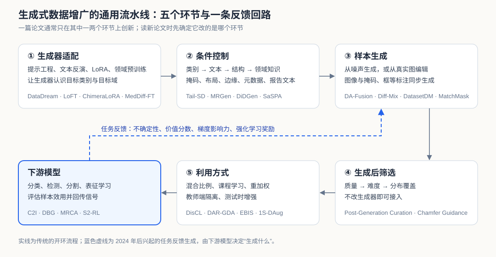

## 摘要

扩散模型让“用生成图像扩充训练集”从个别数据集上的技巧，变成了覆盖分类、分割、检测和表征学习的通用手段。本文基于 Zotero 中 83 条与图像合成增广直接相关的文献（其中 81 篇读取了全文），梳理 2023—2026 年的研究脉络，并比较代表性方法。文献按三条可交叉的轴线组织：主任务决定评价指标，数据条件决定生成要补的缺口，方法阶段决定生成器如何接入训练流程。

研究重心经历了三次转移。2023 年的工作证明，合成图像本身可以作为训练数据。2024 年转向在少样本条件下兼顾保真度与多样性。2025—2026 年进入任务感知阶段：让下游模型的反馈引导生成，或在生成后筛选真正有用的样本，并扩展到长尾识别和医学稠密预测。

比较结果显示，“生成什么”比“生成多少”更重要。只增强训练早期未学会的 30%–40% 样本，或只用约 6% 的生成预算，就能取得稳定收益。但各论文在真实数据量、生成器状态、筛选预算和混合方式上差异很大，指标不宜直接横向比较。文章最后归纳了六类风险，并提出下一步的关键：可复现的任务效用评测、可靠的样本筛选、结构一致的标注生成，以及跨域外部验证。

**关键词**：扩散模型；合成数据；数据增强；长尾识别；少样本学习；医学图像分割；任务反馈生成；样本筛选

## 1. 引言

深度模型依赖大规模、标注充分的数据，但在医学影像、细粒度识别、长尾类别和新场景检测中，真实样本和像素级标注都很昂贵。翻转、裁剪、颜色扰动等传统增强只能带来局部变化，无法改变物种、病灶形态、天气、背景这类语义属性。扩散模型（<a href="#ref-bg-ddpm2020">DDPM</a>、<a href="#ref-bg-ldm2022">LDM</a>）及其可控变体（<a href="#ref-bg-controlnet2023">ControlNet</a>）的成熟，让“按需生成训练数据”成为可行路线。与 <a href="#ref-bg-gan2014">GAN</a> 相比，扩散模型训练更稳定、样本多样性更高，这是近三年该方向几乎全面转向扩散模型的主要原因。

然而，把生成图像直接加进训练集并不必然带来提升。合成图像可能标签不符、分布偏移、过于“典型”，在某些设置下甚至会降低性能（<a href="#ref-2097">When More Data Hurts</a>、<a href="#ref-2194">Limitations in Data-Scarce Domains</a>）。因此本文关心的核心问题是：**在什么数据条件下、生成什么样的样本、以什么方式使用，合成数据才能真正改善下游模型？**

全文结构如下：第 2 节给出问题定义和分类框架；第 3 节梳理 2023—2026 年的发展脉络；第 4 节按技术路线逐类比较代表方法；第 5 节把方法放回下游任务与数据条件中对照；第 6 节讨论质量指标、比较协议和代表性结果；第 7 节分析共同局限与开放问题；第 8 节总结。文献范围、统计口径和开源代码放在文末的折叠附录中。

## 2. 问题定义与分类框架

### 2.1 问题定义

设真实训练集为 Dreal，它可能样本很少、类别长尾、来自单一域或缺少像素级标注。生成式数据增广用生成器 G 构造合成集 Dsyn = {(x̃, ỹ)}，其中 ỹ 可以是类别标签、分割掩码、检测框或深度图；再以某种方式把 Dsyn 与 Dreal 结合，训练下游模型 f，目标是提升 f 在真实测试分布（包括域外分布）上的表现。

这个定义把一篇论文要回答的问题拆成三个：

1. **生成什么**：用什么生成器、什么条件，生成哪一部分数据分布。
2. **标注从哪里来**：ỹ 如何保证正确，尤其是分割掩码和检测框。
3. **怎么使用**：合成样本是否需要筛选、加权，以什么比例、在训练的哪个阶段加入。

### 2.2 三轴分类

本文用三条可交叉的轴线组织文献。一篇论文在“下游任务”上只归一个主类，在另两条轴上可以同时属于多个分支。

| 轴 | 回答的问题 | 取值 | 决定了什么 |
|:--|:--|:--|:--|
| 下游任务 | 合成数据服务于哪个任务 | 分类、目标检测、分割与稠密预测、表征学习、数据集蒸馏 | 评价指标，以及需要同步生成的标注类型 |
| 数据条件 | 真实数据缺什么 | 少样本与数据稀缺、长尾与类别不平衡、跨域与域偏移、标签稀缺与半监督、持续学习与鲁棒性 | 生成要补的缺口 |
| 方法阶段 | 生成器如何接入训练流程 | 图像条件编辑、任务反馈生成、图像—标注联合生成、生成后筛选 | 技术路线与主要风险 |

<small>任务按单一主类统计；数据条件和方法阶段允许交叉归属，计数不能相加。</small>

### 2.3 通用流水线

几乎所有方法都可以放进同一条流水线：生成器适配、条件控制、样本生成、生成后筛选、利用方式五个环节顺序连接，再加一条从下游模型回到生成环节的反馈回路。第 4 节按这条流水线逐环节展开。

## 3. 发展脉络

按核心问题的变化，这批文献大致经历了三个阶段。阶段之间有重叠，年份表示大致的主导时期。

| 阶段 | 核心问题 | 代表方法 | 关键进展 |
|:--|:--|:--|:--|
| 2023 | 合成图像能否直接当训练数据 | <a href="#ref-2240">Azizi 等</a>、<a href="#ref-2162">GIF</a>、<a href="#ref-2262">Fake It</a>、<a href="#ref-364">DiffuMask</a>、<a href="#ref-2166">DatasetDM</a>、<a href="#ref-2258">StableRep</a> | 类条件或文生图合成用于分类和表征学习；从交叉注意力中免费获得掩码 |
| 2024 | 如何兼顾保真度与多样性、适配少样本 | <a href="#ref-2158">DA-Fusion</a>、<a href="#ref-123">DiffuseMix</a>、<a href="#ref-2154">Diff-Mix</a>、<a href="#ref-2150">DataDream</a>、<a href="#ref-2238">DiffAug</a>、<a href="#ref-2260">SynCLR</a> | 从真实图编辑、类间混合、LoRA 少样本适配 |
| 2025—2026 | 生成什么样的样本对模型有用 | <a href="#ref-2118">Diff-II</a>、<a href="#ref-2120">MRCA</a>、<a href="#ref-2098">DBG</a>、<a href="#ref-2122">CORAL</a>、<a href="#ref-2130">DAR-GDA</a>、<a href="#ref-2190">C2I</a>、<a href="#ref-2250">Post-Generation Curation</a>、<a href="#ref-2090">UniDiffDA</a> | 任务反馈生成、生成后筛选、修正生成器的长尾偏差、系统性评测与失效分析 |

### 3.1 2023：从生成图像走向生成训练数据

<a href="#ref-2240">Azizi 等人的工作</a>把 Imagen 微调为类条件模型，在 ImageNet 上证明合成图像能够支持分类器训练，并发现微调和 guidance 权重的选择直接影响图像与标签的对齐。<a href="#ref-2162">GIF</a> 把问题表述为 dataset expansion，用少量真实图像引导 DALL-E 2 或 Stable Diffusion 生成新的带标签样本，同时指出纯合成数据仍不如同规模的真实数据。<a href="#ref-2262">Fake It Till You Make It</a> 只用类名就生成了 ImageNet 克隆，并观察到默认 guidance 下的图像细节丰富但缺乏多样性。

<a href="#ref-364">DiffuMask</a> 和 <a href="#ref-2166">DatasetDM</a> 把增广对象从图像扩展到“图像 + 感知标注”。DiffuMask 利用文本条件扩散中的交叉注意力自动得到像素级掩码；DatasetDM 在扩散模型的潜特征上训练感知解码器，只需约 100 张标注图像就能生成语义分割、实例分割和深度等配对数据，报告 VOC 语义分割提升 13.3 mIoU、COCO 实例分割提升 12.1 AP。<a href="#ref-2258">StableRep</a> 则把合成数据用于表征学习，将同一提示生成的多张图像互为正样本做多正例对比学习。

### 3.2 2024：控制保真度、多样性和少样本适配

这一阶段的共同发现是：现成生成器的图“不像”目标数据，而用少量真实图微调又容易“太像”、缺乏变化。<a href="#ref-2158">DA-Fusion</a> 从真实图像出发，在去噪中途插入原图并用文本反演学到的概念 token 做编辑，可以处理预训练模型没见过的概念。<a href="#ref-123">DiffuseMix</a> 先用条件提示重绘输入图，再与原图拼接并混入分形纹理；<a href="#ref-2154">Diff-Mix</a> 在类别之间做图像翻译，按翻译强度给出软标签。<a href="#ref-2150">DataDream</a> 用少量真实样本对 U-Net 和文本编码器做 LoRA 微调，明显缩小了生成分布和目标分布的差距。

同期还出现两条并行路线。<a href="#ref-2238">DiffAug</a> 只做一次加噪与一次去噪，就提升了分类器的协变量偏移鲁棒性；<a href="#ref-2260">SynCLR</a> 和 StableRep 把合成数据当作视觉预训练的数据源。扩散模型由此从“下游训练集的附加样本生成器”扩展为预训练数据源。

### 3.3 2025—2026：任务感知、长尾与医学场景

焦点转向合成样本的下游效用。<a href="#ref-2118">Diff-II</a> 在同类两张图的反演潜变量之间做圆形插值，再两阶段去噪，同时提高忠实度和多样性。<a href="#ref-2120">MRCA</a> 让实例分割器反过来指导扩散模型，多轮生成模型最不确定的对象。<a href="#ref-2098">DBG</a> 围绕决策边界生成样本。<a href="#ref-2122">CORAL</a> 发现长尾类别在 U-Net 潜空间中会与头部类别重叠，于是用对比正则解耦类别表征。<a href="#ref-2130">DAR-GDA</a> 用一步蒸馏、对抗对齐和重要性重加权同时处理采样效率和分布偏移。

医学与稠密预测工作更关注结构一致性：<a href="#ref-2054">MatchMask</a>、<a href="#ref-2059">MRGen</a>、<a href="#ref-2039">Dual-Stream Diffusion</a>、<a href="#ref-2274">Polyp-LDM</a>、<a href="#ref-2035">DiDGen</a>、<a href="#ref-2276">DiffAtlas</a> 都同时以图像质量和下游分割效果为目标。评测也开始系统化：<a href="#ref-2090">UniDiffDA</a> 把方法拆成模型微调、样本生成、样本利用三部分，在通用、细粒度、长尾、跨域和医学分类上统一复现，发现结果强烈依赖任务和设置。<a href="#ref-2097">When More Data Hurts</a> 和 <a href="#ref-2194">Limitations in Data-Scarce Domains</a> 则开始系统追问“合成数据什么时候反而有害”。

## 4. 方法详解与对比

### 4.1 生成器适配：让生成器认识目标数据

预训练文生图模型对常见概念生成良好，但对细粒度类别、专用领域和医学图像常常“画不出”或“画不像”，因此需要用目标域的真实样本做适配（<a href="#ref-2090">UniDiffDA</a>）。适配强度从轻到重依次是：提示工程、文本反演、LoRA、领域微调、从头训练。

| 方法 | 适配方式 | 所需真实样本 | 关键设计 | 主要解决的问题 |
|:--|:--|:--|:--|:--|
| <a href="#ref-2262">Fake It</a> | 不微调，只改提示并降低 guidance | 0 | 类无关的提示改写，减少语义错误、增加多样性 | 零真实图像构建分类训练集 |
| <a href="#ref-2240">Azizi 等</a> | 把 Imagen 微调成类条件模型 | 全量 ImageNet | 仔细选择 guidance 权重与采样参数 | 图像与标签对齐 |
| <a href="#ref-2158">DA-Fusion</a> | 文本反演学习新概念 token | 每类少量 | 从真实图出发的 SDEdit 式编辑 | 预训练模型没见过的概念 |
| <a href="#ref-2150">DataDream</a> | LoRA 微调 U-Net 与文本编码器 | 少样本 | 再用合成数据 LoRA 微调 CLIP | 合成分布贴合目标分布 |
| <a href="#ref-2281">LoFT</a> | 每张真实图单独训练 LoRA，推理时融合 | 每类 8–64 张 | 融合多张真实图的特征 | 保真度与多样性兼顾 |
| <a href="#ref-2100">ChimeraLoRA</a> | 类共享 LoRA + 逐图 LoRA | 少样本 | 按 Dirichlet 系数组合两类适配器 | 类别先验与个体细节解耦 |
| <a href="#ref-2102">BOB</a> | 微调时条件化背景和姿态 | 每类 5–10 张 | 生成时边缘化类无关属性 | 过拟合与类间伪关联 |
| <a href="#ref-2056">MedDiff-FT</a> | 数据高效微调扩散基础模型 | 小规模医学数据 | 动态引导掩码、随机掩码生成器、自动质检 | 医学图像的结构依赖与域特异性 |
| <a href="#ref-2138">AugGen</a> | 在目标人脸数据集上从头训练类条件模型 | 目标数据集 | 不使用外部数据或预训练模型 | 外部依赖与隐私 |
| <a href="#ref-2110">WILD-Diffusion</a> | 有限数据下从头训练 | 小数据集 | 在 Wasserstein 不确定集中迭代生成训练样本 | 小数据训练扩散模型的过拟合 |

这条线的演进很清楚：从“一个类一个适配器”（DataDream）走向“把类别共性和个体细节解耦”（LoFT、ChimeraLoRA、BOB）。医学方向更依赖领域预训练和数据高效微调。需要注意的是，<a href="#ref-2112">The Learnability Gap</a> 发现：大规模预训练自编码器的潜表征虽然保留了医学判别信息，却很难被分类器学到，而且领域微调也弥合不了这个差距。这意味着“在哪个空间里生成”本身就是一个待解决的问题。

### 4.2 图像条件编辑：从真实图像出发

这类方法以真实图像或其反演潜变量为起点，只改动部分属性，因此更容易保持标签和布局。核心控制量是“离原图有多远”：越近越忠实，越远越多样。

| 方法 | 起点 | 变化来源 | 标签处理 | 作者自述或可见的局限 |
|:--|:--|:--|:--|:--|
| <a href="#ref-2158">DA-Fusion</a> | 真实图插入去噪中途 | 概念 token + 随机编辑强度 | 沿用原标签 | 变化范围受原图约束 |
| <a href="#ref-123">DiffuseMix</a> | 真实图 | 条件提示重绘，与原图半边拼接并混入分形纹理 | 沿用原标签 | 提示错误会生成不真实图像 |
| <a href="#ref-2154">Diff-Mix</a> | 其他类别的真实图 | 类间翻译，强度从 0.5/0.7/0.9 中随机选 | 软标签按强度非线性插值；偏好目标类高置信样本 | 易产生前景残缺的样本 |
| <a href="#ref-2118">Diff-II</a> | 同类两张图的反演 | 圆形插值 + 两阶段去噪 | 沿用类别 | 每类至少两张图；不平衡因子达到 100 时增益下降 |
| <a href="#ref-2116">DisCL</a> | 真实图 | 不同图像引导强度形成“合成到真实”的谱 | 沿用类别 | 需要设计课程 |
| <a href="#ref-2178">MGRAttn-RNO</a> | 参考图 | 只更新前景的参考注意力 + 互相排斥的初始噪声 | 沿用类别 | 依赖前景分割质量 |
| <a href="#ref-2244">Free-Lunch</a> | 真实图 | 弱化噪声 + 背景修复 | 保留前景框 | 面向跨域少样本检测 |
| <a href="#ref-2210">1S-DAug</a> | 单张测试图 | 几何扰动 + 受控加噪 + 图像条件去噪 | 测试时增强 | 只在推理阶段使用 |

几种方法对“编辑强度”的处理代表了三种思路：DA-Fusion 和 Diff-Mix 随机采样强度；DisCL 把强度做成从易到难的课程，训练早期用偏离较大但容易学的样本，后期用接近真实但难学的样本；Diff-II 则绕开强度，改在反演空间里插值。

### 4.3 图像—标注联合生成

分割和检测需要像素级或框级标注，“标注从哪里来”决定了方法的形态。按标注来源可以分成四种范式。

| 范式 | 做法 | 代表方法 | 优点 | 主要问题 |
|:--|:--|:--|:--|:--|
| 先图后标 | 先生成图像，再从扩散注意力或特征中解码标注 | <a href="#ref-364">DiffuMask</a>、<a href="#ref-2166">DatasetDM</a>、<a href="#ref-2104">S3OD</a> | 不需要真实掩码，可无限扩展 | 伪标签边界不准 |
| 先标后图 | 以掩码、布局为条件生成图像 | <a href="#ref-2054">MatchMask</a>、<a href="#ref-2059">MRGen</a>、<a href="#ref-2270">SFD-Polyp</a>、<a href="#ref-2186">Tail-SD</a> | 图像与标注对齐有保障 | 新掩码从哪里来；掩码多样性受限 |
| 联合生成 | 图像与掩码在同一扩散过程或共享潜空间中一起生成 | <a href="#ref-2039">Dual-Stream Diffusion</a>、<a href="#ref-2274">Polyp-LDM</a>、<a href="#ref-2276">DiffAtlas</a>、<a href="#ref-2142">Diff-2-in-1</a>、<a href="#ref-2114">Sketch2CT</a> | 一致性好，可按需生成 | 训练更重，对小数据敏感 |
| 修复与编辑 | 保留背景或前景，只生成局部 | <a href="#ref-240">医学 DiffAug</a>、<a href="#ref-2279">DiGDA</a>、<a href="#ref-2198">ISIC2019 长尾分类</a> | 真实感强，对齐精确 | 多样性受原图限制 |

医学方法的细节差异主要体现在掩码来源和质量控制上：

| 方法 | 数据 | 掩码来源 | 关键设计 | 质量控制 |
|:--|:--|:--|:--|:--|
| <a href="#ref-2054">MatchMask</a> | VOC、COCO、ADE20K（少标注） | 少量真实掩码 | 梯度探针定位关键层，轻量适配器 + 层自适应交叉注意力融合 | 相对过滤错误区域 |
| <a href="#ref-2059">MRGen</a> | 多种 MRI 模态 | 文本 + 掩码 | 构建大规模 MRI 图文数据集，为缺少掩码的模态生成数据 | — |
| <a href="#ref-2039">Dual-Stream Diffusion</a> | 内镜息肉、皮肤镜、肝脏 CT | 结构流预测 | 结构流与外观流解耦，时间门控融合，结构感知头 | — |
| <a href="#ref-2274">Polyp-LDM</a> | 结肠镜 | 统一 VAE 的共享潜空间 | 微调 VAE 解码器，风格克隆模块 | — |
| <a href="#ref-2270">SFD-Polyp</a> | 结肠镜 | 真实掩码 + 保守扰动 | 风格集成模块 | 只做受控的轮廓与子区域小扰动，避免不合理形状 |
| <a href="#ref-2035">DiDGen</a> | 皮肤镜 | 测试时布局引导 + 注意力标注 | LLM 生成结构化临床提示；区域感知注意力损失 | — |
| <a href="#ref-2276">DiffAtlas</a> | 心脏 CT、MRI | 图像—掩码联合扩散 | 测试时生成与目标图像匹配的图像—掩码对，兼具图谱法鲁棒性 | — |
| <a href="#ref-2056">MedDiff-FT</a> | 五个医学分割数据集 | 随机掩码生成器 | 动态自适应引导掩码 | 特征空间自动质检 + 掩码腐蚀 |
| <a href="#ref-240">医学 DiffAug</a> | 息肉、视盘视杯 | 现有标注中的合理位置 | 文本与掩码共同引导的病灶修复 | 潜空间分割网络校验定位 |
| <a href="#ref-2114">Sketch2CT</a> | 3D CT | 先从噪声生成 3D 器官掩码 | 2D 草图与文本共同引导 | — |

在“先标后图”的范式里，掩码很少时新掩码从哪里来，是绕不开的问题。现有做法包括：对真实掩码做常规增强、做保守的局部扰动（SFD-Polyp）、用生成模型直接生成掩码（Sketch2CT、Dual-Stream Diffusion），或者干脆不生成新掩码，只改背景和病灶内容（医学 DiffAug、DiGDA）。目前还没有通用的方法来正式验证合成掩码是否符合解剖规律。

### 4.4 任务反馈生成：让下游模型参与生成

这是当前最活跃的方向。按反馈接入生成的位置，可以分为采样时引导、在线定向生成和强化学习微调三类。

| 方法 | 任务 | 反馈信号 | 接入方式 | 是否修改生成器 |
|:--|:--|:--|:--|:--|
| <a href="#ref-2190">C2I</a> | 少样本医学分类 | 类对比影响力：样本梯度与同类验证梯度对齐、与异类相反 | 以此为奖励，用强化学习微调扩散模型 | 是 |
| <a href="#ref-2283">S2-RL</a> | 分割数据集蒸馏 | 样本级与集合级双重奖励 | GRPO 微调扩散策略 | 是 |
| <a href="#ref-2098">DBG</a> | 长尾分类 | 决策边界 | 生成近边界样本，使决策空间更可分 | — |
| <a href="#ref-2120">MRCA</a> | 长尾实例分割 | 分割模型的不确定性 | 多轮在线生成，按模型状态调整各类数量与尺寸 | 否 |
| <a href="#ref-2104">S3OD</a> | 显著性目标检测 | 模型在各类别上的表现 | 迭代优先生成难类别 | 否 |
| <a href="#ref-2182">BRIDGE</a> | 长尾自监督预训练 | 编码器的 kNN 距离 | 选出覆盖稀疏的锚点，再做图到图生成 | 否 |
| <a href="#ref-2272">EBIS</a> | 烧伤分割（半监督） | 教师模型的不确定性 | 合成图只进入教师路径，避免偏差传给学生 | 否 |
| <a href="#ref-2279">DiGDA</a> | 冠脉狭窄检测 | 用户指定的严重程度 | 修复式生成病灶，平衡中重度样本 | 否 |
| <a href="#ref-2242">Generative Active Learning</a> | 分类 | 贝叶斯采集函数 | 选择对训练最有效的合成样本 | — |

这些工作指向同一个结论：**最有用的样本是靠近决策边界、但仍在真实数据流形上的困难样本**。C2I 的梯度分析、DBG 的近边界生成、MRCA 的不确定性驱动都体现了这一点。代价是反馈模型的错误可能被闭环放大，<a href="#ref-2283">S2-RL</a> 的作者也承认其奖励只是下游效用的近似。

### 4.5 生成后筛选：生成器无关的“挑数据”

筛选不改动生成器，可以直接用在任何生成结果上。筛选标准经历了从“质量”到“难度”再到“分布覆盖”的升级。

| 方法 | 打分依据 | 是否需重训生成器 | 主要发现 |
|:--|:--|:--|:--|
| <a href="#ref-116">TADA</a> | 训练早期按损失聚类，只对未学会的样本做生成 | 否（先选后生成） | 只增强 30%–40% 的样本即优于全量增强，最高提升 2.8 个百分点 |
| <a href="#ref-2250">Post-Generation Curation</a> | 奖励语义对齐，惩罚生成器偏好的“典型模式”冗余 | 否 | 最多少用 40% 的合成样本就达到真实数据性能 |
| <a href="#ref-2234">Chamfer Guidance</a> | 少量真实样例与合成集之间的 Chamfer 距离 | 否（采样时引导） | 只需 2 个真实样例 |
| <a href="#ref-2254">SynBalance</a> | 数量、多样性、可识别度、域差 | 否 | 选择与长尾真实分布互补的子集 |
| <a href="#ref-351">DiffuLT</a> | 特征提取器剔除有害样本 | 训练中引导 | “近分布”样本对长尾识别最有价值 |
| <a href="#ref-2236">SaSPA</a> | 预测置信度过滤 | 否 | 作者比较后认为 CLIP 过滤对细粒度概念不够敏感 |
| <a href="#ref-2198">ISIC2019 长尾分类</a> | OOD 后筛选 | 否 | 保留真实且有临床意义的样本 |

筛选与传统的数据选择研究是同一类思路，已有工作直接借鉴：<a href="#ref-116">TADA</a> 引用了 coreset 选择库 DeepCore，<a href="#ref-2190">C2I</a> 沿用了基于梯度的影响力估计。把 coreset、影响力函数、主动学习采集函数等方法系统地迁移到合成数据上，目前还缺少专门的评测。

### 4.6 长尾：修正生成器，还是修正分类器

长尾场景有一个容易被忽略的嵌套问题：生成器本身也是在长尾数据上训练的。<a href="#ref-2122">CORAL</a> 发现尾部类的潜表征与头部类重叠，导致生成的尾部类图像“借用”了头部类特征，而且这不只是尾部样本少的问题，类别间的相对不平衡本身就有显著影响。文献因此分成两条线。

| 方法 | 修正对象 | 核心思路 | 是否依赖外部模型或数据 |
|:--|:--|:--|:--|
| <a href="#ref-2122">CORAL</a> | 生成器 | 对比正则对齐 U-Net 瓶颈层的潜表征 | 否 |
| <a href="#ref-2126">Principled LT Diffusion</a> | 生成器 | 互学习正则 + 博弈论收敛分析 | 否 |
| <a href="#ref-351">DiffuLT</a> | 生成器与数据 | 只用长尾数据从头训练扩散模型，生成平衡的代理数据集 | 否 |
| <a href="#ref-276">LDMLR</a> | 特征 | 在编码后的特征空间用 DDIM 生成尾部伪特征 | 否 |
| <a href="#ref-2170">Fill-Up</a> | 数据 | 用文本反演 token 生成与真实域对齐的尾部图像 | 是（预训练文生图） |
| <a href="#ref-2254">SynBalance</a> | 数据 | 控制合成属性，选互补子集，两阶段训练 | 是 |
| <a href="#ref-2146">长尾食物分类</a> | 数据 | 正负提示生成尾部图像，强调类间可分性 | 是 |
| <a href="#ref-2098">DBG</a> | 分类器边界 | 生成近边界样本，避免头到尾迁移造成的类间纠缠 | — |
| <a href="#ref-2130">DAR-GDA</a> | 分布对齐 | 一步蒸馏 + 对抗对齐 + 重要性重加权 | 是（教师模型） |
| <a href="#ref-2186">Tail-SD</a> | 检测数据 | 文本、框、掩码混合条件生成稀有目标 | 是 |
| <a href="#ref-2214">长尾遥感分割</a> | 分割数据 | 按类别比例生成布局，再用 ControlNet 渲染 | 是 |
| <a href="#ref-2268">TRCGL-Net</a> | 医学多标签分类 | 文本引导扩散生成尾部胸片 + 标签共现建模 | — |

<a href="#ref-2098">DBG</a> 把两条线连了起来：它指出“头到尾迁移”虽然平衡了决策空间，却会把头部特征混进尾部类，这与 CORAL 发现的“特征借用”是同一现象的两面。目前的医学长尾工作（TRCGL-Net、ISIC2019 长尾分类等）多数仍停留在“给少数类多生成”，还没有吸收这些关于生成器偏差的发现。

### 4.7 表征学习与数据集蒸馏

这两类工作的目标不是扩充某个下游任务的训练集：表征学习把合成图像当作预训练数据，数据集蒸馏则用生成模型把大数据集压缩成小而有效的合成集。

| 方法 | 目标 | 做法 | 代表结果 |
|:--|:--|:--|:--|
| <a href="#ref-2258">StableRep</a> | 自监督表征 | 同一提示生成的多张图互为正样本 | 20M 合成图训练超过 50M 真实图训练的 CLIP |
| <a href="#ref-2260">SynCLR</a> | 表征 | LLM 生成描述，文生图为每条描述生成多图，做对比学习 | ADE20K 上比 MAE、iBOT 高 5.0、3.1 mIoU |
| <a href="#ref-2072">Scaling Laws</a> | 缩放规律分析 | 研究提示、CFG、生成模型类型对缩放的影响 | 训练 CLIP 接近真实图，训练监督分类器明显落后 |
| <a href="#ref-2106">IMS3</a> | 数据集蒸馏 | 缓解扩散模型集中在高密度区域的问题，覆盖边界样本 | — |
| <a href="#ref-2108">EVLF</a> | 数据集蒸馏 | 在编码器与解码器之间早期融合视觉与文本，避免提示主导 | — |
| <a href="#ref-2246">D3S2</a> | 分割数据集蒸馏 | 类别平衡的掩码选择 + 布局到图像生成 | 1% 压缩率下 ADE20K 24.99%、COCO-Stuff 35.49% mIoU |
| <a href="#ref-2283">S2-RL</a> | 分割数据集蒸馏 | GRPO 微调扩散策略，样本级与集合级双奖励 | — |
| <a href="#ref-2285">DIVER</a> | 数据集蒸馏 | 语义继承、引导、融合，去除架构特定噪声 | — |
| <a href="#ref-2287">SFM</a> | 自监督模型的数据集蒸馏 | 统计流匹配替代线性梯度匹配 | — |

数据集蒸馏与生成式增广本质上都是“按训练效用合成数据”，只是预算方向相反。蒸馏结果需要同时报告压缩比例、初始化方式和验证骨干，不能与普通增广的准确率直接比较。

## 5. 应用对照：下游任务 × 数据条件

下表把主要方法放进“任务 × 数据条件”的矩阵，方便按自己的场景查找相关工作。

| 任务 ＼ 数据条件 | 少样本与数据稀缺 | 长尾与类别不平衡 | 跨域与域偏移 | 标签稀缺与半监督 | 鲁棒性与持续学习 |
|:--|:--|:--|:--|:--|:--|
| 分类 | <a href="#ref-2150">DataDream</a>、<a href="#ref-2281">LoFT</a>、<a href="#ref-2100">ChimeraLoRA</a>、<a href="#ref-2102">BOB</a>、<a href="#ref-2118">Diff-II</a>、<a href="#ref-2158">DA-Fusion</a>、<a href="#ref-2190">C2I</a>、<a href="#ref-2202">Few-Shot Synthetic Data</a> | <a href="#ref-2098">DBG</a>、<a href="#ref-2122">CORAL</a>、<a href="#ref-351">DiffuLT</a>、<a href="#ref-2170">Fill-Up</a>、<a href="#ref-2254">SynBalance</a>、<a href="#ref-276">LDMLR</a>、<a href="#ref-2268">TRCGL-Net</a> | <a href="#ref-2116">DisCL</a>、<a href="#ref-2252">Not Just Pretty Pictures</a>、<a href="#ref-2224">病理 SSDA</a> | <a href="#ref-2256">开放集半监督扩散</a>、<a href="#ref-2264">Beyond Words</a> | <a href="#ref-2238">DiffAug</a>、<a href="#ref-2243">Class-Mixed Diffusion</a>、<a href="#ref-2210">1S-DAug</a>、<a href="#ref-2134">Diffusing DeBias</a> |
| 目标检测 | <a href="#ref-2244">Free-Lunch</a>、<a href="#ref-2104">S3OD</a> | <a href="#ref-2186">Tail-SD</a> | <a href="#ref-2244">Free-Lunch</a>、<a href="#ref-2248">FrozenDrive</a> | — | — |
| 分割与稠密预测 | <a href="#ref-2054">MatchMask</a> | <a href="#ref-2120">MRCA</a>、<a href="#ref-2214">长尾遥感分割</a> | <a href="#ref-2039">Dual-Stream Diffusion</a>、<a href="#ref-2276">DiffAtlas</a> | <a href="#ref-2054">MatchMask</a>、<a href="#ref-2059">MRGen</a>、<a href="#ref-2272">EBIS</a> | — |
| 表征学习 | — | <a href="#ref-2182">BRIDGE</a> | — | — | — |

几点观察：

- **分类**是方法最密集的任务。少样本场景的主线是生成器适配，长尾场景的主线是修正生成器偏差与生成近边界样本。类别提示能快速扩大覆盖，但细粒度类别容易受背景捷径和提示偏差影响。
- **目标检测**证据最少，但最能说明“不能只看视觉质量”：生成图像还必须保证目标位置、尺度、遮挡与框标注一致。
- **分割**，尤其是医学分割，主要瓶颈不是图像是否逼真，而是病灶形状、边界和标注是否可信。
- 持续学习、检测与分割在鲁棒性方向的空格，既可能是本文收录范围的偏差，也可能是真正的研究空白。

## 6. 评测：指标、协议与结果

### 6.1 合成质量指标

合成质量的评价可以分为四类：分布距离（FID、KID、CMMD）、样本级相似度（SSIM、PSNR、LPIPS）、语义对齐（CLIP 分数、预训练分类器判定的可识别度）和人工评估（专家打分、图灵测试）。在本文收录的工作中，FID 最常见，但几乎总是与下游任务性能一起报告，单靠 FID 下结论的论文很少。

医学与自然图像的做法有明显差别：

- **医学**更常用专家评估和像素级指标。像素级指标多见于从掩码或配对图生成的任务，因为那里有可以逐像素比较的参考图。
- **医学 FID 的特征空间存在争议**。多数论文直接用 ImageNet 预训练的 Inception-v3 计算 FID，但医学图像与自然图像差异很大。<a href="#ref-2274">Polyp-LDM</a> 因此加报了基于 CLIP 特征的 CLIP-FID 和 CMMD。
- **自然图像**更多用语义指标：<a href="#ref-2072">Scaling Laws</a> 用预训练分类器的可识别度和多样性两个指标刻画合成数据；<a href="#ref-2234">Chamfer Guidance</a> 在 DINOv2 特征上计算 Precision、Recall、Density、Coverage 和 Fréchet 距离。
- **参考集不统一**：有的论文与训练集比，有的与测试集比（如 <a href="#ref-2035">DiDGen</a> 用测试集中的 1000 张真实图），不同论文的 FID 数值不能直接比较。

关于 real vs real 的参照，多数论文只报告“合成 vs 真实”，在方法之间横比“越低越好”，隐含地把真实数据自身的参考水平当作 0。<a href="#ref-2100">ChimeraLoRA</a> 明确把参考集本身的 FID 记为 0.00。更严谨的做法见于眼科 OCT 生成工作 OCTFlow：用 bootstrap 估计真实数据自身的 FID 波动范围，再判断合成数据是否落在这个范围之内。

### 6.2 比较协议

论文报告的指标需要在统一设置下比较，跨数据集的结果不宜拼成总榜。分类工作通常报告 Top-1、balanced accuracy、尾类准确率或 OOD 准确率；检测报告 AP、召回率和跨域表现；分割报告 mIoU、Dice 或边界指标。比较时至少需要固定以下因素：

1. 真实数据量和合成数据比例。
2. 生成器是从头训练、领域微调还是完全冻结。
3. 文本、类别、图像、掩码、布局等控制信号。
4. 采样步数、guidance scale、生成分辨率和筛选预算。
5. 下游模型结构、训练轮数、增强策略和随机种子。
6. 合成数据是单独训练，还是与真实数据混合。
7. 是否报告逐类别、跨域和外部测试集的表现。
8. 测试集是否与生成器的训练、调参数据完全隔离。一项胸片合成研究（eBioMedicine 2024）发现，不隔离会高估合成数据的收益。

<a href="#ref-2090">UniDiffDA</a> 的价值正在于把这些变量拆开评估。<a href="#ref-2096">医学影像系统综述</a>则从更高层面提醒：合成数据的增益主要来自与真实数据互补，真实数据仍然承担核心监督作用。

### 6.3 代表性结果

下表的数字来自论文各自的实验设置，用于理解方法的作用，不构成跨论文的排行榜。

| 方法 | 任务与数据条件 | 主要数据集 | 论文报告的结果 | 比较时需固定的因素 |
|:--|:--|:--|:--|:--|
| <a href="#ref-116">TADA</a> | 分类 | CIFAR-10/100、TinyImageNet | 只增强 30%–40% 的样本，最高提升 2.8 个百分点 | 真实数据量、增强比例、骨干 |
| <a href="#ref-2102">BOB</a> | 分类，少样本 | Aircraft、CUB、Cars、Pets 等 | 24 个设置中 18 个超过先前方法，14 个提升超过 2 个百分点 | shot 数、属性建模、生成模型 |
| <a href="#ref-2150">DataDream</a> | 分类，少样本 | 10 个少样本分类数据集 | 10 个数据集中 7 个超过先前方法 | LoRA 预算与 shot 数 |
| <a href="#ref-2154">Diff-Mix</a> | 分类，细粒度 | CUB、FGVC-Aircraft、Flowers | 在常规、少样本和长尾设置中稳定提升 | 类别粒度、生成倍数 |
| <a href="#ref-2178">MGRAttn-RNO</a> | 分类，长尾单样本 | CUB-LT、Flowers-LT（IF100） | CUB-LT IF100 上最高提升 2.50 和 2.94 个百分点 | 不平衡比例、前景掩码质量 |
| <a href="#ref-2116">DisCL</a> | 分类，长尾与跨域 | ImageNet-LT、iWildCam | ImageNet-LT 尾类准确率 4.40% → 23.64%，整体 35.80% → 39.82%；iWildCam OOD F1 35.5 → 38.2 | many/medium/few 划分、域外测试集 |
| <a href="#ref-2268">TRCGL-Net</a> | 医学多标签，长尾 | PadChest | tail mAP 0.4904，overall mAP 0.4408，mAUC 0.8989 | 多标签指标不能与单标签比较 |
| <a href="#ref-2186">Tail-SD</a> | 检测，长尾 | COCO、LVIS | LVIS rare Box AP +4.89，rare Mask AP +5.68 | rare 类定义、实例预算 |
| <a href="#ref-2120">MRCA</a> | 实例分割，长尾 | LVIS | 只需约 6% 的生成量即可获得持续收益 | 实例预算、评测协议 |
| <a href="#ref-2104">S3OD</a> | 显著性检测，跨域 | DIS、HR-SOD | 纯合成训练的跨数据集错误减少 20%–50% | 错误率不能与 mIoU、AP 混比 |
| <a href="#ref-2054">MatchMask</a> | 分割，少标注 | PASCAL VOC、COCO、ADE20K | PASCAL VOC mIoU 67.5% → 74.3% | 掩码对齐、标注比例、分割骨干 |
| <a href="#ref-2166">DatasetDM</a> | 分割与检测 | PASCAL VOC 2012、COCO 2017 | VOC +13.3 mIoU，COCO +12.1 AP | 生成标注类型、下游模型 |
| <a href="#ref-240">医学 DiffAug</a> | 医学分割 | CVC-ClinicDB、Kvasir-SEG、REFUGE2 | Dice 提升 8%–10%；小息肉和扁平病灶的假阴性率最高降低 28% | 病灶类型、文本提示来源 |
| <a href="#ref-2056">MedDiff-FT</a> | 医学分割 | ISIC、BUSI、PH2、DDTI 等 | 五个数据集平均提升约 1% Dice | 模态、器官、标注比例 |
| <a href="#ref-2246">D3S2</a> | 分割数据集蒸馏 | ADE20K、COCO-Stuff | 1% 压缩率下 mIoU 24.99% / 35.49% | 压缩比例、验证集 |
| <a href="#ref-2258">StableRep</a>、<a href="#ref-2260">SynCLR</a> | 表征学习 | 合成预训练，ImageNet、ADE20K | 20M 合成图超过 50M 真实图的 CLIP；ADE20K 比 MAE、iBOT 高 5.0、3.1 mIoU | 预训练规模、语言监督 |
| <a href="#ref-2234">Chamfer Guidance</a> | 生成后筛选，少样本 | ImageNet-1k、地理多样性基准 | 2 个样例时 precision 96.4%、coverage 86.4%；下游 ID/OOD 准确率最高提升 15%/16% | 质量指标与下游效用需同时报告 |

整体来看，收益来自数据条件与任务模型的匹配：少样本分类看类内变化和分布贴合，长尾看尾类覆盖与决策边界，分割还必须验证图像与掩码的一致性。

## 7. 局限与开放问题

### 7.1 共同局限

以下局限大多来自论文作者在 Limitations 或 Discussion 中的自述。

| 局限 | 具体表现 | 例证 |
|:--|:--|:--|
| 生成成本高 | 多步去噪、微调和多轮反馈都很昂贵，限制了规模和在线生成 | <a href="#ref-351">DiffuLT</a>、<a href="#ref-2142">Diff-2-in-1</a> 自述训练与采样耗时；<a href="#ref-2258">StableRep</a> 每张图约 0.8 秒，无法在线生成不重复图像；<a href="#ref-2134">Diffusing DeBias</a> 为此降低训练分辨率；<a href="#ref-2138">AugGen</a> 从头训练生成器代价高 |
| 受限于预训练生成器 | 目标域超出生成器训练域、或难以用文字描述时失效；生成器的伪影和偏见被继承 | <a href="#ref-2252">Not Just Pretty Pictures</a>、<a href="#ref-2186">Tail-SD</a>、<a href="#ref-2246">D3S2</a>（精细结构出现伪影） |
| 效用代理不可靠 | 奖励、置信度、FID 都只是“有用”的近似；关键假设可能不成立 | <a href="#ref-2283">S2-RL</a>（奖励只是效用近似）；<a href="#ref-2112">The Learnability Gap</a>（只诊断未解决）；<a href="#ref-2258">StableRep</a>（尚不理解为何有效） |
| 保真度与多样性冲突 | 强条件提高标签稳定性却可能复制训练集；弱条件增加变化却带来类别混淆 | <a href="#ref-2097">When More Data Hurts</a> 将其归为“标签边界混淆”等失效模式 |
| 越稀缺越难生效 | 极端稀缺时合成样本倾向于强化已有决策边界，而不是扩展到困难区域 | <a href="#ref-2194">Limitations in Data-Scarce Domains</a>；<a href="#ref-2118">Diff-II</a> 在不平衡因子达到 100 时增益下降 |
| 评测与外部验证不足 | 多数只在少量公开数据集和单一骨干上验证；存在发表偏倚 | <a href="#ref-2130">DAR-GDA</a> 只在两个数据集上验证；<a href="#ref-2097">When More Data Hurts</a> 指出成功结果更容易发表 |
| 隐私与记忆 | 生成器可能复现训练样本或放大数据偏见 | 收录文献多做最近邻检查，缺少用攻击方法的定量评估 |

### 7.2 开放问题

1. **分割任务的样本效用度量**：分类已有基于梯度的效用度量（C2I），分割的反馈仍以不确定性为主，缺少区域级或边界级的效用定义。
2. **生成预算与停止规则**：多篇工作观察到合成比例的收益会饱和，但几乎没有方法能在训练前预测饱和点，或在线决定何时停止生成。
3. **把生成器长尾偏差的发现带到医学**：CORAL、DBG 关于“特征借用”和“边界纠缠”的结论，尚未被医学长尾工作吸收。
4. **在哪个空间里生成**：像素、VAE 潜空间、基础模型表征空间、下游特征空间各有利弊，缺少系统比较。
5. **合成掩码的解剖合理性验证**：目前只有保守扰动等局部方案，缺少通用的验证方法。
6. **可复现的医学评测协议**：固定真实数据预算与生成预算、报告合成比例曲线和外部验证，并保证测试集与生成器数据隔离。

## 8. 总结

扩散模型数据增广正在从“生成更多图像”转向“生成对特定模型和特定缺口有用的图像”。三条主线已经清晰：生成器适配解决“像不像”，任务反馈与生成后筛选解决“有没有用”，图像—标注联合生成解决“标注对不对”。下一步的关键在于建立可复现的任务效用评测、可靠的样本筛选、结构一致的标注生成和跨域外部验证。

## 附录

A. 文献范围与统计口径（点击展开）

本文的文献来自作者整理的 Zotero 文献库「合成图像用于数据增强」子集（169 篇候选记录），以及更广义的 Diffusion Model 子集（219 篇）中与图像合成增广直接相关的少量补充。最终纳入 83 条主体证据，其中 81 篇读取了全文 PDF；参考文献列表共 89 条，包括 6 条背景文献和 83 条主体记录。

- 按质量筛选规则，Sensors 2026 的 Propose-and-Select，以及 ADuLTS、Synthetic Imagery 和 Triple-Prompt 未纳入核心统计。
- 下游任务按单一主类统计：分类 39 条、目标检测 2 条、分割与稠密预测 24 条、表征学习 2 条、数据集蒸馏 8 条、综述与评测 6 条，另有 WILD-Diffusion、Sketch2CT 两条生成器与领域基础记录。
- 数据条件为交叉索引：少样本与数据稀缺 22 条、长尾与类别不平衡 24 条、跨域与域偏移 16 条、标签稀缺与半监督 7 条、持续学习与鲁棒性 6 条。
- 以下两条暂无全文，相关描述依据题目、摘要或出版页面：Generative Active Learning via Bayesian Acquisition for Improving the Efficiency of Synthetic Data；Class-Mixed Diffusion Augmentation for Shortcut-Breaking in Continual Learning。
- 正式接收、预印本、workshop 和 OpenReview 在审状态按 Zotero 条目和来源页面分别标注。

B. 开源代码（点击展开）

下表列出论文来源页或正文中明确指向的作者代码仓库，共 33 个；其中 TRCGL-Net 和 SFD-Polyp 的链接目前返回 Repository not found。依赖库和基础模型的链接没有计入。仓库根目录下的 `README`、`configs`、`scripts` 和训练入口通常包含复现实验所需的命令。

| 方法 | 作者代码路径 | 备注 |
|:--|:--|:--|
| DiffDA-Eval | [nukezil/DiffDA-Eval](https://github.com/nukezil/DiffDA-Eval) | 统一评测与复现实验 |
| DBG | [keepdigitalabc-svg/DBG](https://github.com/keepdigitalabc-svg/DBG) | 决策边界生成 |
| IMS3 | [Westlake-AGI-Lab/IMS3](https://github.com/Westlake-AGI-Lab/IMS3) | 扩散数据集蒸馏 |
| Learnability Gap | [MischaD/LearnabilityGap](https://github.com/MischaD/LearnabilityGap) | 医学潜空间扩散分析 |
| DisCL | [tianyi-lab/DisCL](https://github.com/tianyi-lab/DisCL) | 合成到真实的课程学习 |
| Diff-II | [HKUST-LongGroup/Diff-II](https://github.com/HKUST-LongGroup/Diff-II) | 反演圆插值增广 |
| CORAL | [SankarLab/coral-lt-diffusion](https://github.com/SankarLab/coral-lt-diffusion) | 长尾潜表示解耦 |
| IGD-ML | [pranoydas51/IGD-ML](https://github.com/pranoydas51/IGD-ML) | 长尾生成建模 |
| DAR-GDA | [ruyianry/gda-dar](https://github.com/ruyianry/gda-dar) | 蒸馏、对齐与重加权 |
| Diffusing DeBias | [Malga-Vision/DiffusingDeBias](https://github.com/Malga-Vision/DiffusingDeBias) | 偏置放大与去偏 |
| MedDiff-FT | [JianhaoXie1/MedDiff-FT](https://github.com/JianhaoXie1/MedDiff-FT) | 医学图像轻量微调 |
| DataDream | [ExplainableML/DataDream](https://github.com/ExplainableML/DataDream) | 少样本数据集生成 |
| Diff-Mix | [Zhicaiwww/Diff-Mix](https://github.com/Zhicaiwww/Diff-Mix) | 跨类别扩散混合 |
| DA-Fusion | [brandontrabucco/da-fusion](https://github.com/brandontrabucco/da-fusion) | 图像条件扩散增广 |
| GIF | [Vanint/DatasetExpansion](https://github.com/Vanint/DatasetExpansion) | 小规模数据集扩展 |
| DIAGen | [visinf/DIAGen](https://github.com/visinf/DIAGen) | 生成式图像增广 |
| MGRAttn-RNO | [hvcl/MGRAttn-RNO](https://github.com/hvcl/MGRAttn-RNO) | 参考注意力与排斥噪声 |
| 病理图像 LDM-SSDA | [hsu-lab/ldm-pathology-ssda](https://github.com/hsu-lab/ldm-pathology-ssda) | 半监督域适配 |
| SynRep / SynCLR | [google-research/syn-rep-learn](https://github.com/google-research/syn-rep-learn) | 合成表示学习 |
| DiffAug | [oore-lab/diffaug](https://github.com/oore-lab/diffaug) | diffuse-and-denoise 增广 |
| Free-Lunch | [zzzzj311-droid/Free-Lunch-SITN](https://github.com/zzzzj311-droid/Free-Lunch-SITN) | 跨域少样本检测 |
| D3S2 | [zwj084/D3S2](https://github.com/zwj084/D3S2) | 语义分割数据集蒸馏 |
| LDMLR | [AlvinHan123/LDMLR](https://github.com/AlvinHan123/LDMLR) | 长尾特征扩散 |
| TRCGL-Net | [November-1113/TRCG](https://github.com/November-1113/TRCG) | 胸片长尾分类 |
| SFD-Polyp | [zhaiying0925/SFD-](https://github.com/zhaiying0925/SFD-) | 息肉图像—掩码生成 |
| EBIS | [VEDAs-Lab/EBIS](https://github.com/VEDAs-Lab/EBIS) | 烧伤分割与扩散教师 |
| Polyp-LDM | [16rq/Polyp-LDM](https://github.com/16rq/Polyp-LDM) | 息肉边界对齐生成 |
| DiDGen | [junjie-shentu/DiDGen](https://github.com/junjie-shentu/DiDGen) | 皮肤镜双任务生成 |
| DiffAtlas | [M3DV/DiffAtlas](https://github.com/M3DV/DiffAtlas) | 图谱分割图像—掩码生成 |
| DiGDA | [medipixel/DiGDA](https://github.com/medipixel/DiGDA) | 冠脉检测用户引导增广 |
| LoFT | [ExplainableML/LoFT](https://github.com/ExplainableML/LoFT) | LoRA 少样本数据生成 |
| S2-RL | [00why00/S2RL](https://github.com/00why00/S2RL) | 分割数据集蒸馏 |
| SFM | [einsteinxia/SFM](https://github.com/einsteinxia/SFM) | 自监督数据集蒸馏 |

部分论文只提供了基础模型或依赖库链接，例如 `diffusers`、`latent-diffusion`、`mmsegmentation`、`detectron2` 和 `FLUX`，不能据此判断论文作者实现已经公开。当前尚未定位到作者仓库的代表性方法包括 S3OD、DatasetDM、Fill-Up、Tail-SD、RealSynz、SaSPA、Chamfer Guidance、MRGen、C2I 和 DIVER。仓库是否包含预训练权重、生成数据和完整训练脚本，还需要以仓库当前内容为准。

## 参考文献

参考文献（点击展开）

<ul class="refs">
<li id="ref-bg-gan2014">[1] Goodfellow et al. (2014). <strong>Generative Adversarial Nets.</strong> <a href="https://arxiv.org/abs/1406.2661">来源</a></li>
<li id="ref-bg-ddpm2020">[2] Ho et al. (2020). <strong>Denoising Diffusion Probabilistic Models.</strong> <a href="https://arxiv.org/abs/2006.11239">来源</a></li>
<li id="ref-bg-ldm2022">[3] Rombach et al. (2022). <strong>High-Resolution Image Synthesis with Latent Diffusion Models.</strong> <a href="https://openaccess.thecvf.com/content/CVPR2022/html/Rombach_High-Resolution_Image_Synthesis_With_Latent_Diffusion_Models_CVPR_2022_paper.html">来源</a></li>
<li id="ref-bg-controlnet2023">[4] Zhang et al. (2023). <strong>Adding Conditional Control to Text-to-Image Diffusion Models.</strong> <a href="https://openaccess.thecvf.com/content/ICCV2023/html/Zhang_Adding_Conditional_Control_to_Text-to-Image_Diffusion_Models_ICCV_2023_paper.html">来源</a></li>
<li id="ref-bg-unidiffda2026">[5] Li et al. (2026). <strong>Diffusion-Based Data Augmentation for Image Recognition: A Systematic Analysis and Evaluation.</strong> <a href="https://arxiv.org/abs/2603.08364">来源</a></li>
<li id="ref-bg-tadasurvey2026">[6] When More Data Hurts (2026). <strong>When More Data Hurts: A Critical Survey of Failure Modes in Generative Data Augmentation for Image Classification.</strong> <a href="https://papers.ssrn.com/sol3/papers.cfm?abstract_id=6448800">来源</a></li>
<li id="ref-2090">[7] <strong>Diffusion-Based Data Augmentation for Image Recognition: A Systematic Analysis and Evaluation</strong>（2026；IJCV 2026；分类、综述/评测；<a href="https://arxiv.org/abs/2603.08364">来源</a>；<a href="https://github.com/huggingface/accelerate">代码/项目</a>；<a href="https://github.com/nukezil/DiffDA-Eval">代码/项目</a>）</li>
<li id="ref-2092">[8] <strong>Advances in Diffusion Models for Image Data Augmentation: A Review of Methods, Models, Evaluation Metrics and Future Research Directions</strong>（2025；Artificial Intelligence Review 2025；综述/评测；<a href="https://doi.org/10.1007/s10462-025-11116-x">来源</a>）</li>
<li id="ref-2094">[9] <strong>A Comprehensive Survey on Data Augmentation</strong>（2026；IEEE TKDE 2026；综述/评测；<a href="https://people.cs.vt.edu/~clu/Publication/2026/Survey_on_Data_Augmentation-2026.pdf">来源</a>）</li>
<li id="ref-2096">[10] <strong>Quality Assessment and Model Training Impact of Synthetic Images in Medical Diagnostic Imaging: Systematic Review</strong>（2026；JMIR AI 2026；医学影像、综述/评测；<a href="https://ai.jmir.org/2026/1/e81472/">来源</a>；<a href="https://github.com/DS3-SisCat/2507-synthetic-images-sysrev/">代码/项目</a>；<a href="https://github.com/cebudding/MedNeurips_">代码/项目</a>）</li>
<li id="ref-2097">[11] <strong>When More Data Hurts: A Critical Survey of Failure Modes in Generative Data Augmentation for Image Classification</strong>（2026；分类、综述/评测；<a href="https://papers.ssrn.com/sol3/papers.cfm?abstract_id=6448800">来源</a>）</li>
<li id="ref-116">[12] <strong>Do We Need All the Synthetic Data? Targeted Image Augmentation via Diffusion Models</strong>（2026；分类、少样本与数据稀缺；<a href="https://proceedings.iclr.cc/paper_files/paper/2026/hash/98bf3b8505c611ac21055dd9d355c66e-Abstract-Conference.html">来源</a>；<a href="https://github.com/lucidrains/vit-pytorch.">代码/项目</a>；<a href="https://github.com/openai/glide-text2im.">代码/项目</a>）</li>
<li id="ref-2098">[13] <strong>Decision Boundary-aware Generation for Long-tailed Learning (DBG)</strong>（2026；分类、长尾与类别不平衡；<a href="https://openaccess.thecvf.com/content/CVPR2026/html/Yang_Decision_Boundary-aware_Generation_for_Long-tailed_Learning_CVPR_2026_paper.html">来源</a>；<a href="https://github.com/keepdigitalabc-svg/DBG.">代码/项目</a>）</li>
<li id="ref-2100">[14] <strong>ChimeraLoRA: Multi-Head LoRA-Guided Synthetic Datasets</strong>（2026；分类、少样本与数据稀缺、长尾与类别不平衡；<a href="https://openaccess.thecvf.com/content/CVPR2026/html/Kim_ChimeraLoRA_Multi-Head_LoRA-Guided_Synthetic_Datasets_CVPR_2026_paper.html">来源</a>）</li>
<li id="ref-2102">[15] <strong>Beyond Objects: Contextual Synthetic Data Generation for Fine-Grained Classification (BOB)</strong>（2026；分类、细粒度、少样本与数据稀缺；<a href="https://openaccess.thecvf.com/content/CVPR2026/html/Yang_Beyond_Objects_Contextual_Synthetic_Data_Generation_for_Fine-Grained_Classification_CVPR_2026_paper.html">来源</a>）</li>
<li id="ref-2054">[16] <strong>MatchMask: Mask-Centric Generative Data Augmentation for Label-Scarce Semantic Segmentation</strong>（2026；分割与稠密预测、少标注；<a href="https://openaccess.thecvf.com/content/CVPR2026/html/Lin_MatchMask_Mask-Centric_Generative_Data_Augmentation_for_Label-Scarce_Semantic_Segmentation_CVPR_2026_paper.html">来源</a>）</li>
<li id="ref-2104">[17] <strong>S3OD: Towards Generalizable Salient Object Detection with Synthetic Data</strong>（2026；显著性检测、跨域与域偏移；<a href="https://proceedings.iclr.cc/paper_files/paper/2026/hash/ead7401f3a05d5285f49a915cfac2f2a-Abstract-Conference.html">来源</a>；<a href="https://github.com/black-forest-labs/flux">代码/项目</a>；<a href="https://github.com/black-forest-labs/flux.">代码/项目</a>）</li>
<li id="ref-2106">[18] <strong>IMS3: Breaking Distributional Aggregation in Diffusion-Based Dataset Distillation</strong>（2026；数据集蒸馏、分类；<a href="https://openaccess.thecvf.com/content/CVPR2026/html/Wang_IMS3_Breaking_Distributional_Aggregation_in_Diffusion-Based_Dataset_Distillation_CVPR_2026_paper.html">来源</a>；<a href="https://github.com/Westlake-AGI-Lab/IMS3.">代码/项目</a>）</li>
<li id="ref-2108">[19] <strong>EVLF: Early Vision-Language Fusion for Generative Dataset Distillation</strong>（2026；数据集蒸馏、分类；<a href="https://openaccess.thecvf.com/content/CVPR2026/html/Cai_EVLF_Early_Vision-Language_Fusion_for_Generative_Dataset_Distillation_CVPR_2026_paper.html">来源</a>；<a href="https://github.com/Guang000/">代码/项目</a>）</li>
<li id="ref-2110">[20] <strong>WILD-Diffusion: A WDRO Inspired Training Method for Diffusion Models under Limited Data</strong>（2026；生成模型训练、少样本与数据稀缺；<a href="https://proceedings.iclr.cc/paper_files/paper/2026/hash/9f709622912e87f8d84bffb097ae5503-Abstract-Conference.html">来源</a>）</li>
<li id="ref-2112">[21] <strong>The Learnability Gap in Medical Latent Diffusion</strong>（2026；医学影像、长尾与类别不平衡、分类；<a href="https://papers.miccai.org/miccai-2026/1053-Paper3049.html">来源</a>；<a href="https://github.com/MischaD/LearnabilityGap.git.">代码/项目</a>）</li>
<li id="ref-2114">[22] <strong>Sketch2CT: Multimodal Diffusion for Structure-Aware 3D Medical Volume Generation</strong>（2026；医学影像、3D生成、分割与稠密预测；<a href="https://openaccess.thecvf.com/content/CVPR2026/html/An_Sketch2CT_Multimodal_Diffusion_for_Structure-Aware_3D_Medical_Volume_Generation_CVPR_2026_paper.html">来源</a>）</li>
<li id="ref-2116">[23] <strong>Diffusion Curriculum: Synthetic-to-Real Data Curriculum via Image-Guided Diffusion (DisCL)</strong>（2025；分类、长尾与类别不平衡、低质量数据；<a href="https://openaccess.thecvf.com/content/ICCV2025/html/Liang_Diffusion_Curriculum_Synthetic-to-Real_Data_Curriculum_via_Image-Guided_Diffusion_ICCV_2025_paper.html">来源</a>；<a href="https://github.com/tianyi-lab/DisCL">代码/项目</a>）</li>
<li id="ref-2118">[24] <strong>Inversion Circle Interpolation: Diffusion-based Image Augmentation for Data-scarce Classification (Diff-II)</strong>（2025；分类、少样本与数据稀缺；<a href="https://openaccess.thecvf.com/content/CVPR2025/html/Wang_Inversion_Circle_Interpolation_Diffusion-based_Image_Augmentation_for_Data-scarce_Classification_CVPR_2025_paper.html">来源</a>；<a href="https://github.com/HKUST-LongGroup/Diff-II.">代码/项目</a>）</li>
<li id="ref-2120">[25] <strong>Sample-Efficient Multi-Round Generative Data Augmentation for Long-Tail Instance Segmentation (MRCA)</strong>（2025；实例分割与稠密预测、长尾与类别不平衡；<a href="https://proceedings.neurips.cc/paper_files/paper/2025/hash/69f59f96c3aae0ba9f463e7903715e1e-Abstract-Conference.html">来源</a>）</li>
<li id="ref-2122">[26] <strong>CORAL: Disentangling Latent Representations in Long-Tailed Diffusion</strong>（2025；分类、长尾与类别不平衡；<a href="https://proceedings.neurips.cc/paper_files/paper/2025/hash/a32539cb16274581a17e679f6046f4bf-Abstract-Conference.html">来源</a>；<a href="https://github.com/SankarLab/coral-lt-diffusion.">代码/项目</a>）</li>
<li id="ref-2126">[27] <strong>Principled Long-Tailed Generative Modeling via Diffusion Models</strong>（2025；分类、长尾与类别不平衡；<a href="https://proceedings.neurips.cc/paper_files/paper/2025/hash/9ff5493d7d4a4b4002d67738237abd5b-Abstract-Conference.html">来源</a>；<a href="https://github.com/pranoydas51/IGD-ML">代码/项目</a>）</li>
<li id="ref-2130">[28] <strong>Generative Data Augmentation via Diffusion Distillation, Adversarial Alignment, and Importance Reweighting (DAR-GDA)</strong>（2025；分类、效率/分布对齐；<a href="https://proceedings.neurips.cc/paper_files/paper/2025/hash/62e5721247075dd097023d077d8e22f7-Abstract-Conference.html">来源</a>；<a href="https://github.com/ruyianry/gda-dar.">代码/项目</a>）</li>
<li id="ref-2134">[29] <strong>Diffusing DeBias: Synthetic Bias Amplification for Model Debiasing</strong>（2025；分类、去偏；<a href="https://proceedings.neurips.cc/paper_files/paper/2025/hash/a982938f457eafffedc3205c46b4bac7-Abstract-Conference.html">来源</a>；<a href="https://github.com/Malga-Vision/DiffusingDeBias.">代码/项目</a>）</li>
<li id="ref-2138">[30] <strong>AugGen: Synthetic Augmentation using Diffusion Models Can Improve Recognition</strong>（2025；分类、人脸识别；<a href="https://proceedings.neurips.cc/paper_files/paper/2025/hash/c40daf14d7a6469e65116507c21faeb7-Abstract-Conference.html">来源</a>）</li>
<li id="ref-2142">[31] <strong>Diff-2-in-1: Bridging Generation and Dense Perception with Diffusion Models</strong>（2025；稠密预测、分割与稠密预测、多任务；<a href="https://proceedings.iclr.cc/paper_files/paper/2025/hash/1ec299a5229034141e58aeded0d0b9de-Abstract-Conference.html">来源</a>）</li>
<li id="ref-2056">[32] <strong>MedDiff-FT: Data-Efficient Diffusion Model Fine-Tuning with Structural Guidance for Controllable Medical Image Synthesis</strong>（2025；医学影像、分割与稠密预测、图像—标注联合生成；<a href="https://doi.org/10.1007/978-3-032-04965-0_29">来源</a>；<a href="https://github.com/JianhaoXie1/MedDiff-FT.">代码/项目</a>）</li>
<li id="ref-2146">[33] <strong>Synthetic Data Augmentation using Pre-trained Diffusion Models for Long-tailed Food Image Classification</strong>（2025；分类、长尾与类别不平衡、食品；<a href="https://openaccess.thecvf.com/content/CVPR2025W/MTF/html/Koh_Synthetic_Data_Augmentation_using_Pre-trained_Diffusion_Models_for_Long-tailed_Food_CVPRW_2025_paper.html">来源</a>）</li>
<li id="ref-2150">[34] <strong>DataDream: Few-shot Guided Dataset Generation</strong>（2024；分类、少样本与数据稀缺；<a href="https://www.ecva.net/papers/eccv_2024/papers_ECCV/papers/08991.pdf">来源</a>；<a href="https://github.com/ExplainableML/DataDream.">代码/项目</a>）</li>
<li id="ref-2154">[35] <strong>Enhance Image Classification via Inter-Class Image Mixup with Diffusion Model (Diff-Mix)</strong>（2024；分类、细粒度；<a href="https://openaccess.thecvf.com/content/CVPR2024/html/Wang_Enhance_Image_Classification_via_Inter-Class_Image_Mixup_with_Diffusion_Model_CVPR_2024_paper.html">来源</a>；<a href="https://github.com/Zhicaiwww/Diff-Mix">代码/项目</a>；<a href="https://github.com/huggingface/">代码/项目</a>）</li>
<li id="ref-123">[36] <strong>DiffuseMix: Label-Preserving Data Augmentation with Diffusion Models</strong>（2024；分类、持续学习与鲁棒性；<a href="https://doi.org/10.1109/cvpr52733.2024.02608">来源</a>）</li>
<li id="ref-2158">[37] <strong>Effective Data Augmentation With Diffusion Models (DA-Fusion)</strong>（2024；分类、少样本与数据稀缺；<a href="https://proceedings.iclr.cc/paper_files/paper/2024/file/3f1351a10a3f904e6f3845a94275a909-Paper-Conference.pdf">来源</a>；<a href="https://github.com/brandontrabucco/da-fusion.">代码/项目</a>；<a href="https://github.com/rom1504/clip-retrieval">代码/项目</a>）</li>
<li id="ref-2162">[38] <strong>Expanding Small-Scale Datasets with Guided Imagination (GIF)</strong>（2023；数据集扩增、分类、医学影像；<a href="https://papers.neurips.cc/paper_files/paper/2023/hash/f188a55392d3a7509b0b27f8d24364bb-Abstract-Conference.html">来源</a>；<a href="https://github.com/Vanint/DatasetExpansion.">代码/项目</a>）</li>
<li id="ref-364">[39] <strong>DiffuMask: Synthesizing Images with Pixel-level Annotations for Semantic Segmentation Using Diffusion Models</strong>（2023；分割与稠密预测、开放词汇；<a href="https://ieeexplore.ieee.org/document/10376904/">来源</a>）</li>
<li id="ref-2166">[40] <strong>DatasetDM: Synthesizing Data with Perception Annotations Using Diffusion Models</strong>（2023；分割与稠密预测、实例分割与稠密预测、深度估计、数据集构建；<a href="https://proceedings.neurips.cc/paper_files/paper/2023/hash/ab6e7ad2354f350b451b5a8e14d04f51-Abstract-Conference.html">来源</a>；<a href="https://github.com/zhyever/Monocular-Depth-Estimation-Toolbox">代码/项目</a>）</li>
<li id="ref-2170">[41] <strong>Fill-Up: Balancing Long-Tailed Data with Generative Models</strong>（2023；分类、长尾与类别不平衡；<a href="https://arxiv.org/abs/2306.07200">来源</a>；<a href="https://github.com/LambdaLabsML/lambda-diffusers">代码/项目</a>；<a href="https://github.com/Stability-AI/stablediffusion">代码/项目</a>；<a href="https://github.com/rinongal/textual_inversion/">代码/项目</a>；<a href="https://github.com/runwayml/stable-diffusion">代码/项目</a>）</li>
<li id="ref-2174">[42] <strong>DIAGen: Diverse Image Augmentation with Generative Models</strong>（2024；分类、少样本与数据稀缺；<a href="https://arxiv.org/abs/2408.14584">来源</a>；<a href="https://github.com/visinf/DIAGen">代码/项目</a>）</li>
<li id="ref-2178">[43] <strong>Improving Diffusion-Based Augmentation for Data-Scarce Image Classification via Mask-Guided Reference Attention and Repulsive Noise Optimization</strong>（2026；分类、少样本与数据稀缺；<a href="https://arxiv.org/abs/2611.04242">来源</a>；<a href="https://github.com/hvcl/MGRAttn-RNO">代码/项目</a>）</li>
<li id="ref-2182">[44] <strong>Balancing Representations by Identifying and Generating Under-represented Data (BRIDGE)</strong>（2026；分类、长尾与类别不平衡、无标签反馈；<a href="https://arxiv.org/abs/2611.02952">来源</a>）</li>
<li id="ref-2186">[45] <strong>Improving Long-Tail Detection via Layout-Instruction Conditioned Diffusion Synthesis (Tail-SD)</strong>（2026；目标检测、长尾与类别不平衡；<a href="https://arxiv.org/abs/2611.07553">来源</a>；<a href="https://github.com/ChenyunWu/PhraseCutDataset">代码/项目</a>；<a href="https://github.com/facebookresearch/detectron2">代码/项目</a>；<a href="https://github.com/yoctta/XPaste/issues/2">代码/项目</a>）</li>
<li id="ref-2190">[46] <strong>Generate What Matters: Steering Diffusion Models for Targeted Data Generation to Improve Classification (C2I)</strong>（2026；分类、任务反馈生成；<a href="https://arxiv.org/abs/2607.12464">来源</a>）</li>
<li id="ref-2194">[47] <strong>Limitations of Synthetic Data Generation in Specialized Data-Scarce Domains</strong>（2026；分类、失败分析；<a href="https://arxiv.org/abs/2608.13729">来源</a>）</li>
<li id="ref-2198">[48] <strong>Synthetic Data Generation for Long-Tail Medical Image Classification: A Case Study in Skin Lesions</strong>（2026；医学影像、分类、长尾与类别不平衡；<a href="https://arxiv.org/abs/2605.03221">来源</a>）</li>
<li id="ref-2202">[49] <strong>Few-Shot Synthetic Data Generation with Diffusion Models for Downstream Vision Tasks</strong>（2026；分类、少样本与数据稀缺；<a href="https://arxiv.org/abs/2605.11898">来源</a>）</li>
<li id="ref-2206">[50] <strong>Usefulness of Quantile-Aware Diffusion Modeling for Highly Imbalanced Tabular Data</strong>（2026；表格数据、长尾与类别不平衡；<a href="https://arxiv.org/abs/2610.05825">来源</a>）</li>
<li id="ref-2210">[51] <strong>1S-DAug: One-Shot Data Augmentation for Robust Few-Shot Generalization</strong>（2026；分类、少样本与数据稀缺、测试时增广；<a href="https://arxiv.org/abs/2602.00114">来源</a>）</li>
<li id="ref-2214">[52] <strong>Mitigating Long-Tail Bias via Prompt-Controlled Diffusion Augmentation</strong>（2026；分类、长尾与类别不平衡；<a href="https://arxiv.org/abs/2602.04749">来源</a>）</li>
<li id="ref-2218">[53] <strong>RealSynz: Naturalizing Synthetic Images with Envelope Variation Statistics</strong>（2026；通用后处理、真实性/自然化；<a href="https://openreview.net/challenge?redirect=%2Fforum%3Fid%3D80jkP3BMjb">来源</a>；<a href="https://github.com/black-forest-labs/flux">代码/项目</a>）</li>
<li id="ref-2224">[54] <strong>Semi-Supervised Domain Adaptation with Latent Diffusion for Pathology Image Classification</strong>（2026；IEEE JBHI 2026；医学影像、病理、域适应、分类；<a href="https://doi.org/10.1109/JBHI.2026.3727978">来源</a>；<a href="https://github.com/hsu-lab/ldm-pathology-ssda.">代码/项目</a>）</li>
<li id="ref-2227">[55] <strong>Controlling Augmentations for Balancing Invariance and Diversification in One-Shot Image Classification</strong>（2026；Neurocomputing 2026；分类、少样本与数据稀缺、一-shot；<a href="https://doi.org/10.1016/j.neucom.2026.134322">来源</a>；<a href="https://github.com/kkyuhun94/">代码/项目</a>）</li>
<li id="ref-351">[56] <strong>DiffuLT: Diffusion for Long-tail Recognition Without External Knowledge</strong>（2024；分类、长尾与类别不平衡；<a href="https://doi.org/10.52202/079017-3909">来源</a>）</li>
<li id="ref-2072">[57] <strong>Scaling Laws of Synthetic Images for Model Training ... for Now</strong>（2024；表征学习、合成数据规模律；<a href="https://openaccess.thecvf.com/content/CVPR2024/html/Fan_Scaling_Laws_of_Synthetic_Images_for_Model_Training_..._for_CVPR_2024_paper.html">来源</a>；<a href="https://github.com/google-research/syn-rep-learn">代码/项目</a>；<a href="https://github.com/openai/CLIP/tree/main/notebooks">代码/项目</a>）</li>
<li id="ref-2234">[58] <strong>Increasing the Utility of Synthetic Images through Chamfer Guidance</strong>（2025；表征学习、合成数据筛选；<a href="https://proceedings.neurips.cc/paper_files/paper/2025/hash/cd08b0700a0a4f4856c70d9346b3a506-Abstract-Conference.html">来源</a>；<a href="https://github.com/facebookresearch/dinov2">代码/项目</a>；<a href="https://github.com/huggingface/diffusers">代码/项目</a>；<a href="https://github.com/layer6ai-labs/dgm-eval">代码/项目</a>；<a href="https://github.com/openai/CLIP">代码/项目</a>）</li>
<li id="ref-2236">[59] <strong>SaSPA: Advancing Fine-Grained Classification by Structure and Subject Preserving Augmentation</strong>（2024；分类、细粒度；<a href="https://proceedings.neurips.cc/paper_files/paper/2024/hash/27c8b849acba6793f0b73f7ee7ea7397-Abstract-Conference.html">来源</a>；<a href="https://github.com/huggingface/diffusers">代码/项目</a>）</li>
<li id="ref-2238">[60] <strong>DiffAug: A Diffuse-and-Denoise Augmentation for Training Robust Classifiers</strong>（2024；分类、持续学习与鲁棒性；<a href="https://proceedings.neurips.cc/paper_files/paper/2024/file/24e8b46430df965674221665816a4964-Paper-Conference.pdf">来源</a>；<a href="https://github.com/oore-lab/diffaug">代码/项目</a>）</li>
<li id="ref-2240">[61] <strong>Synthetic Data from Diffusion Models Improves ImageNet Classification</strong>（2023；Transactions on Machine Learning Research；分类、表征学习；<a href="https://arxiv.org/abs/2304.08466">来源</a>）</li>
<li id="ref-2242">[62] <strong>Generative Active Learning via Bayesian Acquisition for Improving the Efficiency of Synthetic Data</strong>（2026；分类、主动学习；暂无全文；<a href="https://neurips.cc/virtual/2026/loc/sydney/poster/149816">来源</a>）</li>
<li id="ref-2243">[63] <strong>Class-Mixed Diffusion Augmentation for Shortcut-Breaking in Continual Learning</strong>（2026；持续学习、分类；暂无全文；<a href="https://neurips.cc/virtual/2026/loc/atlanta/poster/154098">来源</a>）</li>
<li id="ref-2244">[64] <strong>Free-Lunch Augmentation by Revisiting Diffusion-Based Data Generation for Cross-Domain Few-Shot Object Detection</strong>（2026；目标检测、跨域少样本与数据稀缺；<a href="https://arxiv.org/abs/2608.04394">来源</a>；<a href="https://github.com/zzzzj311-droid/Free-Lunch-SITN.">代码/项目</a>）</li>
<li id="ref-2246">[65] <strong>D3S2: Diffusion-Guided Dataset Distillation for Semantic Segmentation</strong>（2026；分割与稠密预测、数据集蒸馏；<a href="https://arxiv.org/abs/2605.25022">来源</a>；<a href="https://github.com/open-mmlab/mmsegmentation">代码/项目</a>；<a href="https://github.com/zwj084/D3S2.">代码/项目</a>）</li>
<li id="ref-2248">[66] <strong>FrozenDrive: Zero-Shot Text-Guided Driving Scene Generation and Data Augmentation with Parameter-Free Frozen Diffusion Model</strong>（2026；自动驾驶、目标检测、场景生成；<a href="https://arxiv.org/abs/2606.20110">来源</a>）</li>
<li id="ref-2250">[67] <strong>Post-Generation Curation of Synthetic Images via Homogeneous-Heterogeneous Splitting</strong>（2026；合成数据筛选、分类；<a href="https://arxiv.org/abs/2607.02637">来源</a>）</li>
<li id="ref-2252">[68] <strong>Not Just Pretty Pictures: Toward Interventional Data Augmentation Using Text-to-Image Generators</strong>（2024；分类、因果/干预增广；<a href="https://proceedings.mlr.press/v235/yuan24e.html">来源</a>）</li>
<li id="ref-2254">[69] <strong>SynBalance: Harnessing Synthetic Data in Long-tailed Recognition</strong>（2025；分类、长尾与类别不平衡；<a href="https://openaccess.thecvf.com/content/ICCV2025W/Findings/html/Jiang_SynBalance_Harnessing_Synthetic_Data_in_Long-tailed_Recognition_ICCVW_2025_paper.html">来源</a>）</li>
<li id="ref-276">[70] <strong>Latent-based Diffusion Model for Long-tailed Recognition</strong>（2024；分类、长尾与类别不平衡、特征增广；<a href="https://doi.org/10.1109/cvprw63382.2024.00270">来源</a>；<a href="https://github.com/AlvinHan123/LDMLR">代码/项目</a>）</li>
<li id="ref-2256">[71] <strong>Data Augmentation with Diffusion for Open-Set Semi-Supervised Learning</strong>（2024；标签稀缺与半监督学习、开放集、分类；<a href="https://proceedings.neurips.cc/paper_files/paper/2024/file/777cc2af0ab984e6dc48d168ce7b754f-Paper-Conference.pdf">来源</a>；<a href="https://github.com/CompVis/latent-diffusion">代码/项目</a>；<a href="https://github.com/LuChengTHU/dpm-solver">代码/项目</a>）</li>
<li id="ref-2258">[72] <strong>StableRep: Synthetic Images from Text-to-Image Models Make Strong Visual Representation Learners</strong>（2023；表征学习、合成数据；<a href="https://papers.neurips.cc/paper_files/paper/2023/hash/971f1e59cd956cc094da4e2f78c6ea7c-Abstract-Conference.html">来源</a>；<a href="https://github.com/google-research/syn-rep-learn">代码/项目</a>）</li>
<li id="ref-2260">[73] <strong>Learning Vision from Models Rivals Learning Vision from Data (SynCLR)</strong>（2024；表征学习、合成数据；<a href="https://openaccess.thecvf.com/content/CVPR2024/html/Tian_Learning_Vision_from_Models_Rivals_Learning_Vision_from_Data_CVPR_2024_paper.html">来源</a>；<a href="https://github.com/google-research/syn-rep-learn">代码/项目</a>）</li>
<li id="ref-2262">[74] <strong>Fake It Till You Make It: Learning Transferable Representations From Synthetic ImageNet Clones</strong>（2023；表征学习、合成数据；<a href="https://openaccess.thecvf.com/content/CVPR2023/html/Sariyildiz_Fake_It_Till_You_Make_It_Learning_Transferable_Representations_From_CVPR_2023_paper.html">来源</a>）</li>
<li id="ref-2264">[75] <strong>Beyond Words: Augmenting Discriminative Richness via Diffusions in Unsupervised Prompt Learning</strong>（2025；视觉-语言、分类；<a href="https://openaccess.thecvf.com/content/CVPR2025/html/Ren_Beyond_Words_Augmenting_Discriminative_Richness_via_Diffusions_in_Unsupervised_Prompt_CVPR_2025_paper.html">来源</a>）</li>
<li id="ref-2268">[76] <strong>TRCGL-Net: A Long-Tailed Multi-Label Chest X-Ray Classification Framework with Generative Data Augmentation and Label Co-Occurrence Modeling</strong>（2026；医学影像、胸片、长尾与类别不平衡、分类；<a href="https://arxiv.org/abs/2607.00975">来源</a>；<a href="https://github.com/November-1113/TRCG">代码/项目</a>）</li>
<li id="ref-2059">[77] <strong>MRGen: Segmentation Data Engine For Underrepresented MRI Modalities</strong>（2025；医学影像、MRI、分割与稠密预测；<a href="https://openaccess.thecvf.com/content/ICCV2025/html/Wu_MRGen_Segmentation_Data_Engine_For_Underrepresented_MRI_Modalities_ICCV_2025_paper.html">来源</a>）</li>
<li id="ref-2270">[78] <strong>Learning Diverse and Realistic Polyp Data via Style-Fused Diffusion Models</strong>（2026；医学影像、分割与稠密预测、息肉；<a href="https://papers.miccai.org/miccai-2026/0557-Paper4818.html">来源</a>；<a href="https://github.com/zhaiying0925/SFD-">代码/项目</a>）</li>
<li id="ref-2039">[79] <strong>Dual-Stream Diffusion with Structure-Aware Fusion for Joint Synthesis of Coherent Medical Image-Mask Pairs</strong>（2026；医学影像、分割与稠密预测、图像—标注联合生成；<a href="https://doi.org/10.1007/978-3-032-38189-7_18">来源</a>）</li>
<li id="ref-2272">[80] <strong>Learning to Segment Burns with Limited Labels: A Dual-Path Cascaded Network with Uncertainty-Guided Teacher Diffusion Exposure</strong>（2026；医学影像、分割与稠密预测、标签稀缺与半监督；<a href="https://papers.miccai.org/miccai-2026/0573-Paper5539.html">来源</a>；<a href="https://github.com/VEDAs-Lab/EBIS.">代码/项目</a>）</li>
<li id="ref-2274">[81] <strong>Polyp-LDM: Accurate Boundary Alignment and Realism Enhancement for Colonoscopic Polyp Image-Mask Pair Generation</strong>（2025；医学影像、分割与稠密预测、图像—标注联合生成；<a href="https://papers.miccai.org/miccai-2025/0037-Paper2379.html">来源</a>；<a href="https://github.com/16rq/Polyp-LDM.">代码/项目</a>）</li>
<li id="ref-2035">[82] <strong>DiDGen: Diffusion-Based Dual-Task Synthesis for Dermoscopic Data Generation</strong>（2025；医学影像、分割与稠密预测、分类、双任务生成；<a href="https://doi.org/10.1007/978-3-032-05141-7_8">来源</a>；<a href="https://github.com/junjie-shentu/DiDGen.">代码/项目</a>）</li>
<li id="ref-2276">[83] <strong>DiffAtlas: GenAI-fying Atlas Segmentation via Image-Mask Diffusion</strong>（2025；医学影像、分割与稠密预测、图谱/atlas；<a href="https://papers.miccai.org/miccai-2025/0231-Paper0228.html">来源</a>；<a href="https://github.com/M3DV/DiffAtlas.">代码/项目</a>；<a href="https://github.com/google-deepmind/surface-">代码/项目</a>）</li>
<li id="ref-240">[84] <strong>Diffusion-Based Data Augmentation for Medical Image Segmentation</strong>（2025；医学影像、分割与稠密预测；<a href="https://doi.org/10.1109/iccvw69036.2025.00143">来源</a>）</li>
<li id="ref-2279">[85] <strong>Diffusion-Based User-Guided Data Augmentation for Coronary Stenosis Detection</strong>（2025；医学影像、冠脉检测、分类；<a href="https://papers.miccai.org/miccai-2025/0238-Paper3613.html">来源</a>；<a href="https://github.com/medipixel/DiGDA.">代码/项目</a>）</li>
<li id="ref-2281">[86] <strong>LoFT: LoRA-Fused Training Dataset Generation with Few-shot Guidance</strong>（2025；分类、细粒度、少样本与数据稀缺；<a href="https://arxiv.org/abs/2505.11703">来源</a>；<a href="https://github.com/ExplainableML/LoFT.">代码/项目</a>）</li>
<li id="ref-2283">[87] <strong>S2-RL: Sample-Set Dual Reinforcement Learning for Generative Semantic Segmentation Dataset Distillation</strong>（2026；分割与稠密预测、数据集蒸馏；<a href="https://arxiv.org/abs/2610.35491">来源</a>；<a href="https://github.com/00why00/S2RL">代码/项目</a>；<a href="https://github.com/huggingface/diffusers">代码/项目</a>；<a href="https://github.com/open-mmlab/mmsegmentation">代码/项目</a>）</li>
<li id="ref-2285">[88] <strong>DIVER: Diving Deeper into Distilled Data via Expressive Semantic Recovery</strong>（2026；数据集蒸馏、分类；<a href="https://proceedings.mlr.press/v306/xia26g.html">来源</a>）</li>
<li id="ref-2287">[89] <strong>Efficient Dataset Distillation for Pre-Trained Self-Supervised Models via Statistical Flow Matching</strong>（2026；数据集蒸馏、表征学习；<a href="https://arxiv.org/abs/2602.05391">来源</a>；<a href="https://github.com/einsteinxia/SFM.">代码/项目</a>）</li>
</ul>

